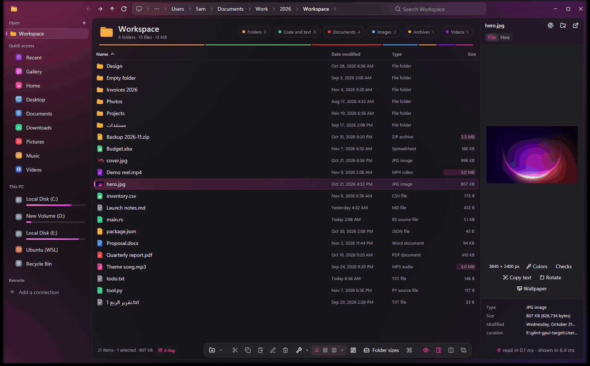
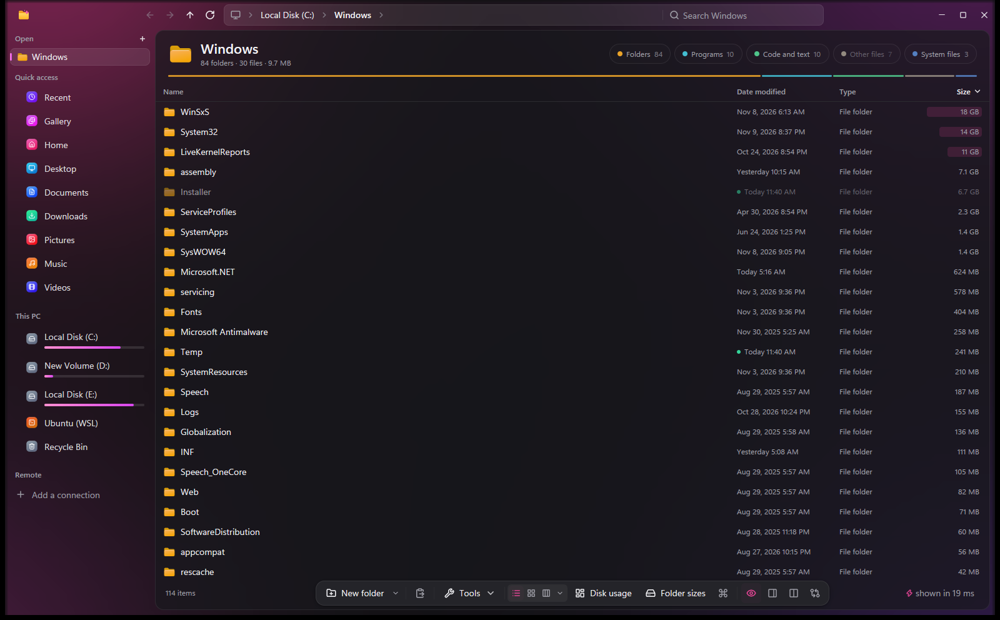
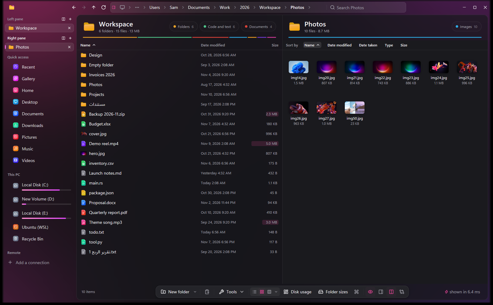
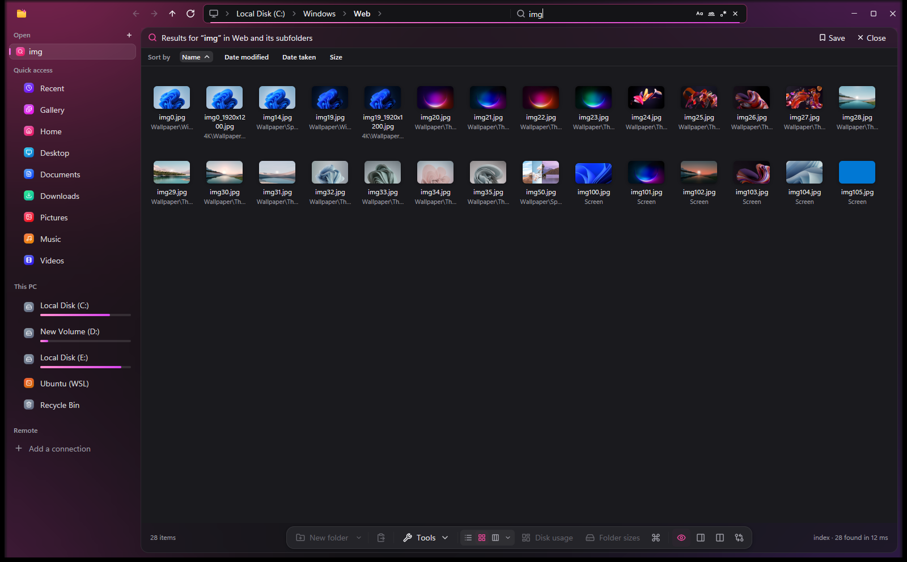
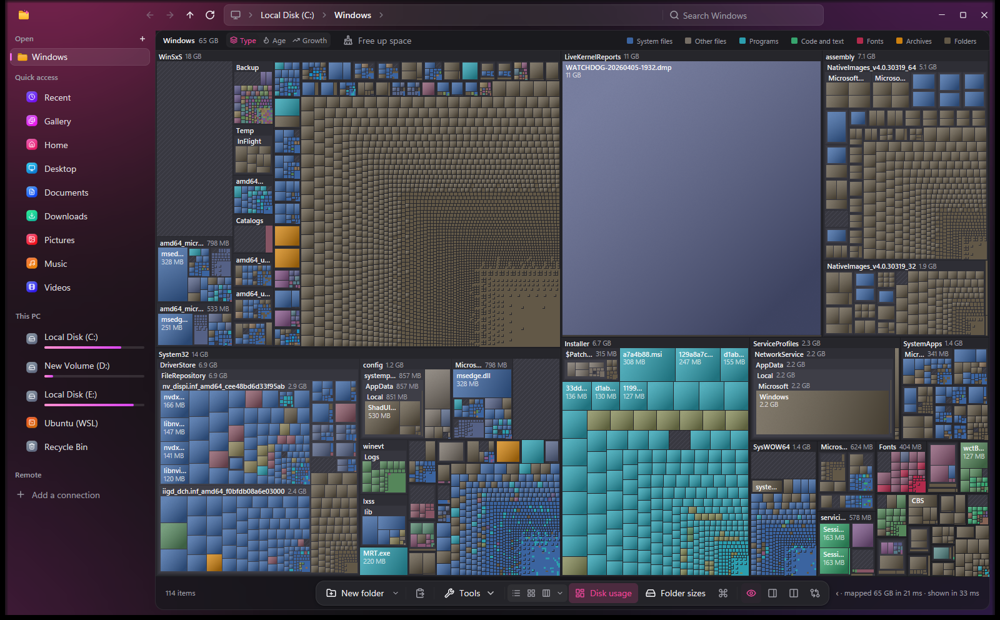
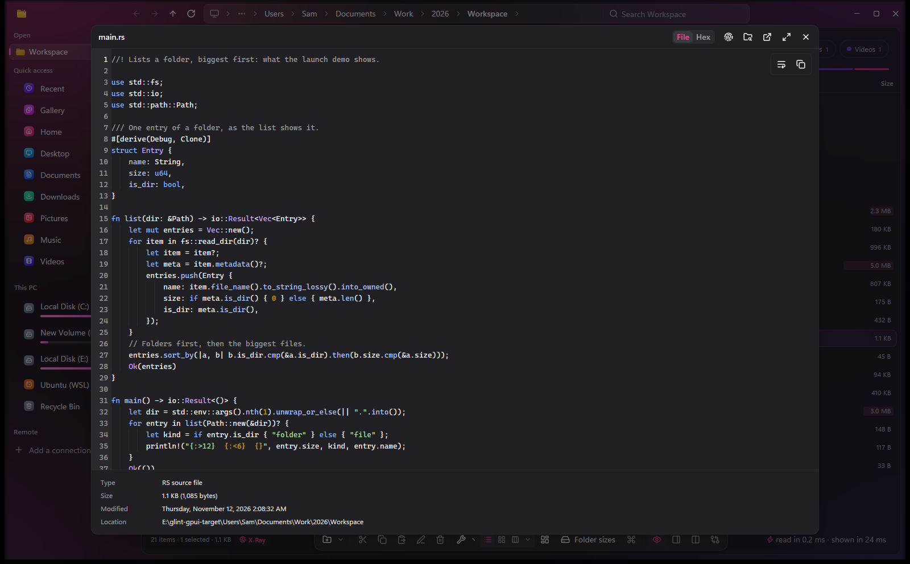
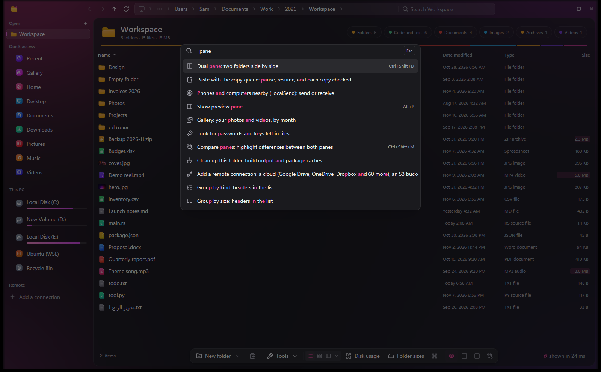
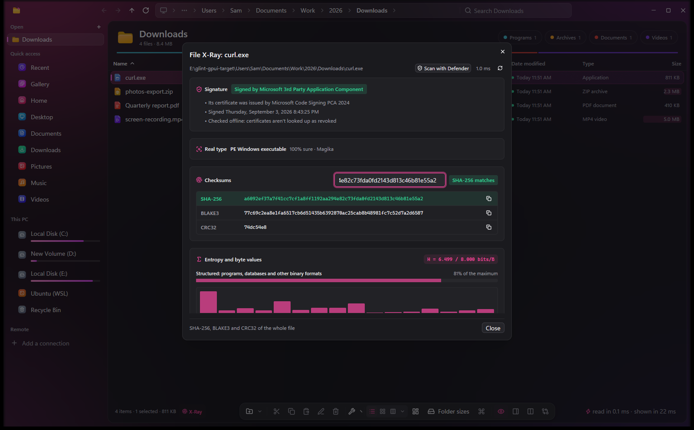
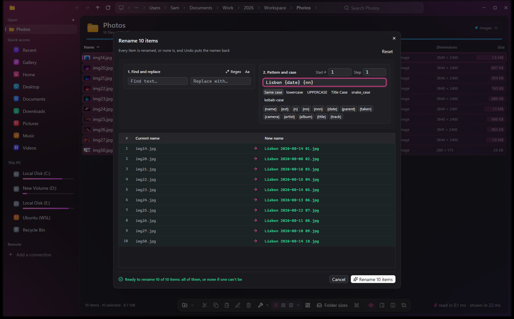
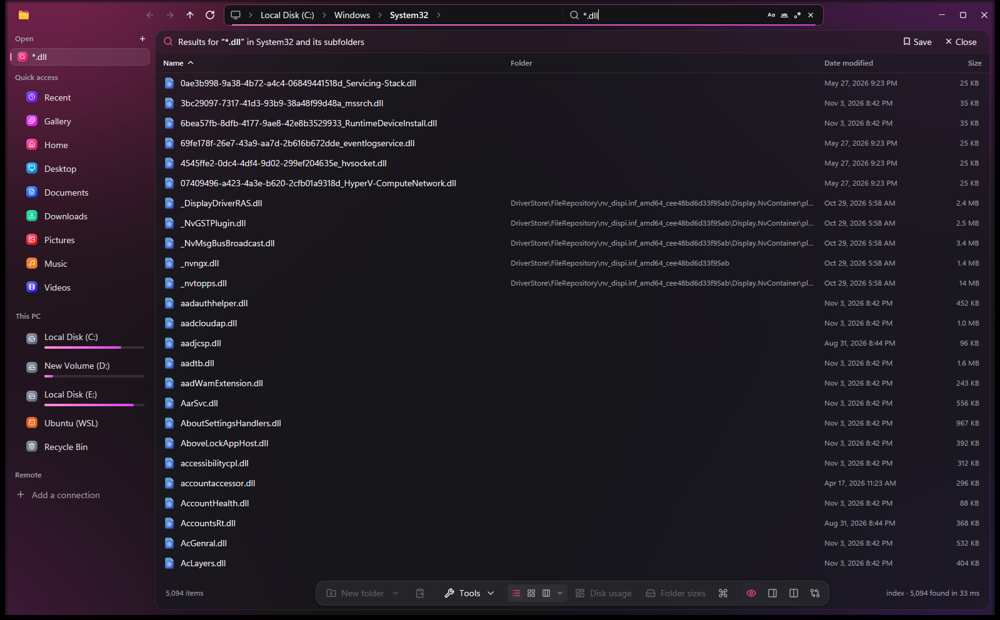

<div align="center">


# Glint

**A file explorer for Windows that opens folders in milliseconds, shows the size of every folder, and finds any file on any drive in an instant.**

Built in Rust on [fd](https://github.com/sharkdp/fd), [pdu](https://github.com/KSXGitHub/parallel-disk-usage) and [ripgrep](https://github.com/BurntSushi/ripgrep), with an NTFS index like Everything's.

[](https://github.com/shadijhade/glint/releases/latest)
[](https://github.com/shadijhade/glint/releases)
[](LICENSE)


<a href="https://apps.microsoft.com/detail/9NQLRJ3HF1C9"></a>

**[Download the installer](https://github.com/shadijhade/glint/releases/latest/download/Glint-setup.exe)** · [Website](https://glint.rafd.tech/) · [Benchmarks](#benchmarks) · [Features](#features) · [Shortcuts](#keyboard-shortcuts) · [Build from source](#build-from-source)



</div>

## Why

-   **Folders open in milliseconds.** System32's 5,097 items are on screen 12 ms after you press Enter, and a folder of 100,000 files takes 47 ms (11 ms if the pointer was resting on it: it has been read by then). One Win32 pass reads names, sizes, dates and attributes together, Rust sorts them, and the list draws only the rows you can see. Glint itself is up, with your folder in it, a quarter of a second after you start it.
-   **Every folder shows its size.** File Explorer keeps them out of the list. Here they're in the Size column as the folder opens (all of `C:\Windows` sized in 0.4 ms from the index), or one click away with pdu. Sort by size, or open **Disk usage** for a treemap like WizTree's, and you see what's filling your disk.
-   **Any file on any drive, in milliseconds.** Turn on instant search and a small service reads each NTFS drive's Master File Table once, the way Everything does, then follows the change journal. Every `kernel32.dll` on three drives (over 3 million names) is listed in about 8 ms. Without it, fd streams results as it finds them.
-   **ripgrep for what's inside files**, in the same search box: a file found by its contents is a row like any other, with the lines that matched under it. Regular expressions, whole words, and a syntax-highlighted preview.
-   **Thumbnails that never hold up the folder.** Switch to the grid (`Ctrl+Shift+2`) and a folder of 1,200 photos is still on screen in 9.3 ms, with the thumbnails filling in right after from Windows' own thumbnail cache (30 in 71 ms). Photos Windows hasn't seen yet are made on several threads at once, about 220 a second, where Windows' isolated thumbnail process manages about 50.
-   **Archives open like folders.** Zip, 7z, RAR, cabinet and tar archives (`.tar.gz` and the other compressed tars too), single `.gz`, `.xz`, `.bz2`, `.zst` or `.lz4` files, and with Open as archive, `.docx`, `.jar` and `.msi` files: press Enter on one and browse it in the list or the grid, with folder sizes, previews and thumbnails: a zip of 50,000 files is on screen 57 ms after Enter, and nothing is extracted until something needs a file's bytes. Copy, Copy to other pane and drag out extract through Windows' file engine.
-   **The tools File Explorer leaves out.** Find duplicate files by their content and recycle, hard-link or (on ReFS and Dev Drives) clone the extra copies, clear out the build output and package caches of projects you've left alone, see which program is holding a file open (and close it), list what changed in a folder lately, check a download against its published SHA-256, and rename many files at once with a live preview and Undo.
-   **Space to Quick Look, Ctrl+K for everything else.** See any file full size without opening it, Word, Excel and PowerPoint documents included (through Windows' own previewers, as in File Explorer), and arrow through the folder. Jump to the folders you use most (ranked by frecency, like zoxide) or run any command by typing a few letters.
-   **A search box over every drive, from anywhere.** `Ctrl+Alt+F` in any app opens Glint's quick search: names answered by the index as you type, `Enter` to open. Keep Glint in the tray and start it with Windows, and it's always there.
-   **Tabs, and two panes side by side.** Each pane has its own tabs (Ctrl+T, or middle-click a folder), and Ctrl+Shift+D shows two folders at once to copy or move between, or to compare down through every subfolder and sync. Your tabs are back the next time you start.
-   **At home in a repository.** Files and folders show their Git status and the address bar the branch, a terminal under the files (`` Ctrl+` ``) follows the folder you're in, a project's scripts and your own are a click away, and the search finds the lines of code as well as the names.
-   **Files where they need to be.** Send a file or a folder straight to another PC with a ticket (encrypted end to end, no account), share a folder with a phone on your network through a QR code, open Google Drive, OneDrive, Dropbox and 60 more clouds, S3 buckets, WebDAV and SFTP servers like folders, keep a folder in sync with a cloud, and let folder rules sort out what lands in Downloads.
-   **Still Windows.** Copy, move, delete and rename run on Windows' own file engine (progress, *Replace or Skip*, Recycle Bin, UAC). The clipboard and drag and drop work with File Explorer and every other app, and Properties, Open with and Open in Terminal are a right-click away.
-   **AI agents use it too.** Claude, Copilot and other agents can ask Glint to find files on every drive in milliseconds, measure folders, list the biggest files, say where a file went and search inside files, through its Model Context Protocol server: see [AI agents](#ai-agents) below.

## Benchmarks

| Task | Where | Found | Time |
| :--- | :--- | ---: | ---: |
| Start Glint ⁴ | to its window with `C:\Windows\System32` in it | 5,097 items | 231 ms |
| Open a folder | `C:\Windows` | 114 items | 9.8 ms |
| | `C:\Windows\System32` | 5,097 items | 12 ms |
| | `C:\Windows\WinSxS` | 25,228 items | 23 ms |
| | a test folder | 100,000 files | 47 ms |
| | the same folder, read ahead ⁵ | 100,000 files | 11 ms |
| Size every folder ¹ | `C:\Windows` | 56 GB | 0.4 ms |
| Map disk usage ¹ | all of `C:\`, six levels down | 20,000 biggest of 464 GB | 53 ms |
| Find files by name ¹ | `kernel32.dll` on all three drives | 18 files | 7.7 ms |
| | `*.dll` in System32 and its subfolders | 5,015 files | 36 ms |
| Search inside files | `DriverVer` in `C:\Windows\INF` (81 MB) | 1,313 matches in 838 files | 39 ms |
| Open a folder in the grid | 1,200 photos | 1,200 items | 9.3 ms |
| Show its thumbnails ² | from Windows' thumbnail cache | the 30 on screen | 71 ms |
| | photos Windows hasn't seen yet | the 30 on screen | 242 ms |
| | `C:\Windows\Web\touchkeyboard` | 8 wallpapers | 15 ms |
| Open an archive ³ | a zip of 50,000 files | 54,001 items | 57 ms |
| | the same files in a solid 7z | 54,001 items | 60 ms |
| | a folder in the zip after that | 500 items | 8.9 ms |

Each time runs from pressing Enter until everything is on screen, as the app's status bar reports it: the median of 5 runs, with the files already in Windows' cache (as when you browse back and forth). Intel Core Ultra 7 265K, NVMe SSD, Windows 11, release build. The status bar shows the time for every folder and search, so you can check these numbers on your own machine.

¹ With [instant search](docs/instant-search.md) on. Without it, fd and pdu do the work: fd on its own lists the same 5,015 DLLs in 0.1–0.3 s, and takes 8 s for a name search across a 219 GB home folder.

² From the first thumbnail asked for to the last one in, as the status bar reports it (*30 thumbnails in 71 ms*), each run a fresh start of the app, so none came from its own memory. Asked for all at once, 1,200 photos come 1,100 a second from Windows' cache, and are made at 220 a second when Windows hasn't seen them.

⁴ From the moment Windows makes the process to the folder painted in its window, the median of 7 starts. Most of it is Windows loading the display driver (155 ms), which Glint now does on a thread of its own while the rest of it starts.

⁵ A folder is read ahead while the pointer or the keyboard rests on it, and its row says what is in it meanwhile. Opening it then only has to draw it.

³ Its list of entries read (47 ms of that), nothing extracted; each run a fresh start of the app, so Glint didn't have the archive in memory yet. After that, every folder in it is read from memory in 0.2 ms. See [docs/archives.md](docs/archives.md).

## Features



### New in 0.11.0

-   **A window of its own.** 0.10 made Glint a native app and kept File Explorer's layout; this one lets it go. **One bar** holds Back, Forward, Up and a single field, with where you are at its start and the search at its end. **Your tabs are a list in the side rail**, every name whole, one list for each pane. The files are on **one sheet**, and the commands are an island in the **dock** at its foot: Cut, Copy, Rename and Delete are there while something is selected and not otherwise, so nothing greyed out stands in it. Glint's mark opens Settings, the palette, the shortcut sheet, Drive health and New window.
-   **One search.** The search box looks for what you type in names and, on `Enter`, inside the files too. A file found by what's in it is a row like any other, with the lines that matched under it: see [One search](#one-search-names-and-what-the-files-hold). The Files | Text switch and the Text screen are gone.
-   **A head on every folder.** Its picture and name, what's in it (*6 folders · 15 files · 13 MB*), a chip for every kind of thing there (press **Images** and only the images show) and a thin band of its make-up.
-   **Light, color and pictures.** Soft light behind the window takes the color of the place you're in (Documents blue, Downloads green, Pictures rose, Music orange), with the sheet, the address field and the tab shown as glass over it. Folders, files and places have pictures drawn for Glint: a folder in its place's color, each kind of file a page in its own, a drive a chip that turns red when it's nearly full.
-   **Motion that keeps up with the hand.** The wheel glides (a list scrolled with it used to jump a notch at a time), hover fills fade, a folder's rows arrive with a short rise, menus settle and dialogs fade in where they are. None of it plays with Windows' animation effects turned off.
-   **It answers before you ask.** Rest the pointer on a folder, or come to it with the arrow keys, and its row says what is in it (*10 files · 8.7 MB*): Glint has read it by then, so opening it takes a frame.
-   **Faster.** Glint's window is up, with your folder in it, about a quarter of a second after you start it (the display driver, most of that wait, now loads while the rest of Glint starts). A click or a key is drawn the moment it's handled instead of at the display's next refresh. A folder of 100,000 files is on screen in 47 ms, and in 11 ms when it was read ahead. With instant search on, results follow the keys from the third letter. See [Benchmarks](#benchmarks).
-   **Fixed**: `Enter` or a double-click on a folder was now and then ignored, when a change in the folder being left was reported at that very moment.

### New in 0.10.0

-   **A native app.** Glint's window is drawn by Rust and [GPUI](https://www.gpui.rs/) (the Zed editor's UI framework) instead of a web page in Microsoft's WebView2: no web view, no HTML and no JavaScript, previews included. A folder is on screen about 70 ms after Glint starts, and it no longer needs WebView2. Your settings, pinned folders, history, saved searches, folder rules and book places come along by themselves the first time 0.10 starts.
-   **Media.** A video or recording's preview has **Trim**: two handles, **Save trim**, copied as stored in a moment (or **Exact**, re-encoded to start on the very frame). Right-click → **Media** converts and shrinks videos (MP4 with H.264, HEVC or AV1, "fit under 10/25/50 MB" for mail and chats, with the PC's NVIDIA, Intel or AMD encoder when it has one), takes the sound out (as stored, or MP3, M4A, Opus, FLAC, WAV), makes GIFs and animated WebPs, and writes **subtitles** from what's said (whisper.cpp, on this PC, in its language or in English). A video Windows can't play (AVI, WMV, MKV and the like) gets a copy that plays, made by FFmpeg in seconds and kept for next time.
-   **PDF tools**, with [pdfcpu](https://github.com/pdfcpu/pdfcpu): merge, split, keep or take out pages, turn them, make a PDF smaller, save its pictures, add or take off a password (AES-256), stamp DRAFT across it. Offline, beside the originals, and Ctrl+Z takes it back.
-   **Data files of any size**, with [DuckDB](https://duckdb.org): once it's installed, **Query** reads CSV, JSON and Parquet where they are, however big; **Profile** describes every column (type, missing values, distinct values, range, quartiles); **Query together** joins several files; **Convert data** writes Parquet, CSV or JSON lines.
-   **Remove personal info** before sharing: where a photo was taken, the camera's serial number, names, the apps used and editing history, out of photos, videos, PDFs (ExifTool) and Word, Excel and PowerPoint files (Glint itself). **Change when it was taken** moves or sets photos' dates.
-   **Disk images and installers open like folders**, with 7-Zip: ISO, VHD(X), VMDK, DMG, WIM, ext4 and APFS images, installers, Debian and RPM packages. See what an installer holds without running it.
-   **Encrypt** files and folders with a passphrase or someone's age key: [age](https://age-encryption.org)'s format, in Glint itself, readable with age or rage anywhere.
-   **Phones nearby.** **Send to a phone nearby** finds the LocalSend apps on your network (Android, iPhone, Mac, Linux) and sends to them; while Nearby is open, they can send to this PC too. **Send to my PC** pushes files to a paired PC's Downloads.
-   **Group by** kind, date, size, type or Git status in the list (the header's menu, or Ctrl+K), each group with its count and size. A **Columns** view (`Ctrl+Shift+9`): the folder above, this one, and what's in the folder you're on, ← and → between them. Saved searches show how many they find, live.
-   **Previews**: Jupyter notebooks with their outputs, 3D models (STL, OBJ, glTF, PLY, 3MF: Windows' 3D Viewer is gone), and **Export as PDF** for Markdown, typeset with its math and Mermaid and Graphviz diagrams.
-   **The text in pictures**: Search inside files instantly reads screenshots and scans with Windows' OCR, so their words are found.
-   **Make smaller**, one action for anything chosen: videos that still look the same (short samples scored by VMAF with [ab-av1](https://github.com/alexheretic/ab-av1), then FFmpeg), photos as smaller JPEGs or as JPEG XL without losing a bit ([libjxl](https://github.com/libjxl/libjxl); **Back to JPEG** gives the very same file back), PNGs losslessly, BMPs as PNGs, PDFs full of pictures for screens or print ([Ghostscript](https://www.ghostscript.com)), and the pictures inside Word, PowerPoint and Excel files. Nothing that comes out bigger is kept, dates stay, and Ctrl+Z takes it back.
-   **Convert document**, with [pandoc](https://pandoc.org): Word, OpenDocument, Markdown, HTML, EPUB, LaTeX, RTF and more into one another, Markdown into PowerPoint, and PDFs typeset by [Typst](https://typst.app) without Word or LaTeX. Arabic and Hebrew documents stay right to left. `.typ` files get a preview and Export as PDF.
-   **Back up** a folder to a USB drive, a network folder or a cloud, with [restic](https://restic.net): encrypted, each backup adding only what changed, every day or week while Glint runs (7 daily, 4 weekly and 12 monthly kept). The backups show in Previous versions, to open, compare and restore.
-   **Books and comics**: EPUB, Kindle (MOBI, AZW3), FB2 and CBZ read in the preview by Glint's own reader, with their contents, text size, the page you stopped at, and Read aloud with Windows' own voices.
-   **Songs**: edit title, artist, album, track, year, genre and cover for one song or many (titles and track numbers from file names too); **Even volume** in Media brings recordings to the same loudness; the audio preview has a waveform.
-   **More previews**: contacts (.vcf), calendar invites (.ics), emails (.eml, and Outlook's .msg) with their attachments and nothing loaded from the internet, the pictures Krita, OpenRaster, Procreate and Sketch files keep, Graphviz and Mermaid files.
-   **Scanned PDFs** become searchable: their pages are read by Windows' OCR into search inside files.
-   **Drop on a PC**: files dropped on a paired PC in the sidebar are sent to it.
-   **Compress in place**: folders take less space and still open normally (games, apps, tools, old projects), with Windows' own transparent compression and no admin rights for your own files. The saving is measured on a sample first, and Ctrl+Z decompresses.
-   **Drive health** in This PC: each drive's temperature, wear, hours on, written data and errors, read from the drive itself without admin rights, and a warning when one may be failing.
-   **Old text files read right**: Arabic (Windows-1256), Cyrillic, Chinese and other older encodings are detected (Firefox's detector, [chardetng](https://github.com/hsivonen/chardetng)) in previews and Search inside files instantly, instead of showing as gibberish. **Read as** another, or **Convert to UTF-8** (Ctrl+Z takes it back).
-   **Word documents without Office**: .docx files laid out as pages in the preview by Glint itself, nothing loaded from the internet.
-   **More for AI agents**: search inside files instantly, photos by what they show, recordings by what's said, code by its structure, SQL over a data file, and comparing two files.
-   **Faster**: Glint allocates memory with Microsoft's [mimalloc](https://github.com/microsoft/mimalloc), so a 100,000-file folder is read, sorted and sent to the page in 29 ms instead of 42 (sorting alone about 60% faster); big folders sort up to about three times faster and show sooner (100,000 files no longer build a lookup of every path as they open), and searches with a typo (close matches) look at 3 million names about four times faster, ruling out most names before comparing any letters; the copy queue copies small files eight at a time (5,000 small files in half the time); `npm run bench` measures folders, search, copies and start-up on your PC.

### New in 0.9.5

-   **Photo search: `shows:`.** Type `shows:dog on a beach`, `shows:receipt` or `shows:whiteboard` in the search box: pictures are found by what's in them. OpenAI's CLIP (MIT) runs on this PC with ONNX Runtime, both downloaded when you turn it on in **Settings → Photos and recordings** (about 240 MB), and reads the folders you choose in the background, at low priority, with Windows' own codecs (so HEIC, AVIF and camera RAW too, with their extensions). What it learns of a picture is kept under the file's ID, so a move or rename keeps it.
-   **Speech search: `says:`.** `says:budget meeting` finds recordings and videos by what's said in them, in any language: whisper.cpp with Whisper's base model (MIT, about 70 MB) transcribes them on this PC, FFmpeg reading videos when it's there. The preview of a recording shows what's said, each line a jump to when it's said, the words searched for marked.
-   **Previous versions.** Right-click a file or folder → **Previous versions…**: what Windows' restore points and backups kept of it (its shadow copies), with **Open**, **Compare** (side by side for a folder, a diff for a file) and **Restore** or **Restore a copy**. A shadow copy opens as a read-only folder of its own, and copying out of one works as from any folder. The times come from the instant search service; without it, Glint finds the copies by itself.
-   **Devices.** Glint on your other PCs: **Settings → Devices** shares folders you pick, read-only, with the PCs you pair with a code, connected directly and end-to-end encrypted over [iroh](https://github.com/n0-computer/iroh), through routers and firewalls. A paired PC shows in the sidebar's Remote section and browses, previews and copies as from any remote.
-   **Remotes in File Explorer, on demand.** Right-click a remote (a cloud through rclone, S3, WebDAV, SFTP or a paired PC) → **Show in File Explorer, on demand**: it appears in File Explorer and every app's Open dialog, as OneDrive does, with Windows' Cloud Files API. Folders fill in as they're opened, and a file downloads when an app reads it. Read-only for now, while Glint runs.
-   **Search inside files instantly.** **Settings → Search inside files instantly** keeps an index (tantivy) of the text, code and documents below folders you choose, current as they change: the search answers from it in milliseconds, as you type. Meaning search speaks 101 languages with the multilingual model.
-   **Tags.** Tag files and folders (**Tags** in the menu); `tag:work` finds them, the sidebar lists every tag, and the tags travel with the files on NTFS, in a stream of their own that the instant search index reads.
-   **Compress to 7z and tar.zst**, with a password for zip (AES) and 7z (names encrypted too).
-   **Content Credentials.** A picture's or video's C2PA credentials in its preview and the File X-Ray: who made it, with what, and whether AI made or changed it (c2patool).
-   **Run in Windows Sandbox**, from a file's menu: a throwaway Windows to try a program or a document in.
-   **More windows.** `Ctrl+N` opens a window, and a tab dragged out of the strip becomes one.
-   **Drag and drop, as you'd expect it.** A drop copies and `Shift` makes it a move, and the dragged picture says which and where (*Copy to Documents*), over Glint as over File Explorer. Hold files over a tab and it opens, to drop into its folder; drop them on a tab or on a folder in the address bar to put them there.
-   **Two panes, easier.** Drag the line between them to share out the width, drag a tab to the far half of the files to open it side by side (or onto the other pane to move it there), swap the panes with `Ctrl+Shift+U`, and right-click a folder for **Open in the other pane**. Each pane has a menu by its tabs, the pane the keyboard isn't on steps back a little, and the address bar shows which pane it's on.
-   **The file dialog jump.** `Ctrl+Alt+G` in any app's Open or Save dialog takes it to the folder open in Glint.
-   **Glint in Arabic**, right to left, with **Settings → Appearance → Language**; Windows' own language is the default where Glint speaks it.
-   **AI agents can tidy up, with your OK**: moving, renaming, making folders and recycling, each asked in a Windows dialog and undoable from Settings; folder sizes come with a map in agents that show apps; and Glint can add itself to Windows' own agent registry where Windows has one.
-   **Faster**: folders read ahead when the pointer rests on them, listings handed to the window in shared memory, reads batched with Windows' I/O ring, and the window resting when it's in the tray; Markdown previews draw math and Mermaid diagrams.

### Files

-   **Instant folders.** Each folder is read in one Win32 enumeration pass and sorted in Rust in natural order (`img9` before `img10`), then drawn as a virtual list. The status bar says how long it took: *read in 0.3 ms · shown in 6.3 ms*.
-   **Find files by name.** Typing in the search box filters the folder as you type; **Enter** searches every subfolder too (from This PC, every drive), and where instant search covers the folder, that happens as you type. All words must match, `*` and `?` work like in Explorer, and `"quotes"` keep spaces. A word with `\` or `/` in it, or after `path:`, matches the whole path rather than the name: `src\lib main` finds what's named *main* in a `src\lib` folder, and `D:\photos` searches drive D from wherever you are. Filters narrow it, as in Everything: `ext:pdf` (or `ext:jpg;png`), `size:>10mb` (`>`, `>=`, `<`, `<=`; kb, mb, gb), `dm:7d` (changed in the last 7 days; h, d, w, y) or `dm:>1y` (longer ago), `file:` and `folder:`. With instant search on, `ext:iso size:>1gb` on This PC lists every big ISO in milliseconds; the search box shows the filters when it's empty. **Save** keeps a search in the sidebar, to run it again with one click. The status bar says who answered: *index · 18 found in 7.7 ms* or *fd · 304 found in 8.09 s*. When nothing turns up, it says what was skipped, with a button each to look in hidden files, skipped folders or every drive.
-   **Plain words work too.** Type `pdfs from last week over 5 mb`, `photos taken in 2024`, `big zip files` or `songs by the beatles` and the box reads them as filters, showing under it what it understood (*PDF files · changed in the last 7 days · over 5 MB*) and the filters that say it: `Tab` puts those in the box, so you learn the syntax by using it, and `Enter` still searches what you typed. It knows kinds of files, when they changed, sizes, and when photos were taken, with what, and who songs are by, all in the page, in microseconds, with nothing sent anywhere. Quick search reads them too.
-   **Photos, videos and music by what they say.** `width:>1920` and `height:<1080` (pixels, as the picture shows, turned by its EXIF), `taken:2024` (`taken:2024-06`, `taken:>2023-06-15`, `taken:7d`, `taken:>1y`), `camera:pixel`, `duration:>5m` (`90s`, `1:30`), `artist:` and `album:` filter by what the files themselves say: their EXIF, video tracks and tags, the same details the preview shows and Date taken sorts by. Typing one filters the folder as each file is read; **Enter** has the index or fd find the photos, videos or songs below it and reads them four at a time, each file once a session, so `taken:2024 camera:canon` over a photo library is a filter and then a read. Each one keeps to the files it can be true of (`artist:` to songs, `width:` to pictures and videos), and the search box lists them when it's empty.
-   **Typos forgiven.** When the index finds nothing named as typed, it looks again for close matches: each word of four letters or more may be a letter off (two letters swapped count as one; two edits from eight letters) at the start of a word in the name, so `reprot` finds *Q3 Report.pdf* and `dowloads` finds *Downloads*. They come closest first, under **Close matches for…**, with *fuzzy* in the status bar. Numbers and shorter words must be there as typed, and so must a word's first letter (unless it's swapped with the second). Looking again costs the service about 30 ms over 3 million names. fd, which answers without the index, finds names only as typed.
-   **Folder sizes.** With instant search on, every folder shows its size as it opens, and search results show folder totals too. Otherwise one click measures them with pdu. A bar behind each size shows how it compares with the biggest in the folder.
-   **Quick search from anywhere.** `Ctrl+Alt+F` opens a search box over every drive, wherever you are: names (and filters) answered by the index as you type, the best matches first and your own files before Windows' (before you type, it offers the folders you use most), and close matches when a name is typed with a typo. `Enter` opens, `Alt+Enter` shows it in Glint, `Esc` puts it away. **Settings → Quick search** picks the shortcut, and can keep Glint in the tray and start it with Windows so it's always there.
-   **It answers before you ask.** Rest the pointer on a folder, or come to it with the arrow keys, and its row says what is in it (*10 files · 8.7 MB*, with a small band of its make-up): Glint has read it by then, so opening it takes a frame. With instant search on, the search box's results follow the keys from the third letter instead of waiting for you to stop typing. And a click or a key is drawn the moment it is handled, not at the display's next refresh: half a frame sooner on average, a whole one at worst.
-   **A window that shows where you are.** Each pane starts with the folder's name and picture, what is in it (*6 folders · 15 files · 13 MB*) and a chip for every kind of thing there: press **Images** and only the images show, press it again for everything. Folders, files and places have pictures of their own, each kind of file a page in its color, and Documents, Downloads, Pictures and the others their own colored folder. Soft light behind the window takes the color of the place you're in (Documents blue, Downloads green, Pictures rose), so you can tell where you are without reading.
-   **Grid view and thumbnails.** Every folder (and every search) can show as a grid of Windows' own thumbnails, in five tile sizes: see [Grid view](#grid-view) below. In the list, pictures and videos get a small one in place of their icon.
-   **Columns, and each folder's own view.** Right-click the list's header for its columns (Date modified, Date taken, Type, Dimensions, Duration, Artist, Album, Size) and what to sort by. Each folder keeps its own columns, sort, and list or grid, as File Explorer's do; until you set them, it opens as its kind does: a folder of pictures with when each was taken and its dimensions, videos with their length, music with its artists and albums, Downloads and Recent newest first. Settings → Files turns it off, for the same view everywhere.
-   **Disk usage map.** A treemap of the open folder, like WizTree's: see [Disk usage map](#disk-usage-map) below.
-   **Git at a glance.** In a Git repository, files and folders show **Changed**, **Staged**, **New** or **Conflict** (a folder shows the strongest of what's below it), what `.gitignore` leaves out is faded, and the status bar says how long status took: 13–15 ms in Glint's own repository here, once its files are in Windows' cache. The address bar shows the branch, with how far it is ahead of or behind the branch it tracks (⎇ main ↑2 ↓1), and a click on it shows what changed and **Show changes**. Typing `git:changed` (or `git:new`, `git:staged`, `git:conflict`, `git:ignored`) in the search box filters the folder to them. A changed file's preview (and Quick Look) can show **Changes**: what changed since its last commit, line by line with the lines around each change, as the preview stays on Changes from one changed file to the next. [gitoxide](https://github.com/GitoxideLabs/gitoxide) reads the repository inside Glint, so Git needn't be installed, and nothing is written to it. Status stops at 4 s and shows what it found by then; a repository of over 300,000 files, or one on another computer, shows it on `F5`. A repository whose own settings name programs for status to run (filter drivers such as Git LFS's, or `core.fsmonitor`) is left alone until you trust it, from the branch in the address bar.
-   **Archives.** `Enter` opens a zip, 7z, RAR, cabinet or tar (compressed or not) like a folder, read-only, with previews, thumbnails and copying out: see [Archives](#archives) below.
-   **Tools.** Find duplicates, clean up developer junk, see what's locking a file, the recent changes in a folder, a file's checksums and hidden streams, and batch rename: see [Tools](#tools) below.
-   **Preview pane and Quick Look.** Syntax-highlighted code and text, images, video, audio, PDFs and folder summaries, in the side pane (`Alt+P`) or full size on `Space`. Quick Look fills the window from its maximize button (or a double-click on its title), `PageUp` and `PageDown` scroll it, and text and code can wrap their long lines and be copied whole. asciinema recordings (.cast) play in the terminal pane's own renderer, with a scrubber and 1×, 2× and 4×, long pauses cut short. **Copy text** under a picture copies the text in it, read by Windows' own OCR. Below a photo: when and where it was taken (the place opens on OpenStreetMap), the camera, lens and exposure; below a song: its artist, album, track, length and quality, with its cover; below a video: when it was recorded and its length. Markdown reads as it does on GitHub, with its tables, task lists, footnotes, highlighted code, math (`$…$`, `$$…$$` and ```` ```math ```` blocks, typeset in place), Mermaid diagrams (```` ```mermaid ```` blocks, drawn as pictures), the pictures beside it and the HTML READMEs use (centered headers, collapsible sections, keys), as GitHub allows it: nothing in a file runs, and pictures from the web aren't fetched. Its links open their file or folder in Glint, web links in your browser, and **Source** shows it as written. A folder's README.md shows above its list too, folded to its title until you open it. JSON, YAML and TOML files show as a tree of their values (with **Text** for the file as written), and a jq filter runs over them, `.items[] | select(.size > 1000)`, in [jaq](https://github.com/01mf02/jaq) (jq rewritten in Rust, installed with one click). The file is read, and the filter run, in a process of their own held to 1 GB and 10 seconds, so one that never ends stops there. Each value's jq path is a click away, to copy or filter by. Every file has a **Hex** view as well: its bytes as [hexyl](https://github.com/sharkdp/hexyl) shows them, colored by kind (zero, text, whitespace, other ASCII, the rest), with **Go to** an offset and the byte under the cursor as numbers; a file Glint knows nothing about that isn't text shows that way. CSV, TSV and JSON-lines files show as tables with their column types, and so do Excel and OpenDocument workbooks (.xlsx, .xlsb, .xls, .ods) without Office, a sheet at a time with the others a click away (**Previewer** shows one through Windows' previewer instead: Excel's, with Office installed), and Parquet files with their columns' types; their first 1,000 rows. SQLite databases show as their tables, indexes and views, each table's rows a click away, and programs and DLLs with their architecture, security features, sections, imports and exports. **Query** runs SQL over any of these, reading only: a CSV, JSON-lines or Parquet file is the table `data`, a workbook's sheets are tables by their names, and a database is opened read-only, without a lock or journal file ever appearing next to it; one statement at a time, stopped at 10 seconds, the first 1,000 rows shown. Everything else Windows has a previewer for shows through that previewer, as in File Explorer: Word and PowerPoint documents, fonts, Visio drawings… (not files downloaded from the internet, which File Explorer doesn't preview either). Online-only OneDrive files are left alone, so nothing downloads by accident.
-   **A repository's card.** A Git repository's folder, previewed (selected, or open with nothing selected), shows what it is: from [onefetch](https://github.com/o2sh/onefetch), its version, license, branch, commits, when it last changed, its languages as a bar and who works on it, with its web address; from [tokei](https://github.com/XAMPPRocky/tokei), its lines of code by language. Both install with one click on the card, and a card is kept for the commit the repository is at.
-   **Command palette.** `Ctrl+K` finds any command, or a folder you've been to by typing a few of its letters (`dl` finds Downloads) or with a typo (`stetings` finds Settings), with the folders you open most often and most recently first. A folder's path counts as well as its name, when the letters typed are close together in it. Type a path, `~` or `%APPDATA%` to go there. Type `=` and a sum to work it out as you type, units and all: `= 3 ft to cm`, `= 1 GiB / (3 MB/s) to s`, `= 0x1F + 1` ([fend](https://github.com/printfn/fend), built in); `Enter` copies the answer.
-   **Folder history shared with zoxide.** With [zoxide](https://github.com/ajeetdsouza/zoxide) installed (one click in **Settings → Tools**) and **Settings → History → Share folder history with zoxide** on, the folders you `cd` to in a terminal rank in `Ctrl+K` and quick search with the ones you open here, and `z` in a terminal finds the folders you open in Glint. zoxide's scores are read when the palette opens, and added to as you go (a burst of folders passed through adds the last); turning it off leaves Glint's own history as it was.
-   **An address bar that gets you there.** The arrow after each part of the path lists that folder's subfolders and archives, with a filter box and arrow keys; the first one lists drives and places. Typing a path (`Ctrl+L`) suggests what's in the folder you're typing in, folders first, and names a letter off after those (`C:\Windows\Sytem32` suggests System32): `Tab` completes, `Enter` opens.
-   **A copy queue.** **Paste with the copy queue** (the folder's menu, or `Ctrl+K`), or every copy and move once Settings → Files says so: each waits its turn, with how far it is, its speed and time left, **Pause** (a file half-copied waits where it is), **Resume** and **Cancel**, in a panel over the bottom right and on the taskbar button. Each copy is read back from the disk and compared with its original (BLAKE3) unless you turn that off. A name that's taken asks: replace, skip or keep both, for the rest too. A move within a drive is a rename; across drives, the originals go only once they're copied and checked, and what was skipped stays. Undo takes back exactly what it made.
-   **Gallery.** Your photos and videos, from Pictures, Videos and the folders you add (Settings → Files), with everything below them, as one grid, newest first by when each was taken, and its years and months down the side: a click goes to a month. Instant search's index lists them at once; when each was taken is read once from the photo or video itself and kept, so the gallery opens at once after that (new ones are dated in the background).
-   **Recent.** First in Quick access: the files and folders you opened lately, here or in any app, newest first, from Windows' own Recent Items, each with the folder it's in, under your most-used folders. Everything works on them as in a folder (preview, open, copy, drag out), and **Remove from Recent** forgets one. Files opened in Glint go to Windows' recent items, as File Explorer's do; when Windows is set not to keep them, Recent says so and stays empty. It can be where Glint starts (Settings → Files).
-   **The usual explorer moves.** Back, forward and up, a breadcrumb address bar you can type into, Quick access, pinned folders, drives with free space, a folder tree in the sidebar (each place's arrow opens it, the arrow keys move through it, and it can open itself down to the folder you're in), sorting, multi-select, type-ahead, rename, and hidden items on demand. **New** makes folders, text documents and every kind of file Windows' own New menu has on your PC (a Word, Excel or PowerPoint document from its app's template, a zip…), named as File Explorer names them.
-   **Select by dragging.** Drag across the empty part of the list or the grid for a marquee that selects what it covers (`Ctrl` adds to the selection); held near the top or bottom, the list scrolls along. **Invert selection** is in `Ctrl+K`.
-   **Windows-native file operations.** Copy, cut, paste, delete and rename go through Windows' own file engine, so progress, *Replace or Skip*, the Recycle Bin and permission prompts behave exactly like Explorer. The clipboard is shared with Explorer: copy here, paste there, and the other way round. A delete or a move says so with **Undo** right there, and `Ctrl+Z` takes back the last copy, move, rename, Recycle Bin delete, new folder or batch rename, with the names Windows actually gave (*Keep both*, *- Copy*), and steps further back on each press.
-   **The Recycle Bin, as a place.** Under the drives in the sidebar (or typed as `Recycle Bin`): what you deleted, every drive's, with the folder each was deleted from, when, and how big it is (a folder's, everything in it). **Restore** puts the selection back where it was deleted from, making that folder again if it's gone, and says so with **Undo**; Quick Look and the preview show an item before you decide. There, `Delete` deletes for good once Glint has asked, naming what goes; **Restore all items** and **Empty the Recycle Bin** are on the right-click menu (Windows asks before emptying), and files dropped on the sidebar's Recycle Bin are deleted, as in File Explorer. What's in it isn't opened, renamed or copied where it is: restore it first. Nothing watches the Recycle Bin, so it's read again after each delete or restore here, when Glint comes back to the front, and with `F5` ([how it works](docs/recycle-bin.md)).
-   **Clouds, through rclone.** Google Drive, OneDrive, Dropbox, Box, pCloud, MEGA, Proton Drive, iCloud Drive and 60 more services [rclone](https://rclone.org) reaches open as folders under **Remote** in the sidebar, with how full each is. **Add a connection** walks through rclone's own steps in Glint: pick a service, and sign in on its own page in your browser (or fill in its settings), without a terminal. Remotes already in rclone's configuration are a click away, the ones made here work in rclone in your terminals too, and their sign-ins stay with rclone. A **folder rule** keeps a folder in sync with one: copied there, mirrored there, or both ways (rclone bisync), when files change and as often as you ask. rclone is optional: Settings → Clouds or the installer's Extra tools page installs it ([how it works](docs/remote.md#clouds-through-rclone)).
-   **Remote connections.** An S3-compatible bucket (Amazon S3, Cloudflare R2, Backblaze B2, MinIO…), a WebDAV server (Nextcloud, a NAS, dufs) or an SFTP server (through Windows' own OpenSSH, with your SSH keys or a password), added under **Remote** in the sidebar, opens as a folder, read-only. Previews read text only as far as they show and download the rest (up to 100 MB); Open, Copy, Copy to the other pane and dragging out download first, with how far and Stop. A connection's secret access key or password stays in Windows Credential Manager, names Windows wouldn't take are shown as it would, and thumbnails (a download each) are a choice per connection ([how it works](docs/remote.md)).
-   **Paste a picture or text as a file.** With no files on the clipboard, `Ctrl+V` (or **Paste**) saves what's there as a new file in the folder: a picture (a screenshot, or one copied in a browser or the Snipping Tool) as *Pasted image* with the date and time, a PNG, and text as *Pasted text*, a UTF-8 .txt. Its name is selected to type a better one, and `Ctrl+Z` takes it back.
-   **Every folder opens.** A folder Windows keeps you out of, such as `C:\PerfLogs` or another account's profile, opens all the same and says why, with **Get access**: as File Explorer's Continue button does, Windows asks for administrator approval once, and your account may open it and everything in it from then on. With instant search on, even a folder Windows keeps to itself, such as *System Volume Information*, shows what's in it, read-only, from the index. Old links such as *Documents and Settings* open where they point, a shortcut to a folder opens the folder right here, and files open as a double-click in File Explorer opens them: with their app, or Windows' app picker when no app is set yet. Type `\\server` (or go up from one of its shares) for the folders a PC or NAS shares on your network, as File Explorer lists them; its administrative shares (`C$`, `ADMIN$`) show with hidden items.
-   **Drag and drop.** Drag files out to File Explorer, the desktop, a mail or a chat, or drop them in from anywhere onto a folder, a tab, a folder in the address bar, a sidebar place or the open folder. A drop copies, and with `Shift` held it moves: the dragged picture says which and where (*Copy to Documents*, *Move to Documents*). Files held over a tab open it after a moment, to drop into its folder.
-   **Live.** The open folder refreshes when files change elsewhere.
-   **Explorer integration.** Properties, Open with…, Run as administrator (on programs and scripts), Show in File Explorer and Open in Terminal. The other way round too, if you turn them on in **Settings → Files**: *Open in Glint* on File Explorer's right-click menu for folders and drives, Glint opening folders when you double-click them in File Explorer or on the desktop, and Win+E opening This PC in Glint. Double-clicked drives, This PC, the Recycle Bin and other special places still open in File Explorer, and file dialogs aren't affected ([how it works](docs/explorer-integration.md)).
-   **Windows' own touches.** The taskbar button's right-click menu has This PC, Quick search, the Recycle Bin and your pinned and most-used folders (the pinned ones only, if Windows is set not to show recently opened items), its preview has Back, Forward and Up for the folder shown, and the button fills with progress while an archive is read or files are extracted or zipped. Linux distributions installed with WSL are under This PC. A disc image (`.iso`, `.img`) opens as a drive right here when Windows' own Mount is its app, without a File Explorer window, and USB drives, discs and mounted images have **Eject**. Pictures turn in place (a JPEG by its orientation, so it loses nothing) or become the desktop background, and files go to Windows' Share, all from the right-click menu. OneDrive's files (and other cloud apps' that sync the way it does, such as Dropbox and iCloud) show File Explorer's marks: available when online, available on this device, always available, or waiting to sync. Any of them can be kept on this device or have its space freed up.
-   **Windows' own menu.** **Show more options** at the bottom of a file's menu, or `Shift`+right-click as in File Explorer, opens Windows' own context menu: every app's entries (7-Zip, Git, your editor, PowerToys, your antivirus), Send to, Open with, Give access to, Restore previous versions, and with `Shift` the extended ones such as Copy as path. Windows runs what you choose; Rename and Delete are Glint's own, with Undo.
-   **At home on Windows 11.** The window sits on Mica Alt, as File Explorer does, behind the bar and the side rail, tinted in Glint's own theme and lit in the color of the place shown; **Settings → Appearance** can turn it off, and can use your Windows accent color instead of Glint's pink. Glint opens where you left it, maximized or not, on the screen you left it on.
-   **Open in your editor or terminal.** **Open in** on a folder's or a file's menu (and `Ctrl+K`) lists the code editors and terminals on this PC: VS Code, Cursor, Zed, Antigravity, Windows Terminal, WezTerm, and yazi (in Windows Terminal). A terminal opens a file's folder. The program **Settings → Inside files** names for opening files can be picked from the editors found, too.
-   **Your set-up, on another PC.** **Settings → About → Settings file** exports Glint's settings, pinned folders, saved searches, remote connections and folder rules to a file, and imports one: added to what's there or replacing it, part by part. Passwords and sign-ins never go in it (they stay in Credential Manager and rclone's configuration), and imported folder rules come turned off.

### Tabs and dual pane



-   **Tabs.** `Ctrl+T` opens a tab on the folder you're in, and tabs drag: along their list in the side rail, onto the other pane's (or its files), or to the far half of the files to open side by side. A middle-click (or `Ctrl+Enter`) opens a folder in a new tab behind the current one, as in a browser. `Ctrl+Tab` and `Ctrl+1`…`Ctrl+9` switch, `Ctrl+W` closes, and `Ctrl+Shift+T` brings the last one back. Each tab keeps its own history, selection, search and scroll position, and your tabs come back when the app starts (Settings → Reopen my tabs). A folder opened from File Explorer or a terminal (`Glint.exe C:\Projects`) gets a new tab in the window that's open: Glint runs once.
-   **Dual pane.** `Ctrl+Shift+D` (or its button in the dock) shows two folders side by side, each pane with its own tabs. Click a pane or press `F6` to work in it: the other one steps back a little, and the address bar shows which pane it's on. Drag files across (`Shift` to move), or use **Copy to other pane** and **Move to other pane**, which run on Windows' own file engine like every other file operation. Drag the line between the panes to share out the width (double-click: halves again); each pane's menu, by its tabs, swaps the panes (`Ctrl+Shift+U`), shows a folder in the other pane, evens them out or closes one, and a folder's right-click menu has **Open in the other pane**.
-   **Compare the panes.** `Ctrl+Shift+M` (or its button in the dock) opens the second pane if it's closed and marks each item that's only in one pane, newer, older, or the same date with a different size; the matches are dimmed. **Diffs only** hides them, **Select** picks every difference, and **Sync** copies what's only here or newer into the other pane through Windows' file engine (`Ctrl+Z` takes it back). Dates within 2 seconds count as equal, and folders compare by size once both are measured.
-   **Compare two files.** Select two files, or one in each pane (a bar over the panes then offers **Compare files**), and press `Ctrl+M` or right-click **Compare the two files**; or right-click a file the other pane has too. Text shows side by side, with each change's lines tinted and the words and characters that changed in them marked: `Alt+Up`/`Alt+Down` go from change to change, a minimap beside them shows where each is, **All**, **Context** or **Diffs** picks the rows shown, whitespace (trailing, or all of it) and case can be ignored, and `Ctrl+F` finds text in both. Each change copies across (`Alt+Right`, `Alt+Left`) and a line edits on a double-click, with `Ctrl+Z`, then **Save** (`Ctrl+S`): a file that isn't UTF-8 isn't saved from here, and one changed on disk since it was compared only with **Save anyway**. Closing, **Swap** or another view asks first while there are edits not saved. With [Difftastic](https://github.com/Wilfred/difftastic) installed (one click, with winget) code is compared by its structure: a line reflowed or re-indented isn't a change, and only the tokens that changed are marked; without it, line by line. Pictures show side by side, with a swipe, an onion skin or a **Pixel diff** (with a tolerance), zoomed and panned; any other two files as bytes in hex, with where they first differ (or "the same, byte for byte"), the previous and next difference, and **Go to** an offset. A changed file's **Changes** view opens its last commit's version against it the same way, with **Side by side**, where what's on disk can be edited and saved too.
-   **Down through subfolders, and by contents.** The compare bar's options: **Subfolders too** compares what's inside folders as well, so a folder differs when anything in it does, and **Sync** then copies what's missing or newer inside them, each file into the folder it goes in. **File contents** reads files of the same size on both sides rather than trusting their sizes and dates. Both skip what Find files skips (`node_modules`, `.git`), and leave links to other folders alone.
-   **Both at full speed.** Each tab searches and sizes folders on its own, so a long search in one pane doesn't stop the other's, and both panes refresh when their folders change.
-   **A terminal under the files.** `` Ctrl+` `` opens one in the folder shown, with tabs of its own: PowerShell 7 (else Windows PowerShell), or Command Prompt, Nushell, Git Bash or WSL from the **+** menu and **Settings → Terminal**. It follows the folder shown: `cd` in it and the pane opens that folder, open a folder and the terminal goes there too, while it waits at its prompt with nothing typed (in WSL only this way round). `Ctrl+C` copies what's selected (with nothing selected it's the shell's), `Ctrl+V` pastes, and `` Ctrl+` `` hides it again with its shells still running. [Ghostty](https://github.com/ghostty-org/ghostty)'s terminal emulator draws it, built for the web as [ghostty-web](https://github.com/coder/ghostty-web), in the app's colors.
-   **Run a project's scripts.** In a project's folder (or below it, up to its repository's root), the command bar's **Run** menu and `Ctrl+K` list what it can run: package.json's scripts (with npm, pnpm, Yarn or Bun, as its lock file says), a justfile's recipes, Cargo's build, run, test, check and clippy, and pyproject.toml's scripts with uv. Each runs in a new terminal under the files, in its project's folder, typed at the prompt as you'd type it, so it stays there to run again; just and uv install with one click when a project needs them.
-   **Your own scripts, on what's chosen.** Put a script in Glint's Scripts folder (`Ctrl+K` → Open the Scripts folder, which starts you with an example): PowerShell, Python (with uv, so a script's `# /// script` dependencies come with it), TypeScript or JavaScript (with Bun or Node.js), Nushell, or a `.cmd`. It's then in the **Scripts** menu when you right-click files or a folder, and in `Ctrl+K`, and runs in the terminal under the files, in the folder shown, given the paths of what's chosen as its arguments: as you, never elevated, and in the same tab when you run it again.

### Grid view



The **List** and **Grid** buttons in the command bar (or `Ctrl+Shift+6` and `Ctrl+Shift+2`, as in Explorer, or `Ctrl+K`) switch the tab you're in; each tab keeps its own view, and new tabs start in the view of the tab they came from. The grid works like the list: click, `Ctrl` and `Shift` to select, arrow keys in all four directions, `Enter` to open, `Space` for Quick Look, `F2` to rename, drag and drop (into the other pane too), the right-click menu and folder sizes under each folder. Sort it from the bar above it.

Zoom it as you would Explorer's icons: `Ctrl` and the mouse wheel over the grid, `Ctrl+=` and `Ctrl+-` (`Ctrl+0` for Medium again), the arrow next to the **Grid** button, or `Ctrl+K` (*large tiles*). There are five tile sizes, from Small (64 px pictures) to Huge (256 px), and they grow with the text size too. The size is a setting (**Settings → Files**), so every grid has it, in both panes and every tab. A grid keeps its place as it zooms: the focused tile stays where it was on screen (otherwise the tiles at the top stay at the top), and the pictures already there grow or shrink at once while sharp ones for the new size come in.

Thumbnails come from Windows' thumbnail cache, the one Explorer fills, so pictures you've seen in Explorer are there at once (30 in 71 ms). Only the tiles on screen ask for one, and they stop asking when you scroll past them or leave the folder. What Windows doesn't have yet is made on worker threads below normal priority: photos that Windows' own photo provider decodes with its built-in codecs (JPEG, PNG, GIF, TIFF, BMP) on several threads at once, and everything else (videos, documents, fonts, HEIC and RAW photos, or pictures another app took over) by its own handler, where Windows runs it, usually an isolated process. Windows caches the result, so next time it's instant, and online-only OneDrive files are only shown when Windows already has their thumbnail, so nothing downloads. The status bar says how many came, how fast and from where. Where Windows makes none, Glint makes its own: a PDF's first page, drawn by Windows' own PDF renderer when no PDF app put in a thumbnail handler, and SVGs, drawn by the app itself, crisp at any tile size, text and all. JPEG XL pictures show through Windows' codec, once its JPEG XL extension is installed.

Bigger tiles ask for bigger thumbnails, one screen pixel to one (Huge at 125% scaling asks for 320 px). Windows keeps each thumbnail at a few sizes (96, 256 and 768 px among them) and answers with a smaller one when it lacks the size asked for, so those are made at the size the tile needs: a photo first seen in the list (32 px there) isn't stuck that small in the grid. Folders of 60 and 300 photos are on screen in 7–9 ms at every size, and their thumbnails come in this fast (status bar, fresh start of the app each run, default window at 125% scaling; median of 5 runs from the cache, 3 of never-seen photos):

| Tile size | Thumbnails on screen | From Windows' cache | Never seen |
| :--- | ---: | ---: | ---: |
| Small | 49 | 89 ms | 238 ms |
| Medium | 30 | 70 ms | 241 ms |
| Large | 24 | 66 ms | 231 ms |
| Extra large | 15 | 61 ms | 165 ms |
| Huge | 8 | 51 ms | 137 ms |

### Disk usage map



**Disk usage** (in the command bar, or `Ctrl+K`) draws the open folder as a squarified treemap, the way WizTree and WinDirStat do: folders nest six levels deep, files are colored by type, and the 20,000 biggest items are drawn, with everything smaller grouped in its folder. Hover for the name, path and size, click a folder to go into it (or a file to go to its folder), `Backspace` or `Alt+Up` to go back out, `Enter` to open, and right-click for the usual menu.

**Type** and **Age** (or `T`) switch the colors between kinds of file and how long ago each changed, from today (hot) to over a year ago (frozen).

**Growth** colors what changed in the last day, 7 days or 30 days: folders that are new, doubled, grew, stayed the same or shrank, and files written to since. A line above the map says where it went ("Local Disk (C:) grew 14.2 GB since Fri, Oct 16 · Docker\wsl +9.1 GB · Downloads +3 GB"), and hovering a folder says what it was ("Was 2.1 GB on Fri, Oct 16 · +1.4 GB"). It comes from instant search: once a day its service takes a mark, and a folder's size is noted just before its first change after a mark, so every folder's size at each of the last 40 marks is exact while only the folders that changed take room.

With instant search on, the map comes from the index in one request: all of `C:\` is on screen 53 ms after the click. Otherwise pdu measures the folder: going into a folder shows its part of the map while pdu measures it, and going back out shows the map you left. Each tab has its own map, and the status bar shows which engine drew it and how long it took.

<table>
<tr>
<td width="50%"></td>
<td width="50%"></td>
</tr>
<tr>
<td align="center"><b>Space</b>: Quick Look</td>
<td align="center"><b>Ctrl+K</b>: the folders you use, and every command</td>
</tr>
</table>

### Archives

Press `Enter` on an archive (or double-click it, or middle-click for a new tab) and it opens like a folder, in the list or the grid, in either pane and any tab: go into its folders, back up out of it, Back and Forward, the path in the address bar (`C:\Downloads\photos.zip\2024\summer`, typed or pasted too), and its tabs come back when the app starts. An archive inside an archive opens the same way. That's zip, 7z, RAR and cabinet (`.cab`) files, tars (`.tar`, and `.tar.gz` or `.tgz`, `.tar.xz`, `.tar.bz2`, `.tar.zst`, `.tar.lz4`), and single compressed files (`.gz`, `.xz`, `.bz2`, `.zst`, `.lz4`), which open as a folder holding the file.

Glint reads only the archive's own list of entries (the zip central directory, the 7z header, a tar's headers), once, and keeps it in memory: a zip of 50,000 files lists in 57 ms, and every folder in it after that in 0.2 ms. A compressed tar keeps no such list, so the first time it's opened it's decompressed from start to end, with progress and Stop. Every folder shows its size, and name search, folder sizes and the disk usage map work inside archives too. Previews, Quick Look and thumbnails extract only the file they show, to a temp copy that goes when you close the app, and opening a file opens a read-only copy of it.

Files that are zips by another name (Word, Excel and PowerPoint documents, `.jar` and `.apk` files, NuGet and VSIX packages, EPUBs…) and Windows Installer packages (`.msi`) still open in their app, or run, on `Enter`; right-click **Open as archive** to look inside. An installer package shows what it installs, laid out as the folders it installs into (`Program Files (x86)\Contoso\app.exe`), read from its cabinets without running anything. A file found to be an archive by its first bytes, under any name, opens too.

A password-protected file (a zip's, ZipCrypto or AES, a 7z's or a RAR's) shows a lock, and its preview asks for the password; an archive whose list of files is encrypted too asks as you open it. The password is tried before it's kept, for that archive only and in memory until Glint closes, and then everything it opens previews, opens, copies and extracts like any other file.

An [ncdu](https://dev.yorhel.nl/ncdu) export (`ncdu -o`, as a `.ncdu` file, or a `.json` one from its preview) opens as the disk it describes, scanned somewhere else, with its folder sizes, search and the disk usage map; its files are names and sizes only. Right-click a folder → **Export as ncdu JSON…** writes one of a folder here, for ncdu or Glint to open later.

Archives are read-only: what would change one is greyed out, with a *Read-only archive* badge in the command bar. **Copy**, **Copy to other pane** and dragging out extract the selection, folders and all, then let Windows' own file engine copy it, so progress and *Replace or Skip* are Windows' own. Paths can't escape the folder they're extracted to (no zip slip), entries are cut off at their declared size, zip bombs (huge expansion ratios, overlapping entries, oversized 7z headers) are refused, password-protected entries without their password say so, and a damaged archive is an error, never a crash. Methods, limits and the temp folders: [docs/archives.md](docs/archives.md).

Right-click **Extract here** on an archive unpacks all of it, with the same checks, into a new folder next to it named after it, as Explorer's *Extract All* does (a single compressed file comes out as the file, next to it). **Compress to zip file** packs the selection into a zip next to it (Deflate, with the files' dates), named after the first item and ready to rename. Both show progress, can be stopped, leave nothing behind when they fail, and `Ctrl+Z` takes them back.

### Tools

In the command bar's **Tools** menu, a folder's or a file's right-click menu, and `Ctrl+K`. A tool that needs a program Glint doesn't ship installs it with one click, for your account only (**Settings → Tools** lists them all; [which ones, and where they go](docs/tools.md)):

-   **Find duplicates.** Files of the same size are compared by their first and last 4 KB, then by a BLAKE3 hash of all their content, so a folder of thousands of files is checked in moments. Keep one copy of each and move the others to the Recycle Bin, or replace them with hard links to the one you keep: every path stays and the space is freed, but the copies become one file, so changing any of them changes them all. Each copy is compared with the kept one byte for byte right before it's linked, and cloud (OneDrive) files are left alone. On a drive that clones files (ReFS, or a [Dev Drive](https://learn.microsoft.com/windows/dev-drive/)), **Clone** takes the place of hard links: each copy becomes a block clone of the one you keep, sharing its space until one of them changes, yet a file of its own with its own dates and attributes. The clone is compared byte for byte with the copy it replaces before it takes its place.
-   **Clean up.** What can go to free space below a folder, in four tabs. **Developer junk**: build output and package caches that a project's own tools make again (`node_modules` and `.next` beside a `package.json`, Rust's `target` beside a `Cargo.toml`, .NET's `bin` and `obj` beside a project file, Python virtual environments and caches, and the build folders of Gradle, Maven, CMake, Unity, Unreal, Flutter, Swift, Elixir, Haskell, Zig, Godot, Elm and Terraform), each with when its project last changed (its build output and `.git` aside), so **Projects untouched for 30 days** picks the ones you've left alone. A folder that only shares the name (a `target` folder of photos) is left out, and so is a link to one (a worktree's `node_modules`). **Empty folders**: nothing in them, down through their subfolders. **Temporary files**: what programs leave behind (`.tmp` files, Office's `~$` owner files, `Thumbs.db`, `.DS_Store`), less what a program still has open. **Big files**: 100 MB to 10 GB and up, biggest first, grouped by type. With [Czkawka](https://github.com/qarmin/czkawka) (one click installs it, with winget): **look-alike pictures** (resized, converted or re-saved copies, with thumbnails and **Keep the biggest**), **look-alike videos** (FFmpeg reads them), the **same music** by its tags or by how it sounds, **broken files** with why they don't open, and files with the **wrong extension**, which get their real one. Hidden folders aren't looked in for empty folders or big files, nor AppData for big files (WSL's and Docker's disks there are whole systems), and Windows' own folder and the Recycle Bin never are. What you choose goes to the Recycle Bin, and `Ctrl+Z` brings it back. With instant search on, 103 folders of developer junk holding 58.6 GB under a `C:\Repos` here were found, sized and dated in 0.3 s; without it, fd finds them and pdu sizes them (7.1 s). Also on the disk-usage map, as **Free up space**.
-   **What's locking this?** For when Windows says a file is open in another program: Windows' Restart Manager names the programs that have the selection open (or files in a folder), in milliseconds, and **End** closes one after asking. *End all* leaves File Explorer and services running.
-   **Recent changes.** What changed in a folder and below it in the last 15 minutes to 30 days, newest first, with the folders that changed most, and a live list of the changes Glint saw while the folder was open.
-   **Moved and deleted: where did a file go?** What was renamed, moved, deleted for good, put in the Recycle Bin, restored or emptied from it, on the drives instant search covers, for the last 30 days, by day: search a name or a folder, and **Show** opens what's still there where it is now (a file moved on since included), or the folder it was in. It comes from each drive's change journal, which Windows keeps anyway, so it reaches back days before it was turned on. A folder deleted with what's in it is one line that counts them, and what programs do with their own files (AppData, caches, temporary files, saves that replace a file) is left out.
-   **File X-Ray.** A file's SHA-256, BLAKE3 and CRC32 (paste a published checksum to compare, and it says which one matched; a file over 256 MB is hashed in full when you ask), its entropy and byte values, size on disk, NTFS file ID and hidden streams (alternate data streams), with Windows' *downloaded from the internet* mark and **Unblock**, as in Properties. A program, installer, driver or script also shows whether its digital signature holds and who signed it, as Windows checks it (in the file, or in the catalogs that sign Windows' own files), offline, with when it was signed; a program's preview says so too. With [Magika](https://github.com/google/magika) installed (one click), it shows the file's real type, told by its content, and warns when a "picture" is really a program.
-   **Scan with Microsoft Defender.** A custom scan of the selection or the folder (also in the File X-Ray), with Stop, and what it found by name; Defender deals with it as its settings say, and Windows Security's Protection history lists it.
-   **Look for passwords and keys.** [Kingfisher](https://github.com/mongodb/kingfisher) (MongoDB's secret scanner, downloaded from its release and checked against its pinned SHA-256 the first time) looks through a folder or a file for passwords, keys and tokens left in it, on this PC only: it doesn't try them against their services. What it finds is listed by file and line, masked (`AKIA••••••••PD`). With it installed, **Compress to zip file** looks first, and asks before zipping when it finds any.
-   **Check with YARA rules.** [YARA-X](https://github.com/VirusTotal/yara-x) checks a folder or a file against the YARA rules in a folder chosen in Settings → Check (community collections, or your own), listing the files that matched and the rules they matched.
-   **Batch rename.** Select several items and press `F2`, or `Ctrl+Shift+R` for the whole folder: find and replace (regular expressions too), a pattern of `{name}`, `{ext}`, `{n}`/`{nn}`/`{nnn}`, `{date}` and `{parent}`, details from inside the files (`{taken}` and `{camera}` from photos, `{artist}`, `{album}`, `{title}` and `{track}` from songs), and case changes, with a live preview that flags clashes. Every item is renamed or none is (swaps and numbered chains included), and **Undo** puts the names back.
-   **Convert pictures.** Select pictures and right-click **Convert pictures…**: [rimage](https://github.com/vlad-salone/rimage) (installed with one click, from its release and checked against its pinned SHA-256) makes JPEGs with MozJPEG, lossless PNGs with OxiPNG, WebP or AVIF, at the quality you choose, at a share of their size or a longest side (never larger), with their camera, place and date taken left in or taken out. They go next to the pictures (with what you add to their names), into a folder there, or in their place, the pictures moved to the Recycle Bin. A few at a time, with progress and Stop, each keeping its picture's date modified; it says how much smaller they came out, and `Ctrl+Z` takes it all back.
-   **Send to another PC.** Right-click a file or a folder and choose **Send to another PC…**: [sendme](https://github.com/n0-computer/sendme) (built on iroh, installed with one click) reads it through and shows a ticket, as text and as a QR code, that the other PC pastes into **Receive from another PC** (or `sendme receive`). It goes straight from one PC to the other, encrypted end to end, through a relay only when the two can't reach each other, with no account and no size limit, and it's offered until you stop it or close Glint (the title bar says **Sending** till then). What's received lands in the folder you're in, under a free name if that one's taken.
-   **Share on this network.** Right-click a folder (or a file) and choose **Share on this network…**: [dufs](https://github.com/sigoden/dufs) (installed with one click) serves it at a link, shown with its QR code, that a phone or another computer on the same network opens in its browser to see and download what's there (a folder as a zip too). The link holds a random key and works only at this PC's address on that network; it's read-only unless you let them add files (and even then nothing that's there can be replaced or deleted), and it stops after 15 minutes, an hour or 4 hours, or when you stop it. The first time, Windows asks whether dufs may accept connections from the network. When Windows keeps other devices out (its firewall blocks dufs on this kind of network, often because the network is set as public), the share says so and opens the page that changes it, the network's settings or the firewall's allowed apps; Glint never changes them itself.
-   **Folder rules.** A rule watches a folder (and its subfolders, if you like) for files that match by name (`*.pdf; invoice*`), size and how long they've sat there, and does something with each once it's complete (its size has held for two seconds and it opens): moves it into a folder (dated ones like `Documents\{year}`, never replacing a file), renames it by a pattern (`{date} {name}{ext}`), unblocks it, extracts it, or puts it in the Recycle Bin. Or a rule keeps the whole folder in sync with a cloud (through rclone), and its preview is rclone's dry run. Rules are off until you turn one on, after **What would it do?** shows what's there that it takes; **What they did** lists every step, each with **Undo**, and so does the note each step shows. They run while Glint runs, and those that wait on age look again every hour.

These work on files on disk, not inside archives.

<table>
<tr>
<td width="50%"></td>
<td width="50%"></td>
</tr>
<tr>
<td align="center"><b>File X-Ray</b>: check a download against its published SHA-256</td>
<td align="center"><b>F2</b> on several items: rename them all, with a preview</td>
</tr>
</table>

### Instant search (NTFS index)



It's off until you turn it on: on This PC, with the status bar's **Turn on instant search**, or in **Settings → Instant search**. Windows asks for administrator approval once, and a small service indexes your fixed NTFS drives. When Glint updates, the service updates itself too, without asking again: it takes only a build signed with Glint's update key, and only a newer one. It reads each drive's Master File Table in one sequential pass (2.3–2.5 s for C: with 2.9 million records here), then follows the USN journal, so a file created, renamed or deleted anywhere is in the index within about 0.3 s. Name searches, folder sizes and disk-usage maps then answer from memory. fd and pdu take over wherever the index can't answer: network shares, FAT and exFAT drives, and searches that read `.gitignore`.

The service only runs once you opt in, with every privilege removed except the three it needs. It answers only you and administrators, over a named pipe no other program can pose as. It knows the names of all files on the indexed drives, including ones your account can't open, so on a shared PC turn it on only for accounts that may see every file name. Measurements, how it works and the full security model are in **[docs/instant-search.md](docs/instant-search.md)**.

### AI agents

AI agents that speak the [Model Context Protocol](https://modelcontextprotocol.io/) (Claude Code and Claude Desktop, VS Code's Copilot, Cursor and others) can use Glint's engines. `Glint.exe mcp` is the server: the agent starts it, and it answers on its standard input and output with nine tools. Five only read; four change files, and only after you allow each in a Windows dialog naming exactly what will happen.

| Tool | What it answers | How |
| :--- | :--- | :--- |
| `search_files` | Files and folders by name on every drive, by the search box's query (`budget ext:xlsx dm:30d`), the best matches first | The instant search index in milliseconds, fd where it doesn't reach |
| `folder_sizes` | A folder's total and each folder in it | The index, otherwise pdu |
| `largest_files` | The biggest files anywhere below a folder | The index's disk-usage map |
| `recent_changes` | What was renamed, moved, deleted or recycled lately, and where each item went | The index's 30 days of changes |
| `search_text` | Lines of text files that contain a pattern | ripgrep |
| `move_items`, `rename_item`, `create_folder`, `recycle_items` | Moves, renames, new folders and the Recycle Bin, asked first and listed in **Settings → AI agents** with Undo | Windows' file engine |

Agents that show apps (MCP Apps) draw `folder_sizes` and `largest_files` as a map of the folder.

**Settings → AI agents** has each agent's setup to copy: `claude mcp add glint -- "C:\…\Glint.exe" mcp` for Claude Code, `code --add-mcp` for VS Code, and the `mcpServers` entry for Claude Desktop, Cursor and the like. Once told, the agent starts Glint for itself and sees the names and text it asks for; Glint tells it that what files are named and contain is data, not instructions. Measured here, through the server as an agent asks: `kernel32.dll` on every drive in 8 ms, `C:\Windows`'s folder sizes in 1 ms, the biggest files on `C:\` in 41 ms.

### One search: names, and what the files hold

The search box at the end of the address field looks for what you type in two places at once: in the names below the folder you're in, and inside the files there. Both come back as one list.

-   **Files found by what's in them are rows like any other.** They are listed under **Inside files**, each with the lines that matched under it (the line's number, the match marked; the first three, then a count of the rest). Open, copy, rename, delete, drag or preview them as you would any result.
-   **Typing filters the folder; Enter searches below it.** Names come as you type where instant search covers the drive. What the files hold is read on Enter by ripgrep, streaming in as it's found, or as you type where the content index covers the folder. A whole drive is read inside only when you ask (**Inside files too** on the results' bar).
-   **Match case, whole words, regular expressions.** The three switches in the box (`Alt+C`, `Alt+W`, `Alt+R`) say how the words are matched inside files. The filters (`ext:pdf`, `size:>1mb`, `dm:7d`) narrow both halves.
-   **Documents.** **Also look inside → Documents** (in the box's hints) searches the text inside PDF, Word, Excel, PowerPoint, OpenDocument and EPUB files, with the same case, whole-word and regex rules, without Office or a search index. Each line says where it is ("p. 12", "slide 3", "Sales, row 40").
    -   PDFs are read by [pdf-extract](https://github.com/jrmuizel/pdf-extract), the rest from their own XML; scanned PDFs, which hold pictures of text, have none to find.
    -   Documents are read by Glint's own worker processes, up to four at a time, each limited to 1 GB and 30 seconds a document, so a damaged or hostile file can't take the app down.
    -   What's read stays in memory for the session (up to 256 MB), so searching the same folder again is quick; none of it is written to disk.
    -   **Pictures** (with Documents) reads the text in pictures as well, with Windows' own OCR (in the languages your Windows has it for): PNG, JPEG, TIFF, BMP and GIF, and WebP, HEIC and AVIF with Microsoft's extensions for them. A scan or a screenshot is then found by what it says.
    -   Skipped: hidden files and folders, the excluded folders (**Settings → Inside files**), and files kept only in the cloud (reading them would download them).
-   **By meaning.** Ranks the passages of documents and notes (`.txt`, `.md`, `.rst`, `.org`, `.adoc`) by how close their meaning is to what you type, not by its words: "something to cook for dinner" finds the spaghetti recipe with neither word in it.
    -   It runs [Model2Vec](https://github.com/MinishLab/model2vec)'s potion-base-8M (30 MB, MIT), a vector for each word piece averaged over a passage, so a folder is ranked about as fast as it's read: no GPU, no index, and what you search for never leaves the PC. The model is downloaded once (**Settings → Tools**, which also removes it), from Hugging Face (or [a copy on GitHub](https://github.com/shadijhade/glint/releases/tag/potion-base-8M-bf8b056) where Hugging Face can't be reached), pinned to one version and checked against its checksums.
    -   A small model weighs words rather than reading sentences, so take its order as a guide: it knows English best, finds the subject more surely than the answer, and a passage that shares a few words with what you typed can come before one that means it.
-   **Recent searches** are one click away in the empty box, each with its folder; **Save** on the results' bar keeps a search in the sidebar.

Up to version 0.10, searching inside files was a mode of its own (Text), with its own screen. From 0.11 it is this one search. What that screen alone did is gone with it: Replace all, code patterns (ast-grep) and exporting the results to CSV or JSON.

## Compared with File Explorer

| | File Explorer | Glint |
| :--- | :--- | :--- |
| Folder sizes | In Properties or a tooltip | In the list, for every folder |
| What fills a drive | Not shown (Storage settings has categories) | A treemap of any folder, like WizTree's |
| Find a file by name | Windows Search where it indexes, otherwise a walk through every folder | An index of every NTFS drive (opt-in), otherwise fd |
| Search inside files | Indexed places and file types | ripgrep in any folder, with regex and replace; code by its structure; PDFs' and Office documents' text too, by words or by meaning |
| Preview | Preview pane | Preview pane with the same previewers, and its own: Markdown as it reads, JSON and YAML as trees with jq, tables with SQL, databases, programs, every file's bytes; Quick Look on `Space` |
| Git | Not shown | Each file's and folder's status, the branch in the address bar, and what changed in a file |
| Compare two folders | Not available | Side by side, down through subfolders and by contents, with Sync |
| Compare two files | Not available (`fc` in a terminal) | Side by side, merged and edited: code by its structure (Difftastic), pictures with a swipe or a pixel diff, any file byte by byte |
| A search from anywhere | Windows Search in the Start menu | `Ctrl+Alt+F`: every drive's names, answered by the index as you type |
| Go to a folder | Quick access, address bar | Address bar, and `Ctrl+K` with your most-used folders |
| Tabs and panes | Tabs (Windows 11) | Tabs in each pane, and two panes side by side |
| A terminal | Open in Terminal, in a window of its own | Under the files, where a `cd` in it opens the folder and a folder opened is `cd`'d to |
| Send files to another PC | Nearby sharing, to Windows PCs close by | A ticket that works from anywhere, encrypted end to end, with no account or size limit |
| Cloud and server storage | OneDrive; WebDAV and FTP as network locations | Google Drive, OneDrive, Dropbox and 60 more clouds (through rclone, signed in to from Glint), S3 buckets, WebDAV and SFTP servers, opened like folders; folders kept in sync with a cloud |
| Sorting out new files | Not available | Folder rules: move, rename, unblock, extract or recycle what comes into a folder, with Undo, or keep it in sync with a cloud |
| Duplicate files | Not found | Found by size, then content; recycled, or replaced with hard links (block clones on ReFS and Dev Drives) |
| Space to free | Disk Cleanup: Windows' own temporary files and caches | Below any folder: build output and package caches beside their projects, empty folders, programs' leftovers and big files; recycled with Undo |
| A file in use | *The action can't be completed*, sometimes naming the program | The programs holding it open, and **End** to close one |
| Where did a file go? | Not shown | What was renamed, moved and deleted in the last 30 days, with where it is now |
| What grew | Not shown | The disk-usage map's Growth colors: what grew in a day, a week or a month, folder by folder |
| Renaming many files | One name for all, numbered (1), (2)… | Patterns, numbering, dates, find and replace, with a preview and Undo |
| Checksums | Not shown (PowerShell's `Get-FileHash`) | SHA-256, BLAKE3 and CRC32 in the File X-Ray, compared with one you paste |
| Who signed a program | Properties → Digital Signatures (signatures in the file only) | In its preview and the File X-Ray, whether it holds, catalog-signed Windows files included |
| Timing | Not shown | In the status bar, for every folder and search |

## Install

**[Get Glint from the Microsoft Store](https://apps.microsoft.com/detail/9NQLRJ3HF1C9).** Microsoft signs the Store's copy, so Windows installs it without a warning, even with Smart App Control on, and the Store keeps it up to date. It's the same Glint, apart from what Windows doesn't let Store apps do: change File Explorer's settings, so *Open in Glint* on File Explorer's menu, *Open folders in Glint by default* and *Win+E opens Glint* need the installer's copy. The two keep their settings apart; **Settings → About → Settings file** moves them across.

Or **[download the installer](https://github.com/shadijhade/glint/releases/latest/download/Glint-setup.exe)** and open it. It installs for your account in a few seconds, without administrator rights, with ripgrep, fd and pdu inside. Its **Extra tools** page offers the rest, each with what Glint uses it for: instant search, and the free tools some features need ([which ones](docs/tools.md)), which you can also add later in **Settings → Tools**. Each installs with or without winget: from its own release, checked against its checksum, where winget isn't. Windows 10 or 11, 64-bit, and nothing else: until 0.10 Glint's window was a web page and wanted Microsoft Edge WebView2, but it now draws itself.

The installer isn't code-signed yet, so Windows may say *Windows protected your PC*: choose **More info**, then **Run anyway** ([why](SECURITY.md#code-signing-and-privacy-policy)). If your browser holds the download back because the file isn't commonly downloaded, choose **Keep**. With Smart App Control on, Windows doesn't run it at all: get Glint from the Microsoft Store there.

From then on the installer's Glint updates itself: when a new version is out, it says so, and **Install** (in that notice or in **Settings → About**) downloads it, checks its signature and restarts into it in a few seconds.

Glint was called ShadUI Ripgrep before 0.3.1. Installing Glint replaces ShadUI Ripgrep and keeps your settings, tabs and instant search.

### With a package manager

winget installs the installer's copy, which updates itself:

```powershell
winget install shadijhade.Glint
```

or the Microsoft Store's:

```powershell
winget install 9NQLRJ3HF1C9 --source msstore
```

[Scoop](https://scoop.sh/) checks the download against its hash and doesn't trigger SmartScreen. It keeps Glint up to date itself (`scoop update glint`), and the app only tells you a new version is out:

```powershell
scoop bucket add shadijhade https://github.com/shadijhade/scoop-bucket
scoop install shadijhade/glint
```

## Keyboard shortcuts

### Files
| Key | Action |
| :--- | :--- |
| `Enter` | Open the selection (an archive opens like a folder) |
| `Space` | Quick Look: the focused item full size. Arrows move through the folder, `PageUp`/`PageDown` scroll it; `Space` or `Esc` closes |
| `Ctrl+K` / `Ctrl+P` | Command palette: folders you use, paths and every command (`=` and a sum works it out) |
| `Shift`+right-click | Windows' own context menu (also **Show more options** in Glint's) |
| `Tab` in the search box | Put in the filters the plain words stand for (`pdfs over 5 mb` → `ext:pdf size:>5mb`) |
| `Ctrl+T` / `Ctrl+W` | New tab on this folder / close the tab |
| `Ctrl+Tab` / `Ctrl+Shift+Tab` · `Ctrl+1`…`Ctrl+9` | Next / previous tab · go to a tab (`Ctrl+9`: the last one) |
| `Ctrl+Shift+T` | Reopen the last closed tab |
| Middle-click a folder / `Ctrl+Enter` | Open it in a new tab |
| `Ctrl+Shift+D` | Dual pane on or off |
| `Ctrl+Shift+M` | Compare the two panes |
| `Ctrl+M` | Compare two selected files (or one selected in each pane) |
| `F6` | Switch to the other pane |
| `` Ctrl+` `` | Show or hide the terminal under the files (the first one opens in the folder shown) |
| `Alt+Left` / `Backspace` / mouse button 4 · `Alt+Right` / mouse button 5 · `Alt+Up` | Back · Forward · Up |
| `Ctrl+L` / `Alt+D` / `F4` | Type a path in the address bar |
| `Ctrl+F` / `Ctrl+E` / `F3` | Search: typing filters (and searches subfolders, where instant search covers them), `Enter` searches subfolders, `Esc` clears |
| `Ctrl+Shift+2` / `Ctrl+Shift+6` | Grid view (thumbnails) / list view |
| `Ctrl+=` / `Ctrl+-` · `Ctrl`+wheel | In the grid: bigger / smaller tiles (`Ctrl+0`: medium) |
| `Arrows`, `Home`, `End`, `PageUp/Down` | Move: in the grid, `Left` and `Right` too (`Shift` extends the selection, `Ctrl` moves without selecting) |
| `Ctrl+Space` | Add the focused item to the selection, or take it out |
| Letters | Jump to the next name starting with them |
| `Ctrl+A` | Select all |
| `Ctrl+C` / `Ctrl+X` / `Ctrl+V` | Copy / cut / paste (works with File Explorer too; a copied picture or text pastes as a new file) |
| `Ctrl+Shift+C` | Copy path |
| `F2` | Rename (several selected: batch rename) |
| `Ctrl+Shift+R` | Batch rename the selection, or every item in the folder |
| `Delete` / `Shift+Delete` | Move to the Recycle Bin / delete permanently (in the Recycle Bin, `Delete` deletes for good, once asked) |
| `Ctrl+Z` | Undo the last copy, move, rename, delete, new item or batch rename |
| `Ctrl+Shift+N` | New folder |
| `Alt+Enter` | Properties |
| `F5` / `Ctrl+R` | Refresh |
| `Ctrl+H` | Show or hide hidden items |
| `Alt+P` | Show or hide the preview pane |
| `Ctrl+F` / `Ctrl+Shift+F` | Search this folder and below: names, and inside the files |

### Disk usage map
| Key | Action |
| :--- | :--- |
| Click | Go into a folder; on a file, go to its folder with the file selected |
| `Backspace` / `Alt+Up` | Back out to the folder above |
| `Alt+Left` · `Alt+Right` | Back · Forward, as in the list |
| `Enter` / double-click | Open the selected item (a folder is mapped) |
| `Space` | Quick Look the selected item |
| Right-click | The item's menu, as in the list |
| `F5` | Map the folder again (measures it again when pdu drew it) |
| `T` | Color by kind of file, by age, or by what grew |

### The search box
| Key | Action |
| :--- | :--- |
| `Enter` | Search below the folder: names, and inside the files |
| `Tab` | Take the filters read from plain words ("pdfs from last week") |
| `Arrow Down` | On to the results |
| `Alt+C` / `Alt+W` / `Alt+R` | Match case / whole words / regular expression, inside files |
| `Esc` | Clear the search and go back to the folder |

`F1` (or `Ctrl+/`) shows every shortcut on one sheet, `Ctrl+,` opens Settings from anywhere in Glint, and `Ctrl+Alt+F` opens quick search from any app (**Settings → Quick search** picks another shortcut, or none).

## How it works

-   **Folders**: one `FindFirstFileExW` pass (basic info, large fetch) gets every name, size, date and attribute at once. Rust sorts them in the window's own process, and the list draws only the rows on screen.
-   **Name search**: the instant-search service when it covers the folder, otherwise fd, with results streamed into the list as they arrive.
-   **Folder sizes**: the index's per-folder totals, otherwise pdu. It took over from dust, giving the same totals 14–30% faster: the subfolders of `C:\Windows` are sized in 4.9 s instead of 6.9 s, and its map is measured in 4.7 s instead of 6.7 s (warm cache, the median of 5).
-   **Thumbnails**: Windows' thumbnail cache through `IShellItemImageFactory` (thumbnails only, from the cache only: about a millisecond each), on worker threads that are each a COM apartment of their own. What the cache doesn't have is made by the file type's thumbnail handler: Windows' photo provider runs on our own threads with `IThumbnailCache` and `WTS_EXTRACTINPROC` (220 a second with 8 threads, where the isolated process Windows uses for other handlers makes about 50 however many ask), and Windows caches each one as if Explorer had made it. Requests wait in their tab's queue, shared between panes showing the same file, and are dropped when the tiles asking for them scroll away. Each tile asks at its size in screen pixels; when the cache answers with a smaller size it has (it keeps 16 to 2,560 px versions), the thumbnail is made at the size asked, and the smaller one is the answer only for online-only files or when making fails. Each answer reaches the UI as one binary buffer, an uncompressed BMP, and both sides keep the latest ones in memory.
-   **Disk usage map**: one request to the index returns the biggest files and folders six levels down (folders are walked biggest first, so nothing too small to draw is looked at), or pdu's JSON tree when the index doesn't have the folder. Either way it goes straight to the window and is drawn as a squarified treemap. For all of C: here (464 GB, 2.9 million MFT records) the service answers in 19 ms for the 20,000 biggest items six levels down, and the map is on screen 53 ms after the click; on a synthetic index of 2.86 million records it takes 9–17 ms, whether the map goes 4 or 32 levels down.
-   **Archives**: [zip](https://github.com/zip-rs/zip2) reads a zip's central directory, served from memory in one read of the file's end (13 ms for 50,000 entries, where reading it from the file takes 150 ms), and [sevenz-rust2](https://github.com/hasenbanck/sevenz-rust2) reads a 7z's header, once Glint has checked how big it unpacks to. Tars and cabinets are read by Glint's own readers, and gzip, xz, bzip2, Zstandard, LZ4 and LZX by pure Rust decoders. RAR is read with RARLAB's UnRAR (C++), which only ever tests files and hands their bytes over; everything else is pure Rust. The entries become a tree of folders kept in memory, with safe Windows names and folder totals, and each listing reaches the list the same way as a folder's. A file is extracted only when it's previewed, opened or copied, cut off at its declared size, and copies out go through `IFileOperation` from a staging folder. See [docs/archives.md](docs/archives.md).
-   **Inside files**: ripgrep's JSON output, streamed in batches, each file it names read once for its size and date so it is a row like any other. Documents are read by worker processes of Glint's own (pdf-extract for PDFs, their XML for the rest), each held to 1 GB and 30 seconds; meaning search tokenizes each passage as BERT does and averages Model2Vec's static vectors for it, in microseconds, with no GPU or index.
-   **Git**: [gitoxide](https://github.com/GitoxideLabs/gitoxide) reads the repository inside Glint: status for the folder on screen and below it, stopped at 4 s, cached per folder and refreshed by one watcher per repository. Nothing is written to it, and a repository whose settings would run programs for status waits until you trust it.
-   **Previews of its own**: Markdown through [comrak](https://github.com/kivikakk/comrak), with the HTML in it cut down to what GitHub allows and never added to the page as HTML; JSON, YAML and TOML read with [jaq](https://github.com/01mf02/jaq)'s readers by a worker process of Glint's own, and jq filters run in jaq, both held to 1 GB and 10 seconds; workbooks through [calamine](https://github.com/tafia/calamine) and Parquet through the [parquet](https://github.com/apache/arrow-rs) crate; Query in SQLite, the file's table loaded into memory or the database opened read-only.
-   **Remote folders**: Glint's own S3 (signed requests) and WebDAV clients, over HTTPS whose certificates Windows checks; SFTP through Windows' own OpenSSH `sftp.exe`, a password handed over by Glint itself when it asks (never on a command line), and host keys checked against `~/.ssh/known_hosts` and a list of Glint's. Clouds through [rclone](https://rclone.org): one `rclone rcd` (its remote control) on 127.0.0.1, on a port and with a password of its own at each start, in a Windows job that ends it with Glint; sign-ins are rclone's own (`rclone authorize`, its page opened by Glint), kept in rclone's configuration. Listings reach the list the same way as a folder's. See [docs/remote.md](docs/remote.md).
-   **Sending and sharing**: [sendme](https://github.com/n0-computer/sendme) and [dufs](https://github.com/sigoden/dufs) run as programs of their own in a Windows job that ends them with Glint; dufs listens only at this PC's address on the network, on a free port, behind a random key in the link.
-   **Folder rules**: notify watches each rule's folder; every 500 ms Glint looks again at the files that came in, and acts on one once its size has held for two seconds and it opens for reading. Rules that wait on age look again every hour, and every step goes to a log kept with Glint's data, which Undo works from. A sync rule runs `rclone copy`, `sync` or `bisync` with its filters, reading rclone's JSON log for what it did.
-   **Previews from Windows**: the file type's preview handler (`IPreviewHandler`), the one File Explorer uses, created out of process (Office's run in Word, Excel and PowerPoint; others in `prevhost.exe`) and drawing in a window over the preview pane. A thread of Glint's with its own COM apartment owns that window and talks to the handler, so the UI never waits on one, and a watchdog cancels a call that hangs. GPUI's window is a DirectComposition window that a handler's child window can't draw over, so the handler is hosted in an owned pop-up kept over the pane's rectangle, and Glint hides it while a menu, dialog or toast covers the pane.
-   **Comparing folders**: Rust walks both trees side by side and answers with each top-level item's status and what Sync copies each way; files compare by date and size, or byte for byte when asked, reading both until they differ.
-   **Quick search**: `RegisterHotKey` on a thread of its own, and a second, borderless window of the app that searches as Files does.
-   **File operations**: Windows' `IFileOperation` (the engine Explorer uses), the clipboard formats Explorer reads, and OLE drag and drop.
-   **Live folders**: [notify](https://github.com/notify-rs/notify) watches the folders on screen (one per pane).
-   **Terminal**: [portable-pty](https://github.com/wezterm/wezterm) runs each shell in a Windows pseudo console (ConPTY), and a thread of its own reads the output into the emulator of [alacritty_terminal](https://github.com/alacritty/alacritty), whose grid the window draws. Each shell is started so its prompt says where it is, as Windows Terminal reads it (OSC 9;9): PowerShell's own prompt is wrapped, and Command Prompt's `PROMPT` and Git Bash's `PROMPT_COMMAND` are set; Nushell says it by itself. Rust picks those (and OSC 7) out of the output, and the pane goes there. The other way, Glint types a `cd` for the shell, only while it sits at its prompt with nothing typed.
-   **Tabs and panes**: every tab keeps its own state, and its name searches and pdu runs go in a lane of their own in Rust, so tabs and panes never stop each other's work.
-   **Opening folders from Windows**: per-user shell verbs under `HKEY_CURRENT_USER\Software\Classes` (no administrator rights) run `Glint.exe "%V"`, and a later launch hands its folders to the window that's open (a named mutex decides which copy is first; the later one sends its folders to the first's hidden message window as `WM_COPYDATA` and ends). What Glint can't open goes back to File Explorer before any window shows. See [docs/explorer-integration.md](docs/explorer-integration.md).
-   **Instant search**: a Windows service in Rust ([`crates/shadui-index`](crates/shadui-index), built as `shadui-index.exe`) that reads each NTFS volume's Master File Table in one sequential pass and follows its USN journal. See [docs/instant-search.md](docs/instant-search.md).

Built in Rust: the [windows](https://github.com/microsoft/windows-rs) crate for Windows' own APIs, and [GPUI](https://www.gpui.rs/) (the UI framework of the Zed editor) for the window, with no web view, no HTML and no JavaScript engine in the app; until 0.10 its interface was a web page in WebView2 (Tauri, React). The patched copy of GPUI Glint builds with is in `vendor/` ([docs/gpui/VENDOR.md](docs/gpui/VENDOR.md)). The bundled tools:

| Tool | Version | Used for | License |
| :--- | :--- | :--- | :--- |
| [ripgrep](https://github.com/BurntSushi/ripgrep) | 15.2.0 | Searching inside files | MIT or Unlicense |
| [fd](https://github.com/sharkdp/fd) | 10.5.2 | Finding files by name | MIT or Apache-2.0 |
| [pdu](https://github.com/KSXGitHub/parallel-disk-usage) | 0.24.0 | Folder sizes and disk-usage maps | Apache-2.0 |

## Build from source

You need Windows 10 or 11 and [Rust](https://www.rust-lang.org/tools/install) (stable, MSVC toolchain, with the Visual Studio C++ build tools). [Node.js](https://nodejs.org/) 22 or newer is only for the release scripts (`npm run release` and the like, which use nothing from npm), and [NSIS](https://nsis.sourceforge.io/) 3 only to pack an installer.

```bash
git clone https://github.com/shadijhade/glint.git
cd glint
cargo run -p glint
```

The first build compiles GPUI and all the other dependencies, which takes several minutes; later ones take seconds. Everything builds into `target\ui` (set in `.cargo/config.toml`). `cargo build --release -p glint -p shadui-index` makes `Glint.exe` and the instant search service in `target\ui\release`, and `npm run gpui:installer` packs them into `Glint-setup.exe`. The Windows x64 builds of ripgrep, fd and pdu ship in `crates/glint/binaries/`; `crates/glint/build.rs` puts them next to the built `Glint.exe`. `npm run release`, or the release workflow when a version tag is pushed, builds a release on top of that: the update package the app installs, code signing, and the winget and Scoop manifests ([docs/releasing.md](docs/releasing.md)).

The checks to run before you commit:

```bash
cargo test --workspace
cargo clippy --workspace --all-targets -- -D warnings
npm run test:signing
```

`powershell -STA -File tests\e2e\run.ps1` also drives a debug `Glint.exe` the way a person does, with real clicks and keys ([tests/e2e/README.md](tests/e2e/README.md)).

Release builds run once per app identifier, so a release build of Glint hands its folders to an installed Glint that's running. Try them under a name and identifier of their own ([docs/explorer-integration.md](docs/explorer-integration.md#trying-it-without-touching-your-glint)).

The index's tests (MFT record parsing, queries, disk-usage maps, folder totals under random changes, snapshots, the wire format, and a real named-pipe round trip with its ACL) run without administrator rights.

## Roadmap

-   [x] Tabs and a dual-pane view
-   [x] A disk-usage map (treemap) from the index
-   [x] Thumbnails and a grid view
-   [x] Auto-update, with signed update packages
-   [x] A Scoop package
-   [ ] Code-signed installers (the SignPath Foundation invited a new application once Glint is better known)
-   [x] The winget package (`winget install shadijhade.Glint`)
-   [x] [The Microsoft Store](https://apps.microsoft.com/detail/9NQLRJ3HF1C9), signed by Microsoft
-   [x] Zip, 7z, RAR, cabinet and tar archives (compressed too) opened like folders, Extract here, and Compress to zip
-   [x] Password-protected zip, 7z and RAR archives, opened with their password
-   [x] Undo (`Ctrl+Z`) for copies, moves, renames, deletes and new items
-   [x] Quick search from anywhere (`Ctrl+Alt+F`), the tray, and starting with Windows
-   [x] Word, Excel, PowerPoint and font previews through Windows' previewers
-   [x] Comparing folders down through subfolders and by contents, with Sync
-   [x] A terminal under the files that follows the folder shown
-   [x] The Recycle Bin as a place: restore with Undo, delete for good, empty
-   [x] Git status, the branch and what changed, in every folder of a repository
-   [x] Previews of Markdown, JSON and YAML trees with jq, workbooks and Parquet with SQL, and every file's bytes
-   [x] Searching inside PDFs and Office documents, by words or by meaning, and code by its structure
-   [x] Clean up, and duplicates cloned on ReFS and Dev Drives
-   [x] Sending files to another PC, sharing a folder with a phone, and S3, WebDAV and SFTP folders
-   [x] Folder rules
-   [x] Windows 11's Mica and your accent color, Windows' own context menu, marquee selection
-   [x] Plain words read as filters, and name searches ranked across every drive
-   [x] An MCP server, so AI agents can use Glint's instant search
-   [x] Photo search (`shows:`) and speech search (`says:`), on this PC
-   [x] Previous versions, from Windows' shadow copies
-   [x] Your other PCs as devices, and remotes in File Explorer on demand
-   [x] Search inside files from an index, tags, and Glint in Arabic
-   [x] A native app: Rust and GPUI, with no web view
-   [x] A window of its own: one bar, tabs in a rail, a dock, and one search for names and contents

Missing something? [Open an issue](https://github.com/shadijhade/glint/issues/new/choose). If the app saves you time, a star helps other people find it.

## Contributing

Bug reports, ideas and pull requests are welcome. [CONTRIBUTING.md](CONTRIBUTING.md) covers the setup, where things are in the code, and the checks. To report a security issue, see [SECURITY.md](SECURITY.md).

## Acknowledgments

-   [fd](https://github.com/sharkdp/fd), [pdu](https://github.com/KSXGitHub/parallel-disk-usage) and [ripgrep](https://github.com/BurntSushi/ripgrep), which do the heavy lifting and ship inside the app.
-   The tools Glint installs when a feature needs them, Czkawka, Difftastic, ast-grep, jaq, YARA-X, Kingfisher, rimage, sendme, dufs and more ([docs/tools.md](docs/tools.md)), and the crates it's built from ([THIRD_PARTY_CRATES.md](THIRD_PARTY_CRATES.md)).
-   [Everything](https://www.voidtools.com/) and [WizTree](https://diskanalyzer.com/), which showed that reading the MFT directly is the fast way, and [goz](https://github.com/mustafaahci/goz) and [everyfind](https://github.com/kyo5uke/everyfind), whose ideas the index service borrows.
-   [zoxide](https://github.com/ajeetdsouza/zoxide) for frecency, and macOS for Quick Look.

## License

MIT, see [LICENSE](LICENSE). The bundled ripgrep, fd and pdu, and the crates that read archives, keep their own licenses; see [THIRD_PARTY_LICENSES.md](THIRD_PARTY_LICENSES.md), and [THIRD_PARTY_CRATES.md](THIRD_PARTY_CRATES.md) for every crate in the app.
