<div align="center">


# Glint

**A file explorer for Windows that opens folders in milliseconds, shows the size of every folder, and finds any file on any drive in an instant.**

Built in Rust on [fd](https://github.com/sharkdp/fd), [dust](https://github.com/bootandy/dust) and [ripgrep](https://github.com/BurntSushi/ripgrep), with an NTFS index like Everything's.

[](https://github.com/shadijhade/glint/releases/latest)
[](https://github.com/shadijhade/glint/releases)
[](LICENSE)


**[Download for Windows](https://github.com/shadijhade/glint/releases/latest)** · [Benchmarks](#benchmarks) · [Features](#features) · [Shortcuts](#keyboard-shortcuts) · [Build from source](#build-from-source)

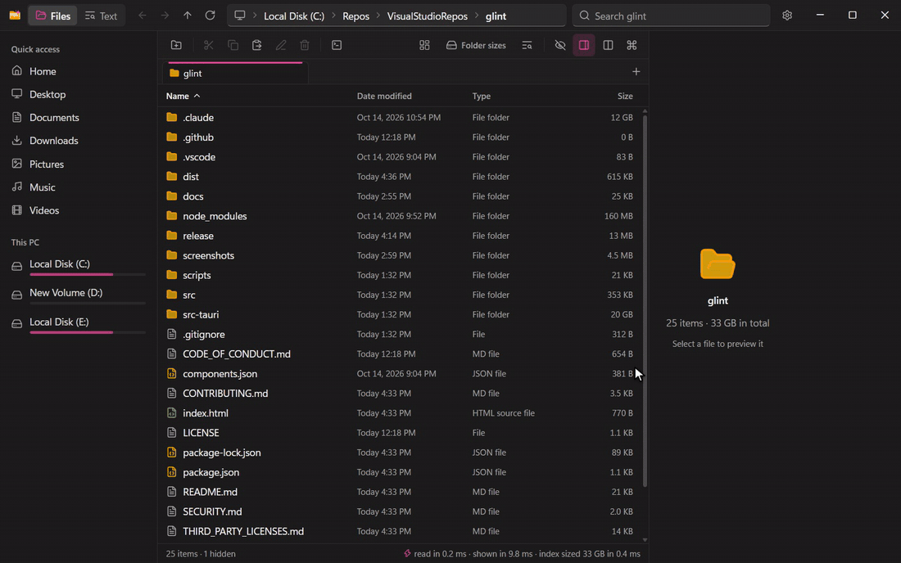

</div>

## Why

-   **Folders open in milliseconds.** System32's 5,092 items are on screen 12 ms after you press Enter, and a folder of 100,000 files takes 114 ms. One Win32 pass reads names, sizes, dates and attributes together, Rust sorts them, and the list draws only the rows you can see.
-   **Every folder shows its size.** File Explorer keeps them out of the list. Here they're in the Size column as the folder opens (all of `C:\Windows` sized in 0.4 ms from the index), or one click away with dust. Sort by size, or open **Disk usage** for a treemap like WizTree's, and you see what's filling your disk.
-   **Any file on any drive, in milliseconds.** Turn on instant search and a small service reads each NTFS drive's Master File Table once, the way Everything does, then follows the change journal. Every `kernel32.dll` on three drives (over 3 million names) is listed in about 8 ms. Without it, fd streams results as it finds them.
-   **ripgrep for what's inside files**: regular expressions, whole words, replace across files, and a syntax-highlighted preview.
-   **Thumbnails that never hold up the folder.** Switch to the grid (`Ctrl+Shift+2`) and a folder of 1,200 photos is still on screen in 9.3 ms, with the thumbnails filling in right after from Windows' own thumbnail cache (30 in 71 ms). Photos Windows hasn't seen yet are made on several threads at once, about 220 a second, where Windows' isolated thumbnail process manages about 50.
-   **Archives open like folders.** Zip, 7z and tar archives (`.tar.gz` and the other compressed tars too), cabinets (`.cab`), and single `.gz`, `.xz`, `.bz2`, `.zst` or `.lz4` files: press Enter on one and browse it in the list or the grid, with folder sizes, previews and thumbnails: a zip of 50,000 files is on screen 57 ms after Enter, and nothing is extracted until something needs a file's bytes. Copy, Copy to other pane and drag out extract through Windows' file engine.
-   **The tools File Explorer leaves out.** Find duplicate files by their content and recycle or hard-link the extra copies, see which program is holding a file open (and close it), list what changed in a folder lately, check a download against its published SHA-256, and rename many files at once with a live preview and Undo.
-   **Space to Quick Look, Ctrl+K for everything else.** See any file full size without opening it, Word, Excel and PowerPoint documents included (through Windows' own previewers, as in File Explorer), and arrow through the folder. Jump to the folders you use most (ranked by frecency, like zoxide) or run any command by typing a few letters.
-   **A search box over every drive, from anywhere.** `Ctrl+Alt+F` in any app opens Glint's quick search: names answered by the index as you type, `Enter` to open. Keep Glint in the tray and start it with Windows, and it's always there.
-   **Tabs, and two panes side by side.** Each pane has its own tabs (Ctrl+T, or middle-click a folder), and Ctrl+Shift+D shows two folders at once to copy or move between, or to compare down through every subfolder and sync. Your tabs are back the next time you start.
-   **Still Windows.** Copy, move, delete and rename run on Windows' own file engine (progress, *Replace or Skip*, Recycle Bin, UAC). The clipboard and drag and drop work with File Explorer and every other app, and Properties, Open with and Open in Terminal are a right-click away.

## Benchmarks

| Task | Where | Found | Time |
| :--- | :--- | ---: | ---: |
| Open a folder | `C:\Windows` | 108 items | 6.3 ms |
| | `C:\Windows\System32` | 5,092 items | 12 ms |
| | `C:\Windows\WinSxS` | 21,650 items | 73 ms |
| | a test folder | 100,000 files | 114 ms |
| Size every folder ¹ | `C:\Windows` | 56 GB | 0.4 ms |
| Map disk usage ¹ | all of `C:\`, six levels down | 20,000 biggest of 464 GB | 53 ms |
| Find files by name ¹ | `kernel32.dll` on all three drives | 18 files | 7.7 ms |
| | `*.dll` in System32 and its subfolders | 5,015 files | 36 ms |
| Search inside files | `DriverVer` in `C:\Windows\INF` (81 MB) | 1,313 matches in 838 files | 39 ms |
| Open a folder in the grid | 1,200 photos | 1,200 items | 9.3 ms |
| Show its thumbnails ² | from Windows' thumbnail cache | the 30 on screen | 71 ms |
| | photos Windows hasn't seen yet | the 30 on screen | 242 ms |
| | `C:\Windows\Web\touchkeyboard` | 8 wallpapers | 15 ms |
| Open an archive ³ | a zip of 50,000 files | 54,001 items | 57 ms |
| | the same files in a solid 7z | 54,001 items | 60 ms |
| | a folder in the zip after that | 500 items | 8.9 ms |

Each time runs from pressing Enter until everything is on screen, as the app's status bar reports it: the median of 5 runs, with the files already in Windows' cache (as when you browse back and forth). Intel Core Ultra 7 265K, NVMe SSD, Windows 11, release build. The status bar shows the time for every folder and search, so you can check these numbers on your own machine.

¹ With [instant search](docs/instant-search.md) on. Without it, fd and dust do the work: fd on its own lists the same 5,015 DLLs in 0.1–0.3 s, and takes 8 s for a name search across a 219 GB home folder.

² From the first thumbnail asked for to the last one in, as the status bar reports it (*30 thumbnails in 71 ms*), each run a fresh start of the app, so none came from its own memory. Asked for all at once, 1,200 photos come 1,100 a second from Windows' cache, and are made at 220 a second when Windows hasn't seen them.

³ Its list of entries read (47 ms of that), nothing extracted; each run a fresh start of the app, so Glint didn't have the archive in memory yet. After that, every folder in it is read from memory in 0.2 ms. See [docs/archives.md](docs/archives.md).

## Features

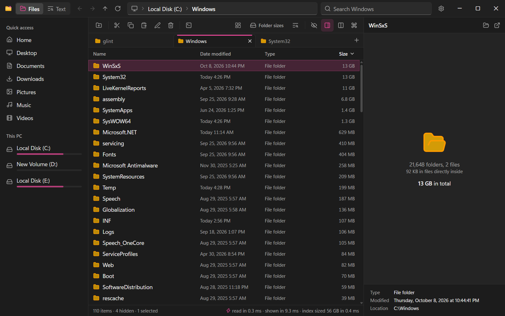

### Files

-   **Instant folders.** Each folder is read in one Win32 enumeration pass and sorted in Rust in natural order (`img9` before `img10`), then drawn as a virtual list. The status bar says how long it took: *read in 0.3 ms · shown in 6.3 ms*.
-   **Find files by name.** Typing in the search box filters the folder as you type; **Enter** searches every subfolder too (from This PC, every drive). All words must match, `*` and `?` work like in Explorer, and `"quotes"` keep spaces. Filters narrow it, as in Everything: `ext:pdf` (or `ext:jpg;png`), `size:>10mb` (`>`, `>=`, `<`, `<=`; kb, mb, gb), `dm:7d` (changed in the last 7 days; h, d, w, y) or `dm:>1y` (longer ago), `file:` and `folder:`. With instant search on, `ext:iso size:>1gb` on This PC lists every big ISO in milliseconds; the search box shows the filters when it's empty. **Save** keeps a search in the sidebar, to run it again with one click. The status bar says who answered: *index · 18 found in 7.7 ms* or *fd · 304 found in 8.09 s*. When nothing turns up, it says what was skipped, with a button each to look in hidden files, skipped folders or every drive.
-   **Folder sizes.** With instant search on, every folder shows its size as it opens, and search results show folder totals too. Otherwise one click measures them with dust. A bar behind each size shows how it compares with the biggest in the folder.
-   **Quick search from anywhere.** `Ctrl+Alt+F` opens a search box over every drive, wherever you are: names (and filters) answered by the index as you type, the best matches first and your own files before Windows' (before you type, it offers the folders you use most). `Enter` opens, `Alt+Enter` shows it in Glint, `Esc` puts it away. **Settings → Quick search** picks the shortcut, and can keep Glint in the tray and start it with Windows so it's always there.
-   **Grid view and thumbnails.** Every folder (and every search) can show as a grid of Windows' own thumbnails, in five tile sizes: see [Grid view](#grid-view) below. In the list, pictures and videos get a small one in place of their icon.
-   **Disk usage map.** A treemap of the open folder, like WizTree's: see [Disk usage map](#disk-usage-map) below.
-   **Archives.** `Enter` opens a zip, 7z, cabinet or tar (compressed or not) like a folder, read-only, with previews, thumbnails and copying out: see [Archives](#archives) below.
-   **Tools.** Find duplicates, see what's locking a file, the recent changes in a folder, a file's checksums and hidden streams, and batch rename: see [Tools](#tools) below.
-   **Preview pane and Quick Look.** Syntax-highlighted code and text, images, video, audio, PDFs and folder summaries, in the side pane (`Alt+P`) or full size on `Space`. CSV, TSV and JSON-lines files show as tables with their column types, SQLite databases as their tables, indexes and views, and programs and DLLs with their architecture, security features, sections, imports and exports. Everything else Windows has a previewer for shows through that previewer, as in File Explorer: Word, Excel and PowerPoint documents, fonts, Visio drawings… (not files downloaded from the internet, which File Explorer doesn't preview either). Online-only OneDrive files are left alone, so nothing downloads by accident.
-   **Command palette.** `Ctrl+K` finds any command, or a folder you've been to by typing a few of its letters (`dl` finds Downloads), with the folders you open most often and most recently first. Type a path, `~` or `%APPDATA%` to go there.
-   **An address bar that gets you there.** The arrow after each part of the path lists that folder's subfolders and archives, with a filter box and arrow keys; the first one lists drives and places. Typing a path (`Ctrl+L`) suggests what's in the folder you're typing in, folders first: `Tab` completes, `Enter` opens.
-   **The usual explorer moves.** Back, forward and up, a breadcrumb address bar you can type into, Quick access, pinned folders, drives with free space, sorting, multi-select, type-ahead, rename, new folders and text documents, and hidden items on demand.
-   **Windows-native file operations.** Copy, cut, paste, delete and rename go through Windows' own file engine, so progress, *Replace or Skip*, the Recycle Bin and permission prompts behave exactly like Explorer. The clipboard is shared with Explorer: copy here, paste there, and the other way round. A delete or a move says so with **Undo** right there, and `Ctrl+Z` takes back the last copy, move, rename, Recycle Bin delete, new folder or batch rename, with the names Windows actually gave (*Keep both*, *- Copy*), and steps further back on each press.
-   **Every folder opens.** A folder Windows keeps you out of, such as `C:\PerfLogs` or another account's profile, opens all the same and says why, with **Get access**: as File Explorer's Continue button does, Windows asks for administrator approval once, and your account may open it and everything in it from then on. With instant search on, even a folder Windows keeps to itself, such as *System Volume Information*, shows what's in it, read-only, from the index. Old links such as *Documents and Settings* open where they point, a shortcut to a folder opens the folder right here, and files open as a double-click in File Explorer opens them: with their app, or Windows' app picker when no app is set yet.
-   **Drag and drop.** Drag files out to File Explorer, the desktop, a mail or a chat, or drop them in from anywhere onto a folder, a sidebar place or the open folder. As in Explorer, dropping on the same drive moves and on another drive copies.
-   **Live.** The open folder refreshes when files change elsewhere.
-   **Explorer integration.** Properties, Open with…, Show in File Explorer and Open in Terminal. The other way round too, if you turn them on in **Settings → Files**: *Open in Glint* on File Explorer's right-click menu for folders and drives, and Glint opening folders when you double-click them in File Explorer or on the desktop. Drives, This PC, the Recycle Bin and other special places still open in File Explorer, and file dialogs aren't affected ([how it works](docs/explorer-integration.md)).

### Tabs and dual pane

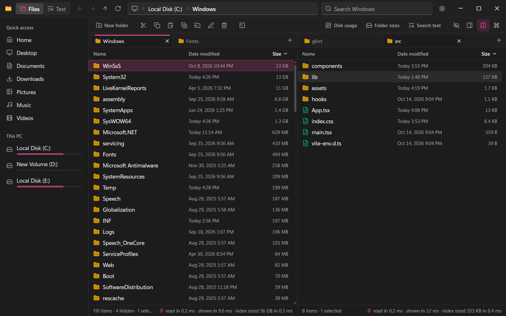

-   **Tabs.** `Ctrl+T` opens a tab on the folder you're in, and tabs drag: along their strip, or onto the other pane's. A middle-click (or `Ctrl+Enter`) opens a folder in a new tab behind the current one, as in a browser. `Ctrl+Tab` and `Ctrl+1`…`Ctrl+9` switch, `Ctrl+W` closes, and `Ctrl+Shift+T` brings the last one back. Each tab keeps its own history, selection, search and scroll position, and your tabs come back when the app starts (Settings → Reopen my tabs). A folder opened from File Explorer or a terminal (`Glint.exe C:\Projects`) gets a new tab in the window that's open: Glint runs once.
-   **Dual pane.** `Ctrl+Shift+D` (or the toolbar button) shows two folders side by side, each pane with its own tabs. Click a pane or press `F6` to work in it. Drag files across, or use **Copy to other pane** and **Move to other pane**, which run on Windows' own file engine like every other file operation.
-   **Compare the panes.** `Ctrl+Shift+M` (or the toolbar button) opens the second pane if it's closed and marks each item that's only in one pane, newer, older, or the same date with a different size; the matches are dimmed. **Diffs only** hides them, **Select** picks every difference, and **Sync** copies what's only here or newer into the other pane through Windows' file engine (`Ctrl+Z` takes it back). Dates within 2 seconds count as equal, and folders compare by size once both are measured.
-   **Down through subfolders, and by contents.** The compare bar's options: **Subfolders too** compares what's inside folders as well, so a folder differs when anything in it does, and **Sync** then copies what's missing or newer inside them, each file into the folder it goes in. **File contents** reads files of the same size on both sides rather than trusting their sizes and dates. Both skip what Find files skips (`node_modules`, `.git`), and leave links to other folders alone.
-   **Both at full speed.** Each tab searches and sizes folders on its own, so a long search in one pane doesn't stop the other's, and both panes refresh when their folders change.

### Grid view

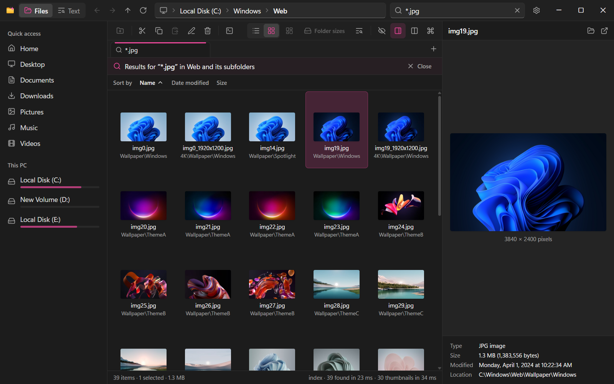

The **List** and **Grid** buttons in the command bar (or `Ctrl+Shift+6` and `Ctrl+Shift+2`, as in Explorer, or `Ctrl+K`) switch the tab you're in; each tab keeps its own view, and new tabs start in the view of the tab they came from. The grid works like the list: click, `Ctrl` and `Shift` to select, arrow keys in all four directions, `Enter` to open, `Space` for Quick Look, `F2` to rename, drag and drop (into the other pane too), the right-click menu and folder sizes under each folder. Sort it from the bar above it.

Zoom it as you would Explorer's icons: `Ctrl` and the mouse wheel over the grid, `Ctrl+=` and `Ctrl+-` (`Ctrl+0` for Medium again), the arrow next to the **Grid** button, or `Ctrl+K` (*large tiles*). There are five tile sizes, from Small (64 px pictures) to Huge (256 px), and they grow with the text size too. The size is a setting (**Settings → Files**), so every grid has it, in both panes and every tab. A grid keeps its place as it zooms: the focused tile stays where it was on screen (otherwise the tiles at the top stay at the top), and the pictures already there grow or shrink at once while sharp ones for the new size come in.

Thumbnails come from Windows' thumbnail cache, the one Explorer fills, so pictures you've seen in Explorer are there at once (30 in 71 ms). Only the tiles on screen ask for one, and they stop asking when you scroll past them or leave the folder. What Windows doesn't have yet is made on worker threads below normal priority: photos that Windows' own photo provider decodes with its built-in codecs (JPEG, PNG, GIF, TIFF, BMP) on several threads at once, and everything else (videos, documents, fonts, HEIC and RAW photos, or pictures another app took over) by its own handler, where Windows runs it, usually an isolated process. Windows caches the result, so next time it's instant, and online-only OneDrive files are only shown when Windows already has their thumbnail, so nothing downloads. The status bar says how many came, how fast and from where.

Bigger tiles ask for bigger thumbnails, one screen pixel to one (Huge at 125% scaling asks for 320 px). Windows keeps each thumbnail at a few sizes (96, 256 and 768 px among them) and answers with a smaller one when it lacks the size asked for, so those are made at the size the tile needs: a photo first seen in the list (32 px there) isn't stuck that small in the grid. Folders of 60 and 300 photos are on screen in 7–9 ms at every size, and their thumbnails come in this fast (status bar, fresh start of the app each run, default window at 125% scaling; median of 5 runs from the cache, 3 of never-seen photos):

| Tile size | Thumbnails on screen | From Windows' cache | Never seen |
| :--- | ---: | ---: | ---: |
| Small | 49 | 89 ms | 238 ms |
| Medium | 30 | 70 ms | 241 ms |
| Large | 24 | 66 ms | 231 ms |
| Extra large | 15 | 61 ms | 165 ms |
| Huge | 8 | 51 ms | 137 ms |

### Disk usage map

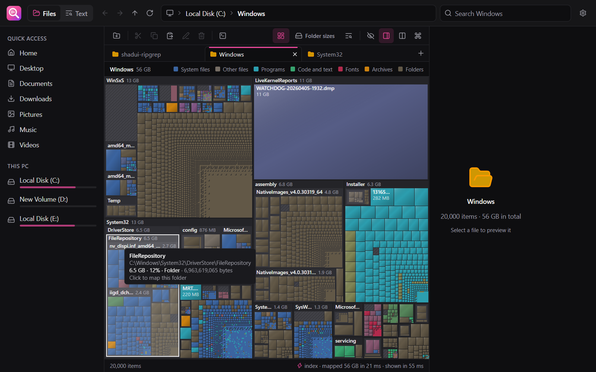

**Disk usage** (in the command bar, or `Ctrl+K`) draws the open folder as a squarified treemap, the way WizTree and WinDirStat do: folders nest six levels deep, files are colored by type, and the 20,000 biggest items are drawn, with everything smaller grouped in its folder. Hover for the name, path and size, click a folder to go into it (or a file to go to its folder), `Backspace` or `Alt+Up` to go back out, `Enter` to open, and right-click for the usual menu.

**Type** and **Age** (or `T`) switch the colors between kinds of file and how long ago each changed, from today (hot) to over a year ago (frozen).

With instant search on, the map comes from the index in one request: all of `C:\` is on screen 53 ms after the click. Otherwise dust measures the folder: going into a folder shows its part of the map while dust measures it, and going back out shows the map you left. Each tab has its own map, and the status bar shows which engine drew it and how long it took.

<table>
<tr>
<td width="50%">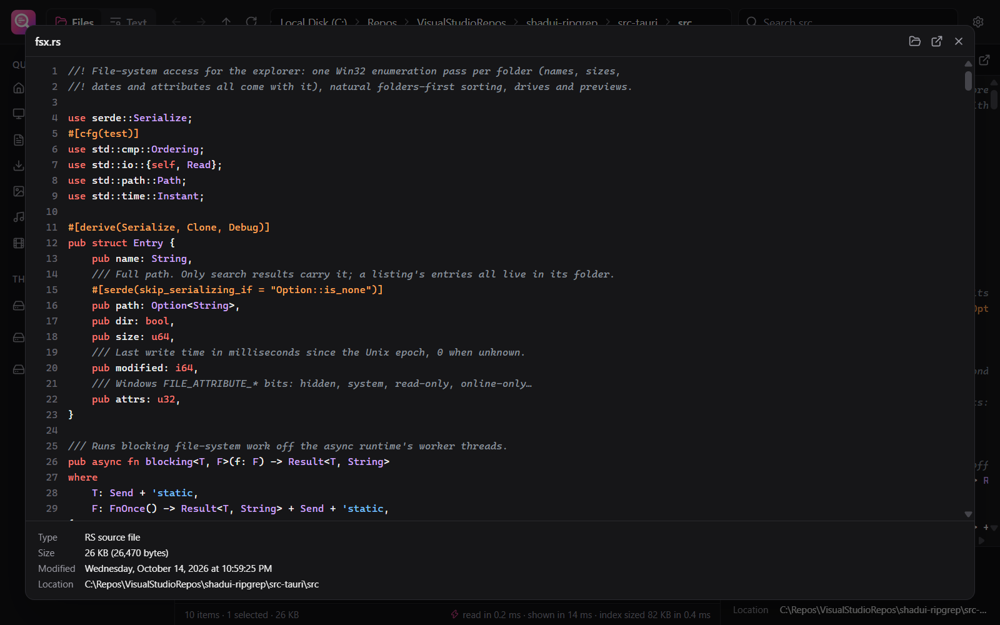</td>
<td width="50%">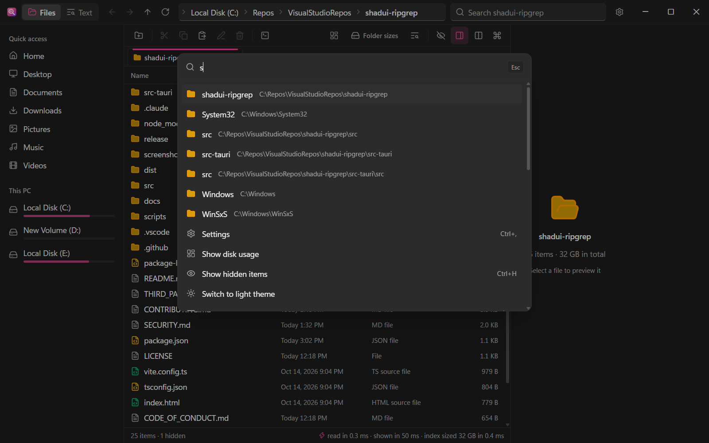</td>
</tr>
<tr>
<td align="center"><b>Space</b>: Quick Look</td>
<td align="center"><b>Ctrl+K</b>: the folders you use, and every command</td>
</tr>
</table>

### Archives

Press `Enter` on a zip, 7z, cabinet (`.cab`) or tar file (`.tar.gz`, `.tgz`, `.tar.xz`, `.tar.bz2`, `.tar.zst` and `.tar.lz4` too), or a single compressed file (`.gz`, `.xz`, `.bz2`, `.zst`, `.lz4`), or double-click it, or middle-click for a new tab) and it opens like a folder, in the list or the grid, in either pane and any tab: go into its folders, back up out of it, Back and Forward, the path in the address bar (`C:\Downloads\photos.zip\2024\summer`, typed or pasted too), and its tabs come back when the app starts. An archive inside an archive opens the same way.

Glint reads only the archive's own list of entries (the zip central directory, the 7z header, a tar's headers), once, and keeps it in memory: a zip of 50,000 files lists in 57 ms, and every folder in it after that in 0.2 ms. A compressed tar keeps no such list, so the first time it's opened it's decompressed from start to end, with progress and Stop.

Files that are zips by another name (Word, Excel and PowerPoint documents, `.jar` and `.apk` files, NuGet and VSIX packages, EPUBs…) and Windows Installer packages (`.msi`) still open in their app, or run, on `Enter`; right-click **Open as archive** to look inside. An installer package shows what it installs, as the folders it installs into (`Program Files (x86)\Contoso\app.exe`), read from its cabinets without running anything. Every folder shows its size, and name search, folder sizes and the disk usage map work inside archives too. Previews, Quick Look and thumbnails extract only the file they show, to a temp copy that goes when you close the app, and opening a file opens a read-only copy of it.

Archives are read-only: what would change one is greyed out, with a *Read-only archive* badge in the command bar. **Copy**, **Copy to other pane** and dragging out extract the selection, folders and all, then let Windows' own file engine copy it, so progress and *Replace or Skip* are Windows' own. Paths can't escape the folder they're extracted to (no zip slip), entries are cut off at their declared size, zip bombs (huge expansion ratios, overlapping entries, oversized 7z headers) are refused, password-protected entries say so, and a damaged archive is an error, never a crash. Methods, limits and the temp folders: [docs/archives.md](docs/archives.md).

Right-click **Extract here** on an archive unpacks all of it, with the same checks, into a new folder next to it named after it, as Explorer's *Extract All* does (a single compressed file comes out as the file, next to it). **Compress to zip file** packs the selection into a zip next to it (Deflate, with the files' dates), named after the first item and ready to rename. Both show progress, can be stopped, leave nothing behind when they fail, and `Ctrl+Z` takes them back.

### Tools

In the command bar's **Tools** menu, a folder's or a file's right-click menu, and `Ctrl+K`:

-   **Find duplicates.** Files of the same size are compared by their first and last 4 KB, then by a SHA-256 of all their content, so a folder of thousands of files is checked in moments. Keep one copy of each and move the others to the Recycle Bin, or replace them with hard links to the one you keep: every path stays and the space is freed, but the copies become one file, so changing any of them changes them all. Each copy is compared with the kept one byte for byte right before it's linked, and cloud (OneDrive) files are left alone.
-   **What's locking this?** For when Windows says a file is open in another program: Windows' Restart Manager names the programs that have the selection open (or files in a folder), in milliseconds, and **End** closes one after asking. *End all* leaves File Explorer and services running.
-   **Recent changes.** What changed in a folder and below it in the last 15 minutes to 30 days, newest first, with the folders that changed most, and a live list of the changes Glint saw while the folder was open.
-   **File X-Ray.** A file's SHA-256 and CRC32 (paste a published checksum to compare; a file over 256 MB is hashed in full when you ask), its entropy and byte values, size on disk, NTFS file ID and hidden streams (alternate data streams), with Windows' *downloaded from the internet* mark and **Unblock**, as in Properties.
-   **Batch rename.** Select several items and press `F2`, or `Ctrl+Shift+R` for the whole folder: find and replace (regular expressions too), a pattern of `{name}`, `{ext}`, `{n}`/`{nn}`/`{nnn}`, `{date}` and `{parent}`, and case changes, with a live preview that flags clashes. Every item is renamed or none is (swaps and numbered chains included), and **Undo** puts the names back.

These work on files on disk, not inside archives.

<table>
<tr>
<td width="50%">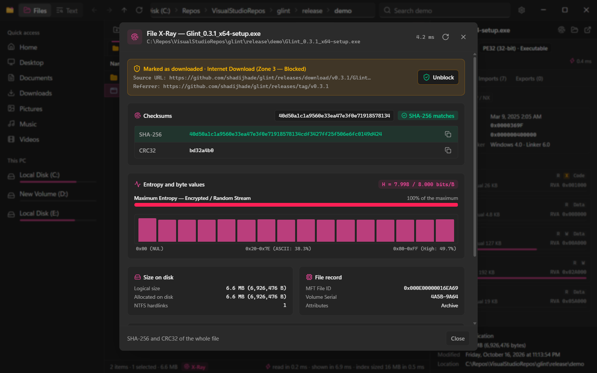</td>
<td width="50%">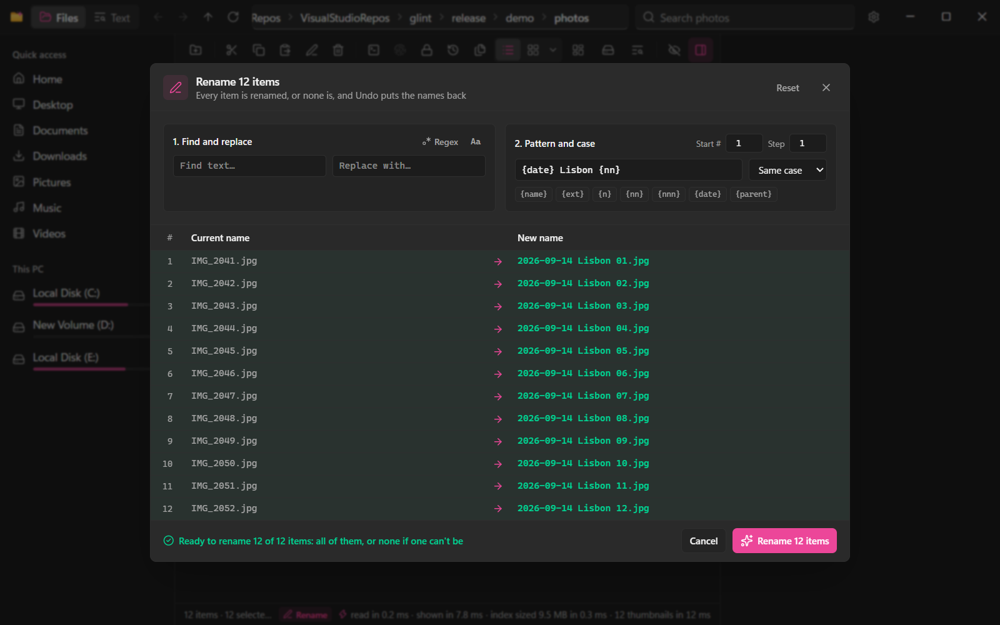</td>
</tr>
<tr>
<td align="center"><b>File X-Ray</b>: check a download against its published SHA-256</td>
<td align="center"><b>F2</b> on several items: rename them all, with a preview</td>
</tr>
</table>

### Instant search (NTFS index)

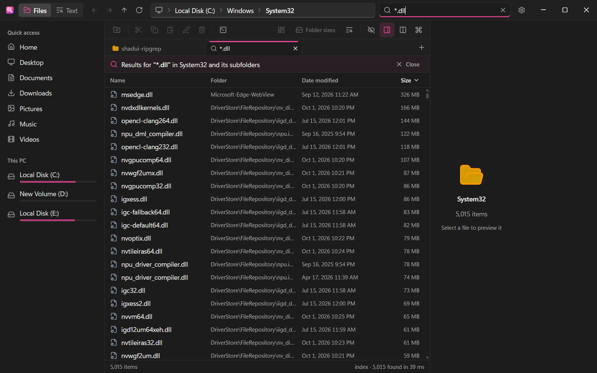

It's off until you turn it on: on This PC, with the status bar's **Turn on instant search**, or in **Settings → Instant search**. Windows asks for administrator approval once, and a small service indexes your fixed NTFS drives. It reads each drive's Master File Table in one sequential pass (2.3–2.5 s for C: with 2.9 million records here), then follows the USN journal, so a file created, renamed or deleted anywhere is in the index within about 0.3 s. Name searches, folder sizes and disk-usage maps then answer from memory. fd and dust take over wherever the index can't answer: network shares, FAT and exFAT drives, and searches that read `.gitignore`.

The service only runs once you opt in, with every privilege removed except the three it needs. It answers only you and administrators, over a named pipe no other program can pose as. It knows the names of all files on the indexed drives, including ones your account can't open, so on a shared PC turn it on only for accounts that may see every file name. Measurements, how it works and the full security model are in **[docs/instant-search.md](docs/instant-search.md)**.

### Text: search inside files (ripgrep)

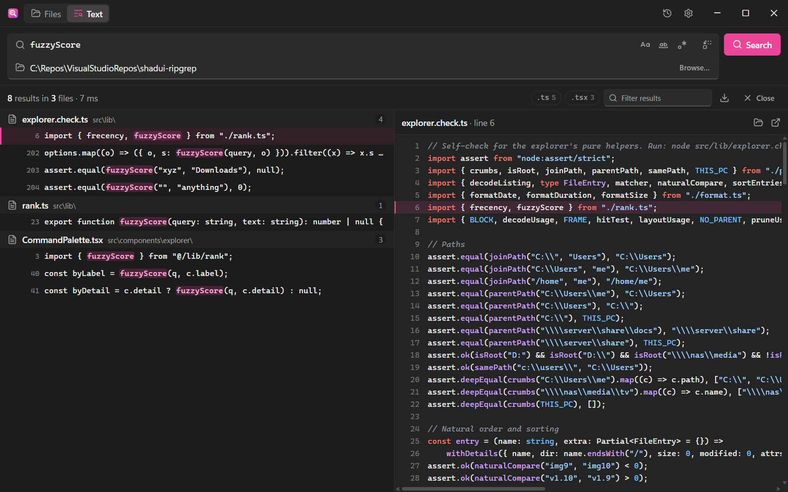

-   **ripgrep speed.** Results stream in as rg finds them.
-   **Search and replace** across many files at once, matching line by line as ripgrep searched (`^` and `$` mean a line's start and end, CRLF files included), each file written safely: a write cut short leaves it as it was.
-   **Results that fold.** Click a file to fold its matches away, or collapse them all at once; a bar on each file shows which have the most matches.
-   **Regex, case, whole word, exclusions.** Full regular expressions (multi-line with `Shift+Enter`), case sensitivity, whole words, and patterns to skip (`node_modules`, `.git`…).
-   **Preview, history and export.** A syntax-highlighted preview of every result, recent searches one click away, and results exported to CSV or JSON.
-   **Connected to Files.** **Search text** (`Ctrl+Shift+F`) searches the folder you're in; **Show in folder** on a result opens it in Files with the file selected.

## Compared with File Explorer

| | File Explorer | Glint |
| :--- | :--- | :--- |
| Folder sizes | In Properties or a tooltip | In the list, for every folder |
| What fills a drive | Not shown (Storage settings has categories) | A treemap of any folder, like WizTree's |
| Find a file by name | Windows Search where it indexes, otherwise a walk through every folder | An index of every NTFS drive (opt-in), otherwise fd |
| Search inside files | Indexed places and file types | ripgrep in any folder, with regex and replace |
| Preview | Preview pane | Preview pane with the same previewers (and tables, databases and programs of its own), and Quick Look on `Space` |
| Compare two folders | Not available | Side by side, down through subfolders and by contents, with Sync |
| A search from anywhere | Windows Search in the Start menu | `Ctrl+Alt+F`: every drive's names, answered by the index as you type |
| Go to a folder | Quick access, address bar | Address bar, and `Ctrl+K` with your most-used folders |
| Tabs and panes | Tabs (Windows 11) | Tabs in each pane, and two panes side by side |
| Duplicate files | Not found | Found by size, then content; recycled or replaced with hard links |
| A file in use | *The action can't be completed*, sometimes naming the program | The programs holding it open, and **End** to close one |
| Renaming many files | One name for all, numbered (1), (2)… | Patterns, numbering, dates, find and replace, with a preview and Undo |
| Checksums | Not shown (PowerShell's `Get-FileHash`) | SHA-256 and CRC32 in the File X-Ray, compared with one you paste |
| Timing | Not shown | In the status bar, for every folder and search |

## Install

1.  Download `Glint_<version>_x64-setup.exe` from the [latest release](https://github.com/shadijhade/glint/releases/latest) and run it (installs for your account without administrator rights; ripgrep, fd and dust come with it), or install with a package manager:

    ```powershell
    # Scoop
    scoop bucket add shadijhade https://github.com/shadijhade/scoop-bucket
    scoop install shadijhade/glint

    # winget (once microsoft/winget-pkgs#455306 merges)
    winget install shadijhade.Glint
    ```

Glint was called ShadUI Ripgrep before 0.3.1. Installing Glint replaces ShadUI Ripgrep and keeps your settings, tabs and instant search.

Copies installed with the setup program update themselves: when a new version is out, the app says so, and **Install** (in that notice or in **Settings → About**) downloads it, checks its signature and restarts into it in a few seconds.

Windows 10 or 11, 64-bit. The installer isn't code-signed yet, so SmartScreen may show *Windows protected your PC* for a new version: choose **More info → Run anyway**, or install with Scoop, which doesn't trigger it ([more](SECURITY.md#code-signing-and-privacy-policy)).

## Keyboard shortcuts

### Files
| Key | Action |
| :--- | :--- |
| `Enter` | Open the selection (an archive opens like a folder) |
| `Space` | Quick Look: the focused item full size. Arrows move through the folder; `Space` or `Esc` closes |
| `Ctrl+K` / `Ctrl+P` | Command palette: folders you use, paths and every command |
| `Ctrl+T` / `Ctrl+W` | New tab on this folder / close the tab |
| `Ctrl+Tab` / `Ctrl+Shift+Tab` · `Ctrl+1`…`Ctrl+9` | Next / previous tab · go to a tab (`Ctrl+9`: the last one) |
| `Ctrl+Shift+T` | Reopen the last closed tab |
| Middle-click a folder / `Ctrl+Enter` | Open it in a new tab |
| `Ctrl+Shift+D` | Dual pane on or off |
| `Ctrl+Shift+M` | Compare the two panes |
| `F6` | Switch to the other pane |
| `Alt+Left` / `Backspace` · `Alt+Right` · `Alt+Up` | Back · Forward · Up |
| `Ctrl+L` / `Alt+D` / `F4` | Type a path in the address bar |
| `Ctrl+F` / `Ctrl+E` / `F3` | Search: typing filters, `Enter` searches subfolders, `Esc` clears |
| `Ctrl+Shift+2` / `Ctrl+Shift+6` | Grid view (thumbnails) / list view |
| `Ctrl+=` / `Ctrl+-` · `Ctrl`+wheel | In the grid: bigger / smaller tiles (`Ctrl+0`: medium) |
| `Arrows`, `Home`, `End`, `PageUp/Down` | Move: in the grid, `Left` and `Right` too (`Shift` extends the selection, `Ctrl` moves without selecting) |
| `Ctrl+Space` | Add the focused item to the selection, or take it out |
| Letters | Jump to the next name starting with them |
| `Ctrl+A` | Select all |
| `Ctrl+C` / `Ctrl+X` / `Ctrl+V` | Copy / cut / paste (works with File Explorer too) |
| `Ctrl+Shift+C` | Copy path |
| `F2` | Rename (several selected: batch rename) |
| `Ctrl+Shift+R` | Batch rename the selection, or every item in the folder |
| `Delete` / `Shift+Delete` | Move to the Recycle Bin / delete permanently |
| `Ctrl+Z` | Undo the last copy, move, rename, delete, new item or batch rename |
| `Ctrl+Shift+N` | New folder |
| `Alt+Enter` | Properties |
| `F5` / `Ctrl+R` | Refresh |
| `Ctrl+H` | Show or hide hidden items |
| `Alt+P` | Show or hide the preview pane |
| `Ctrl+Shift+F` | Search text in this folder |

### Disk usage map
| Key | Action |
| :--- | :--- |
| Click | Go into a folder; on a file, go to its folder with the file selected |
| `Backspace` / `Alt+Up` | Back out to the folder above |
| `Alt+Left` · `Alt+Right` | Back · Forward, as in the list |
| `Enter` / double-click | Open the selected item (a folder is mapped) |
| `Space` | Quick Look the selected item |
| Right-click | The item's menu, as in the list |
| `F5` | Map the folder again (measures it again when dust drew it) |
| `T` | Color by kind of file or by age |

### Text search
| Key | Action |
| :--- | :--- |
| `Enter` | Search (in the search box) / open the selected result |
| `Shift+Enter` | New line in the search box (multi-line search) |
| `Arrow Up/Down` | Move through results (`Down` in the search box goes on to them) |
| `Ctrl+F` / `Ctrl+K` | Focus the search box |
| `Ctrl+H` | Show or hide Replace |
| `Alt+C` / `Alt+W` / `Alt+R` | Toggle match case / whole word / regex |
| `Ctrl+Shift+E` | Back to Files |
| `Esc` | Leave the search box; again, stop a running search; close menus and dialogs |

`F1` (or `Ctrl+/`) shows every shortcut on one sheet, `Ctrl+,` opens Settings from anywhere in Glint, and `Ctrl+Alt+F` opens quick search from any app (**Settings → Quick search** picks another shortcut, or none).

## How it works

-   **Folders**: one `FindFirstFileExW` pass (basic info, large fetch) gets every name, size, date and attribute at once. Rust sorts them and hands the whole listing to the UI as a single binary buffer rather than JSON, and React draws only the rows on screen.
-   **Name search**: the instant-search service when it covers the folder, otherwise fd, with results streamed into the list as they arrive.
-   **Folder sizes**: the index's per-folder totals, otherwise dust.
-   **Thumbnails**: Windows' thumbnail cache through `IShellItemImageFactory` (thumbnails only, from the cache only: about a millisecond each), on worker threads that are each a COM apartment of their own. What the cache doesn't have is made by the file type's thumbnail handler: Windows' photo provider runs on our own threads with `IThumbnailCache` and `WTS_EXTRACTINPROC` (220 a second with 8 threads, where the isolated process Windows uses for other handlers makes about 50 however many ask), and Windows caches each one as if Explorer had made it. Requests wait in their tab's queue, shared between panes showing the same file, and are dropped when the tiles asking for them scroll away. Each tile asks at its size in screen pixels; when the cache answers with a smaller size it has (it keeps 16 to 2,560 px versions), the thumbnail is made at the size asked, and the smaller one is the answer only for online-only files or when making fails. Each answer reaches the UI as one binary buffer, an uncompressed BMP, and both sides keep the latest ones in memory.
-   **Disk usage map**: one request to the index returns the biggest files and folders six levels down (folders are walked biggest first, so nothing too small to draw is looked at), or dust's JSON tree when the index doesn't have the folder. Either way it reaches the UI as one binary buffer and is drawn on a canvas as a squarified treemap. For all of C: here (464 GB, 2.9 million MFT records) the service answers in 19 ms for the 20,000 biggest items six levels down, and the map is on screen 53 ms after the click; on a synthetic index of 2.86 million records it takes 9–17 ms, whether the map goes 4 or 32 levels down.
-   **Archives**: [zip](https://github.com/zip-rs/zip2) reads a zip's central directory, served from memory in one read of the file's end (13 ms for 50,000 entries, where reading it from the file takes 150 ms), and [sevenz-rust2](https://github.com/hasenbanck/sevenz-rust2) reads a 7z's header, once Glint has checked how big it unpacks to. Tars and cabinets are read by Glint's own readers, and gzip, xz, bzip2, Zstandard, LZ4 and LZX by pure Rust decoders. All of it is pure Rust. The entries become a tree of folders kept in memory, with safe Windows names and folder totals, and each listing reaches the UI as the same binary buffer as a folder's. A file is extracted only when it's previewed, opened or copied, cut off at its declared size, and copies out go through `IFileOperation` from a staging folder. See [docs/archives.md](docs/archives.md).
-   **Text search**: ripgrep's JSON output, streamed in batches.
-   **Previews from Windows**: the file type's preview handler (`IPreviewHandler`), the one File Explorer uses, created out of process (Office's run in Word, Excel and PowerPoint; others in `prevhost.exe`) and drawing in a window over the preview pane. A thread of Glint's with its own COM apartment owns that window and talks to the handler, so the UI never waits on one, and a watchdog cancels a call that hangs. WebView2 would draw over a child window, so the web view gets a window region with the preview's rectangle cut out, and the UI hides the preview while a menu, dialog or toast covers it.
-   **Comparing folders**: Rust walks both trees side by side and answers with each top-level item's status and what Sync copies each way; files compare by date and size, or byte for byte when asked, reading both until they differ.
-   **Quick search**: `RegisterHotKey` on a thread of its own, and a second, borderless window of the app that searches as Files does.
-   **File operations**: Windows' `IFileOperation` (the engine Explorer uses), the clipboard formats Explorer reads, and OLE drag and drop.
-   **Live folders**: [notify](https://github.com/notify-rs/notify) watches the folders on screen (one per pane).
-   **Tabs and panes**: every tab keeps its own state, and its name searches and dust runs go in a lane of their own in Rust, so tabs and panes never stop each other's work.
-   **Opening folders from Windows**: per-user shell verbs under `HKEY_CURRENT_USER\Software\Classes` (no administrator rights) run `Glint.exe "%V"`, and [tauri-plugin-single-instance](https://v2.tauri.app/plugin/single-instance/) hands a later launch's folders to the window that's open. What Glint can't open goes back to File Explorer before any window shows. See [docs/explorer-integration.md](docs/explorer-integration.md).
-   **Instant search**: a Windows service in Rust ([`src-tauri/index`](src-tauri/index), built as `shadui-index.exe`) that reads each NTFS volume's Master File Table in one sequential pass and follows its USN journal. See [docs/instant-search.md](docs/instant-search.md).

Built with [Tauri 2](https://tauri.app/) and the [windows](https://github.com/microsoft/windows-rs) crate on the Rust side, and [React](https://react.dev/), [Vite](https://vite.dev/), [Tailwind CSS](https://tailwindcss.com/), [shadcn/ui](https://ui.shadcn.com/), [Lucide](https://lucide.dev/) and [Zustand](https://github.com/pmndrs/zustand) in the UI. The bundled tools:

| Tool | Version | Used for | License |
| :--- | :--- | :--- | :--- |
| [ripgrep](https://github.com/BurntSushi/ripgrep) | 15.2.0 | Searching inside files | MIT or Unlicense |
| [fd](https://github.com/sharkdp/fd) | 10.5.0 | Finding files by name | MIT or Apache-2.0 |
| [dust](https://github.com/bootandy/dust) | 1.2.6 | Folder sizes and disk-usage maps | Apache-2.0 |

## Build from source

You need Windows 10 or 11, [Node.js](https://nodejs.org/) 22.18 or newer, [Rust](https://www.rust-lang.org/tools/install) (stable, MSVC toolchain) and the [Tauri prerequisites](https://tauri.app/start/prerequisites/).

```bash
git clone https://github.com/shadijhade/glint.git
cd glint
npm install
npm run tauri dev
```

`npm run tauri build` makes the installer in `src-tauri/target/release/bundle/nsis/`. The Windows x64 builds of ripgrep, fd and dust ship in `src-tauri/binaries/`; on other platforms, add binaries named `rg-<target-triple>`, `fd-<target-triple>` and `dust-<target-triple>` there. `npm run release`, or the release workflow when a version tag is pushed, builds a release on top of that: the update package the app installs, code signing, and the winget and Scoop manifests ([docs/releasing.md](docs/releasing.md)).

The checks to run before you commit:

```bash
npm run build
node src/lib/explorer.check.ts
node src/lib/text.check.ts
cd src-tauri && cargo clippy --workspace --all-targets -- -D warnings && cargo test --workspace
```

Release builds run once per app identifier, so a release build of Glint hands its folders to an installed Glint that's running. Try them under a name and identifier of their own ([docs/explorer-integration.md](docs/explorer-integration.md#trying-it-without-touching-your-glint)).

The index's tests (MFT record parsing, queries, disk-usage maps, folder totals under random changes, snapshots, the wire format, and a real named-pipe round trip with its ACL) run without administrator rights.

## Roadmap

-   [x] Tabs and a dual-pane view
-   [x] A disk-usage map (treemap) from the index
-   [x] Thumbnails and a grid view
-   [x] Auto-update, with signed update packages
-   [x] A Scoop package
-   [ ] Code-signed installers (the SignPath Foundation invited a new application once Glint is better known)
-   [ ] The winget package (in review: [microsoft/winget-pkgs#455306](https://github.com/microsoft/winget-pkgs/pull/455306))
-   [x] Zip, 7z, cabinet and tar archives (compressed too) opened like folders, Extract here, and Compress to zip
-   [x] Undo (`Ctrl+Z`) for copies, moves, renames, deletes and new items
-   [x] Quick search from anywhere (`Ctrl+Alt+F`), the tray, and starting with Windows
-   [x] Word, Excel, PowerPoint and font previews through Windows' previewers
-   [x] Comparing folders down through subfolders and by contents, with Sync

Missing something? [Open an issue](https://github.com/shadijhade/glint/issues/new/choose). If the app saves you time, a star helps other people find it.

## Contributing

Bug reports, ideas and pull requests are welcome. [CONTRIBUTING.md](CONTRIBUTING.md) covers the setup, where things are in the code, and the checks. To report a security issue, see [SECURITY.md](SECURITY.md).

## Acknowledgments

-   [fd](https://github.com/sharkdp/fd), [dust](https://github.com/bootandy/dust) and [ripgrep](https://github.com/BurntSushi/ripgrep), which do the heavy lifting and ship inside the app.
-   [Everything](https://www.voidtools.com/) and [WizTree](https://diskanalyzer.com/), which showed that reading the MFT directly is the fast way, and [goz](https://github.com/mustafaahci/goz) and [everyfind](https://github.com/kyo5uke/everyfind), whose ideas the index service borrows.
-   [zoxide](https://github.com/ajeetdsouza/zoxide) for frecency, and macOS for Quick Look.

## License

MIT, see [LICENSE](LICENSE). The bundled ripgrep, fd and dust, and the crates that read archives, keep their own licenses; see [THIRD_PARTY_LICENSES.md](THIRD_PARTY_LICENSES.md).
