<div align="center">


# Glint

**The file explorer for Windows that doesn't make you wait.**

Folders open in milliseconds, every folder shows its size, and any file on any drive turns up as you type.<br>
A native Windows app written in Rust. Free, open source, and no account.

[](https://github.com/shadijhade/glint/releases/latest)
[](https://github.com/shadijhade/glint/releases)
[](#install)
[](#install)
[](#how-it-works)
[](LICENSE)

<a href="https://apps.microsoft.com/detail/9NQLRJ3HF1C9"></a>

**[Download the installer](https://github.com/shadijhade/glint/releases/latest/download/Glint-setup.exe)** · [Website](https://glint.rafd.tech/) · [What's new](#whats-new) · [Features](#features) · [Benchmarks](#benchmarks) · [Shortcuts](#keyboard-shortcuts)

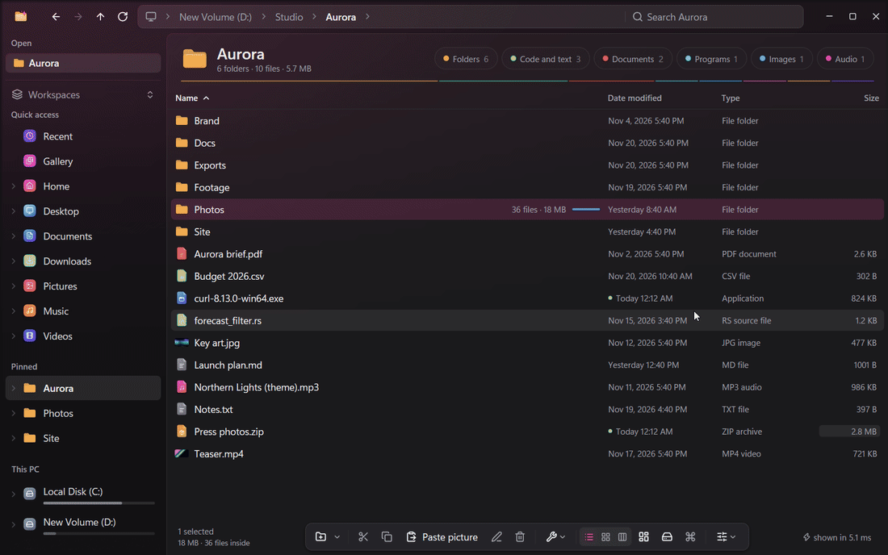

</div>

## Why Glint

-   **Folders open in milliseconds.** System32's 5,097 items are on screen 12 ms after you press Enter, and a folder of 100,000 files in 47 ms (11 ms if the pointer rested on it first). Glint itself is up, with your folder in it, about a quarter of a second after you start it.
-   **Every folder shows its size.** File Explorer keeps folder sizes in Properties. Glint puts them in the list as the folder opens (all of `C:\Windows` in 0.4 ms from the index), and draws any folder as a map of what fills it, like WizTree.
-   **Any file on any drive, as you type.** Turn on instant search and a small service reads each NTFS drive's Master File Table once, the way Everything does, then follows every change: every `kernel32.dll` on three drives, among 3 million names, in 7.7 ms. Without it, fd streams results as it finds them.
-   **One search for names and contents.** ripgrep reads inside the files from the same box, and a file found by what it holds is a row like any other, with the lines that matched under it. PDFs, Office documents and the text in pictures too.
-   **A preview for nearly every file.** `Space` shows it full size: code, Markdown, PDFs, Word documents without Office, spreadsheets and databases you can query with SQL, books, videos, 3D models, and every file's bytes.
-   **More to do with files.** Trim and shrink videos, merge and split PDFs, query CSV and Parquet files of any size, convert documents, take personal info out of photos, encrypt with age, rename hundreds of files at once, and take it all back with `Ctrl+Z`.
-   **Tabs, two panes, a terminal and Git.** Each pane has its own tabs, two folders compare and sync down through every subfolder, a terminal under the files follows the folder you're in, and every file shows its Git status.
-   **Still Windows.** Copy, move and delete run on Windows' own file engine, with its progress, *Replace or Skip*, Recycle Bin and UAC. The clipboard, drag and drop and Windows' own context menu work with File Explorer and every other app.
-   **AI agents use it too.** Through its [MCP server](#ai-agents), Claude, Copilot, Cursor and other agents find files on every drive in milliseconds, measure folders and search inside files.

## Install

| Where | What you get |
| :--- | :--- |
| **[Microsoft Store](https://apps.microsoft.com/detail/9NQLRJ3HF1C9)** | Signed by Microsoft, so Windows installs it without a warning, even with Smart App Control on. The Store keeps it up to date. |
| **[Installer](https://github.com/shadijhade/glint/releases/latest/download/Glint-setup.exe)** | Installs for your account in a few seconds, without administrator rights, with ripgrep and fd inside, and updates itself. Its **Extra tools** page offers instant search and the free tools some features use ([which ones](docs/tools.md)). |
| **winget** | The installer's copy, or the Store's (commands below). |
| **[Scoop](https://scoop.sh/)** | Checked against its hash, no SmartScreen prompt; `scoop update glint` keeps it current. |

```powershell
# winget: the installer's copy, which updates itself
winget install shadijhade.Glint
# winget: the Microsoft Store's copy
winget install 9NQLRJ3HF1C9 --source msstore
# Scoop
scoop bucket add shadijhade https://github.com/shadijhade/scoop-bucket
scoop install shadijhade/glint
```

Glint needs Windows 10 or 11, 64-bit, and nothing else: it draws its own window, so it doesn't need WebView2. The installer's copy updates itself: when a new version is out it says so, and **Install** (in that notice or in **Settings → About**) downloads it, checks its signature and restarts into it in a few seconds. The Store's copy can't change File Explorer's settings (Windows doesn't let Store apps), so *Open in Glint* on File Explorer's menu, *Open folders in Glint by default* and *Win+E opens Glint* need the installer's copy. The two keep their settings apart, and **Settings → About → Settings file** moves them across.

> [!NOTE]
> The installer isn't code-signed yet, so Windows may say *Windows protected your PC*: choose **More info**, then **Run anyway** ([why](SECURITY.md#code-signing-and-privacy-policy)). If your browser holds the download back, choose **Keep**. With Smart App Control on, Windows doesn't run it at all: get Glint from the Microsoft Store there.

## What's new

**0.13.2** (November 16, 2026) brings updates nobody has to think about. Glint looks for a new version every hour by the clock, so one that lives in the tray finds it without a restart, downloads it in the background (picking up where a broken download stopped, never on a metered connection) and installs it when you quit, or after a start with Windows before you open the window. **Restart to update** in the header does it right away. A copy installed with Scoop updates through Scoop, so Scoop and UniGetUI know the new version too; **Settings → About → Install updates automatically** turns all of it off.

**0.13.1** (November 16, 2026) puts the zoom right. `Ctrl` and the wheel, or a pinch, change how a folder is laid out and never which folder you're in: in from the list to the grid's small tiles and on to bigger ones, out the same way back, each file flying between its row and its tile. In 0.13.0 the same turn opened the folder under the pointer, or went up to the one above. Opening a folder is a small step now, not a flight, and menus and dialogs move less.

**0.13.0** (November 16, 2026) makes Glint pay attention. The right-click menu and the dock know what you picked, say what is true about it, and put the next step first.

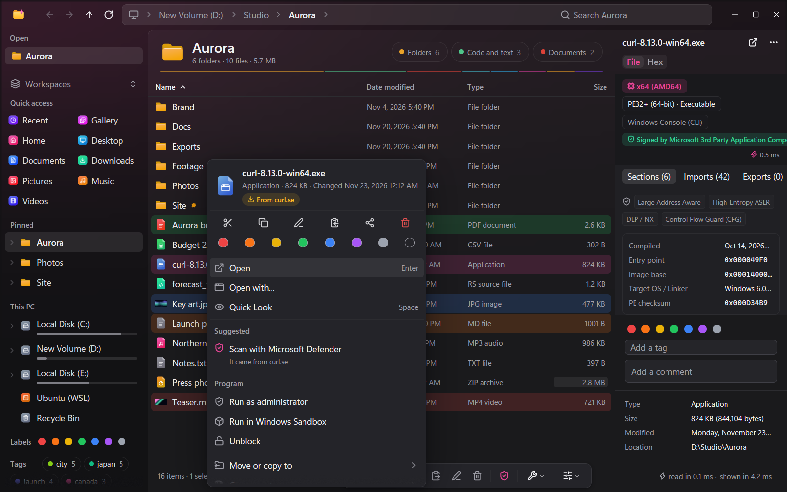

-   **A menu that knows the file.** It starts with the item itself: what it is, where a download came from, whether a program is signed, how many identical copies there are, which program has it open. Under that, **Suggested**: *Extract here* for an archive, *Scan with Microsoft Defender* for a download, *Run in Windows Sandbox* for a program nobody signed, each with its reason.
-   **Type in the menu.** Start typing and only the rows that match stay, the ones in submenus too; `Enter` runs the first. A greyed row says why it's off.
-   **The dock's next step.** With something selected, the dock offers what you'd likely do next (*Extract here*, *Compare*, *Clean up…*), **Paste** says what it would paste, and the words beside it say what the selection holds: lines, pages, minutes, or everything inside a folder, counted before you ask.
-   **It learns, on your PC only.** What you choose rises in `Ctrl+K` and in **Suggested**, and **Move or copy to** offers the folder that kind of file usually goes to. Two switches and **Forget what Glint learned** are in Settings.
-   **Settings, reworked.** Pages with an overview and a search box, suggestions for this PC, and tools that install and update the first time. Seven rarely used tools are gone.
-   **Windows 10.** Glint 0.10 to 0.12 asked Windows for something only Windows 11 has, and didn't start there. It does again, and every release is now checked for it.

Release notes: [0.13.2](https://github.com/shadijhade/glint/releases/tag/v0.13.2), [0.13.1](https://github.com/shadijhade/glint/releases/tag/v0.13.1), [0.13.0](https://github.com/shadijhade/glint/releases/tag/v0.13.0) · [Every release](https://github.com/shadijhade/glint/releases) · 0.12 made Glint [smaller and quieter](https://github.com/shadijhade/glint/releases/tag/v0.12.0), 0.11 gave it [a window of its own](https://github.com/shadijhade/glint/releases/tag/v0.11.0), and 0.10 made it [a native app](https://github.com/shadijhade/glint/releases/tag/v0.10.0).

## Benchmarks

| Task | Where | Found | Time |
| :--- | :--- | ---: | ---: |
| Start Glint ¹ | to its window with `C:\Windows\System32` in it | 5,097 items | 231 ms |
| Open a folder | `C:\Windows` | 114 items | 9.8 ms |
| | `C:\Windows\System32` | 5,097 items | 12 ms |
| | `C:\Windows\WinSxS` | 25,228 items | 23 ms |
| | a test folder | 100,000 files | 47 ms |
| | the same folder, read ahead ² | 100,000 files | 11 ms |
| Size every folder ³ | `C:\Windows` | 56 GB | 0.4 ms |
| Map disk usage ³ | all of `C:\`, six levels down | 20,000 biggest of 464 GB | 53 ms |
| Find files by name ³ | `kernel32.dll` on all three drives | 18 files | 7.7 ms |
| | `*.dll` in System32 and its subfolders | 5,015 files | 36 ms |
| Search inside files | `DriverVer` in `C:\Windows\INF` (81 MB) | 1,313 matches in 838 files | 39 ms |
| Open a folder in the grid | 1,200 photos | 1,200 items | 9.3 ms |
| Show its thumbnails ⁴ | from Windows' thumbnail cache | the 30 on screen | 71 ms |
| | photos Windows hasn't seen yet | the 30 on screen | 242 ms |
| | `C:\Windows\Web\touchkeyboard` | 8 wallpapers | 15 ms |
| Open an archive ⁵ | a zip of 50,000 files | 54,001 items | 57 ms |
| | the same files in a solid 7z | 54,001 items | 60 ms |
| | a folder in the zip after that | 500 items | 8.9 ms |

Each time runs from pressing Enter until everything is on screen, as the app's status bar reports it: the median of 5 runs, with the files already in Windows' cache (as when you browse back and forth). Intel Core Ultra 7 265K, NVMe SSD, Windows 11, release build. The status bar shows the time for every folder and search, so you can check these numbers on your own PC; built from source, `npm run bench` measures folders, search, copies and start-up for you.

<sub>¹ From the moment Windows makes the process to the folder painted in its window, the median of 7 starts. Most of it is Windows loading the display driver (155 ms), which Glint does on a thread of its own while the rest of it starts.</sub>

<sub>² A folder is read ahead while the pointer or the keyboard rests on it, and its row says what is in it meanwhile. Opening it then only has to draw it.</sub>

<sub>³ With [instant search](docs/instant-search.md) on. Without it, fd and pdu do the work: fd on its own lists the same 5,015 DLLs in 0.1–0.3 s, and takes 8 s for a name search across a 219 GB home folder.</sub>

<sub>⁴ From the first thumbnail asked for to the last one in, each run a fresh start of the app, so none came from its own memory. Asked for all at once, 1,200 photos come 1,100 a second from Windows' cache, and are made at 220 a second when Windows hasn't seen them.</sub>

<sub>⁵ Its list of entries read (47 ms of that), nothing extracted, each run a fresh start of the app. After that, every folder in it is read from memory in 0.2 ms. See [docs/archives.md](docs/archives.md).</sub>

## Features

A tour of what Glint does. **Every feature, in detail: [docs/features.md](docs/features.md).**

### Folders and their sizes

<table>
<tr>
<td width="50%">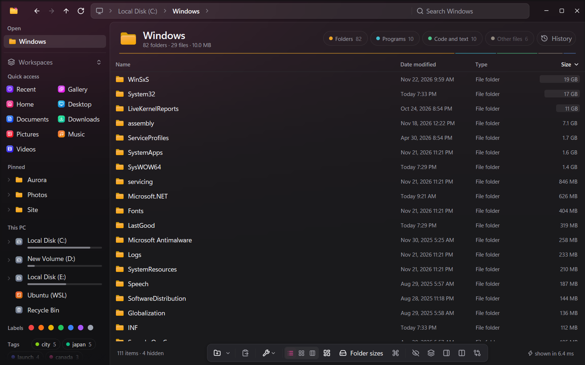</td>
<td width="50%">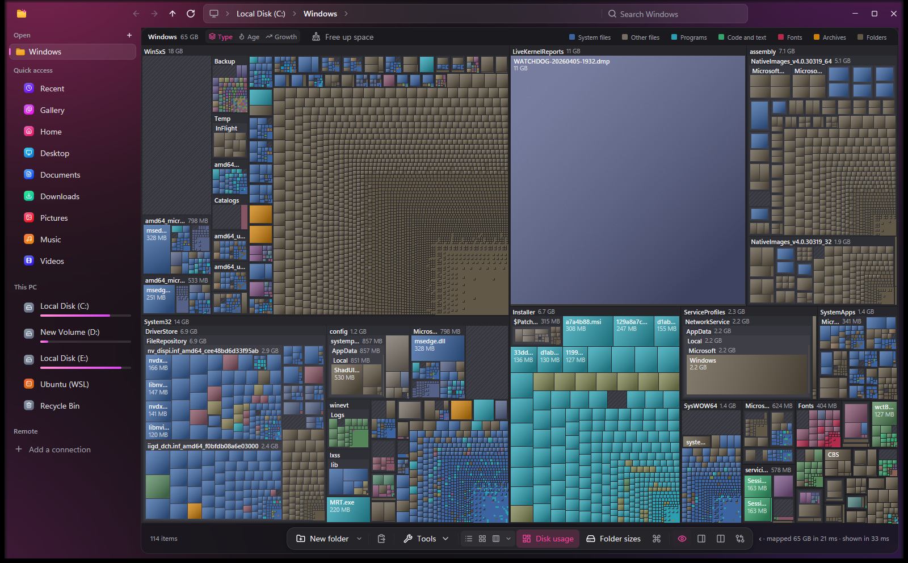</td>
</tr>
<tr>
<td align="center">The size of every folder, in the list</td>
<td align="center"><b>Disk usage</b>: what fills a drive</td>
</tr>
</table>

-   **Instant folders.** One Win32 pass reads every name, size, date and attribute, Rust sorts them in natural order (`img9` before `img10`), and only the rows on screen are drawn.
-   **A size for every folder**, in the list as it opens with instant search on, or one click away with pdu, with a bar showing how each compares with the biggest.
-   **Disk usage map.** A treemap like WizTree's, six levels deep, colored by kind of file, by age, or by what grew in the last day, week or month.
-   **A head on every folder.** What's in it (*6 folders · 15 files · 13 MB*), a chip for each kind of file to show only those, and soft light behind the window in the color of the place you're in.
-   **It answers before you ask.** Rest the pointer on a folder and its row says what's in it: Glint has read it by then, so opening it takes a frame.
-   **List, grid, columns and gallery.** Windows' own thumbnails in five tile sizes, a Columns view (`Ctrl+Shift+9`), **Group by** kind, date, size, type or Git status, and a Gallery of your photos and videos by month.

[More about browsing →](docs/features.md#browsing)

### A menu and a dock that pay attention

-   **The menu starts with the item.** Its picture, name and what is true about it: a download's site, a program's signer (or that it has none), identical copies, the program that has it open, a video's length, a folder's weight.
-   **Suggested, with the reason.** Up to three rows put first for this kind of thing, and for what you did with it before: *Extract here*, *Scan with Microsoft Defender · It came from github.com*, *Run in Windows Sandbox · It isn't signed*. The menu's own rows never move.
-   **Type to find a row**, in submenus too, and `Enter` runs the first. A greyed row says why.
-   **The dock knows the selection.** A next step with one press, **Paste** that says what it holds (*Paste 3 files*), and what the selection weighs: *2 selected · 68 B · 4 lines*, *1 selected · 600 MB · 3 files inside*. It says **Changing now** while the folder is being written to, and when its drive is nearly full.
-   **Nothing leaves the PC, and nothing waits.** Glint looks while the pointer rests, on threads Windows runs in efficiency mode; what isn't known yet isn't said.

[More about the menu and the dock →](docs/features.md#the-menu-and-the-dock)

### Search

<table>
<tr>
<td width="50%">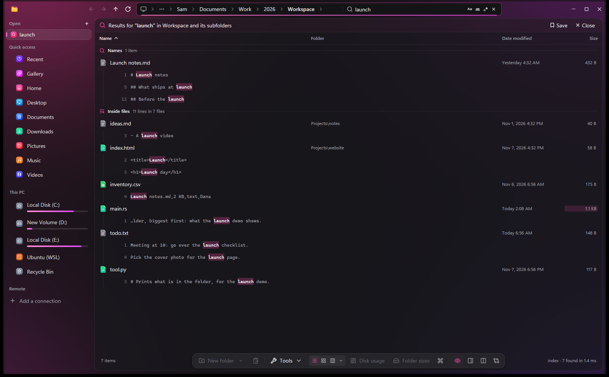</td>
<td width="50%">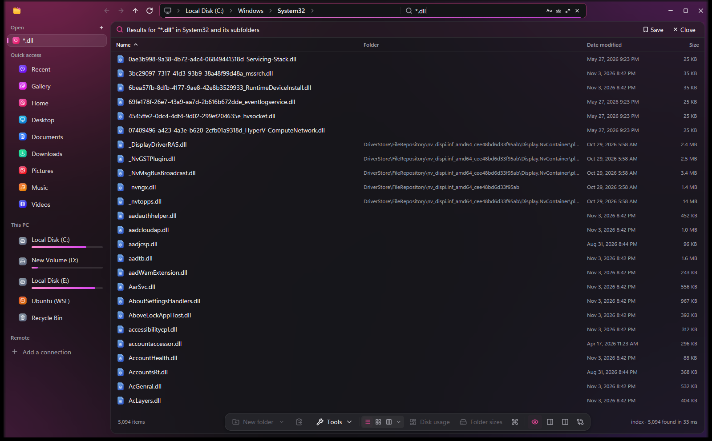</td>
</tr>
<tr>
<td align="center">One search: names, and what the files hold</td>
<td align="center">Instant search over every NTFS drive</td>
</tr>
</table>

-   **One box for names and contents.** Typing filters the folder; `Enter` searches below it, names by the index or fd and contents by ripgrep, in one list.
-   **Instant search**, when you turn it on: an index of every NTFS drive, kept current from the change journal, so names, folder sizes and maps answer from memory in milliseconds ([how it works, and its security model](docs/instant-search.md)).
-   **Filters, or plain words.** `ext:pdf size:>10mb dm:7d`, `taken:2024 camera:canon`, `artist:`, `tag:work`, `git:changed`… or type `pdfs from last week over 5 mb` and Glint shows the filters it read. Typos are forgiven: `reprot` finds *Q3 Report.pdf*.
-   **Inside documents and pictures.** The text in PDFs, Word, Excel, PowerPoint, OpenDocument and EPUB files without Office, and in screenshots and scans through Windows' OCR. **Search inside files instantly** keeps an index of the folders you choose, to answer as you type.
-   **Quick search from anywhere.** `Ctrl+Alt+F` in any app opens a search box over every drive, answered by the index as you type.

[More about search →](docs/features.md#search)

### Tabs, two panes and the grid

<table>
<tr>
<td width="50%">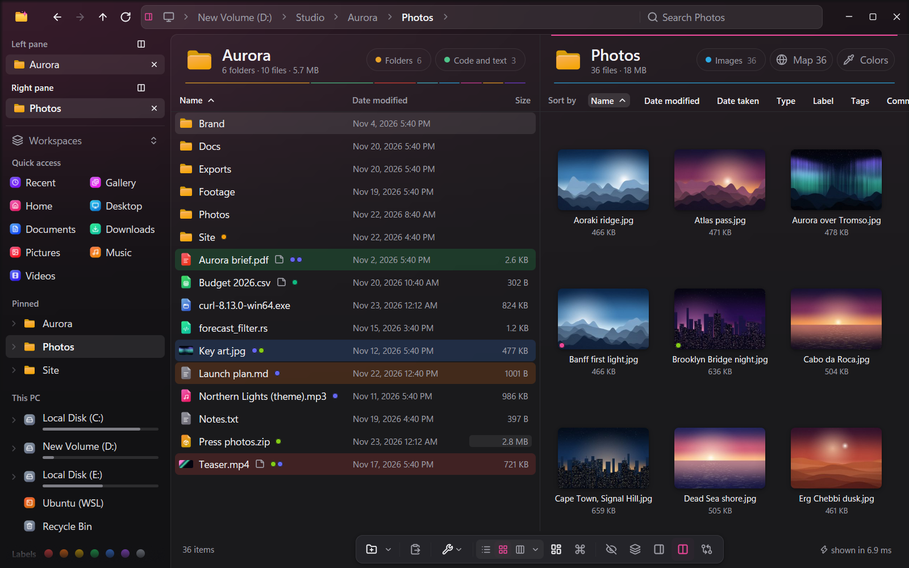</td>
<td width="50%">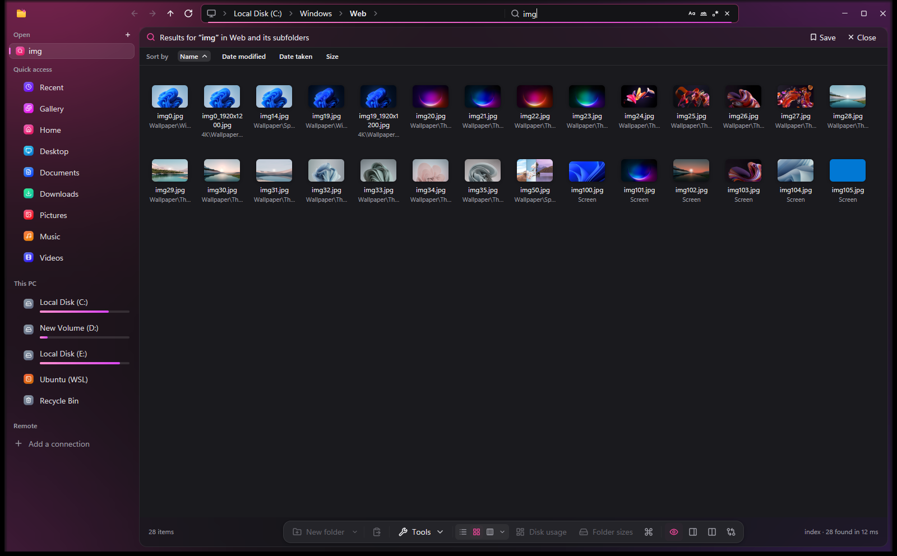</td>
</tr>
<tr>
<td align="center"><b>Ctrl+Shift+D</b>: two panes, each with its tabs</td>
<td align="center"><b>Ctrl+Shift+2</b>: the grid, with Windows' thumbnails</td>
</tr>
</table>

-   **Tabs** in each pane, listed whole in the side rail and back when you start Glint again.
-   **Two panes.** Drag between them, compare them down through every subfolder and by contents, and **Sync**.
-   **Compare two files** (`Ctrl+M`): text side by side with the words that changed marked, code by its structure with Difftastic, pictures with a swipe, an onion skin or a pixel diff, anything else byte by byte.
-   **Thumbnails that never hold up the folder**, from Windows' own cache (30 in 71 ms), and made on several threads when Windows hasn't seen a photo yet.
-   **`Ctrl+K` for everything else.** Every command, the folders you use most (ranked by frecency, like zoxide), paths, and `=` to work out a sum, units and all.

[More about tabs and panes →](docs/features.md#tabs-and-two-panes)

### Previews and Quick Look

<table>
<tr>
<td width="50%">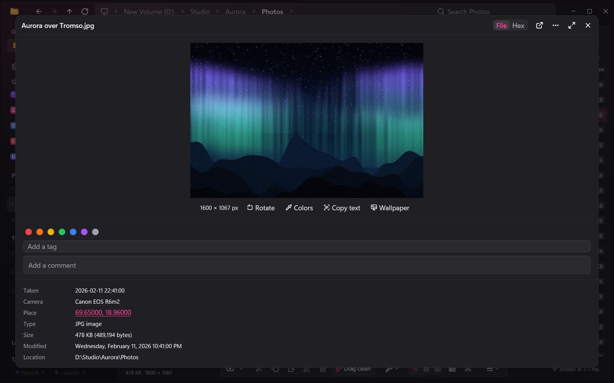</td>
<td width="50%">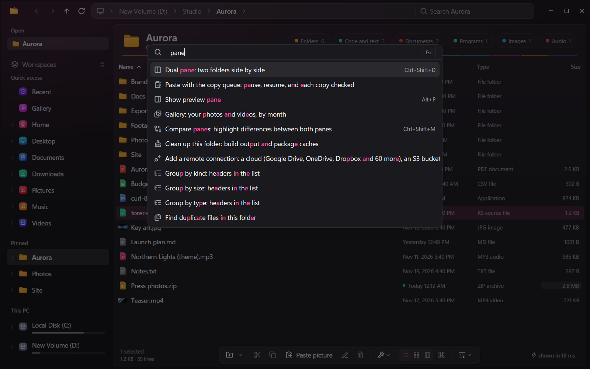</td>
</tr>
<tr>
<td align="center"><b>Space</b>: Quick Look</td>
<td align="center"><b>Ctrl+K</b>: the folders you use, and every command</td>
</tr>
</table>

-   **Code and text** with syntax colors, **Markdown** as GitHub shows it (math and Graphviz diagrams included), and **JSON, YAML and TOML** as trees you can filter with jq.
-   **Tables you can query.** CSV, Excel, OpenDocument and Parquet files and SQLite databases, with SQL that only reads.
-   **Documents without their apps.** Word documents laid out as pages, books and comics (EPUB, Kindle, FB2, CBZ) with Read aloud, Jupyter notebooks, 3D models, emails with their attachments, contacts and calendar invites.
-   **Photos, songs and videos** with where and when they were taken, covers and waveforms, and **Trim** for a video or a recording.
-   **Every file's bytes** in a Hex view, and Windows' own previewers for the rest, as in File Explorer.

[More about previews →](docs/features.md#previews-and-quick-look)

### More to do with files

-   **Media**, with FFmpeg: convert and shrink videos (to fit under 10, 25 or 50 MB, on the PC's own video encoder when it has one), take the sound out, make GIFs, even out loudness, and write **subtitles** from what's said, with whisper.cpp on your PC.
-   **Make smaller.** Videos re-encoded to look the same, smaller photos, PNGs, PDFs and the pictures inside Office files. Nothing that comes out bigger is kept.
-   **PDF tools** ([pdfcpu](https://github.com/pdfcpu/pdfcpu)), **data files of any size** ([DuckDB](https://duckdb.org)), **Convert document** ([pandoc](https://pandoc.org)) and **Convert pictures** ([rimage](https://github.com/vlad-salone/rimage)).
-   **Archives and disk images open like folders.** Zip, 7z, RAR, tar and the rest, ISO, VHDX and WIM images and installers, read-only, with nothing extracted until a file's bytes are needed. Compress to zip, 7z or tar.zst, a zip or a 7z with a password.
-   **Remove personal info** from photos, videos, PDFs and Office files, **Encrypt** with [age](https://age-encryption.org), **Compress in place** with Windows' own compression, and **Batch rename** with a live preview.

[More about media, documents and data →](docs/features.md#media-documents-and-data) · [Archives →](docs/features.md#archives-and-disk-images)

### Tools

<table>
<tr>
<td width="50%">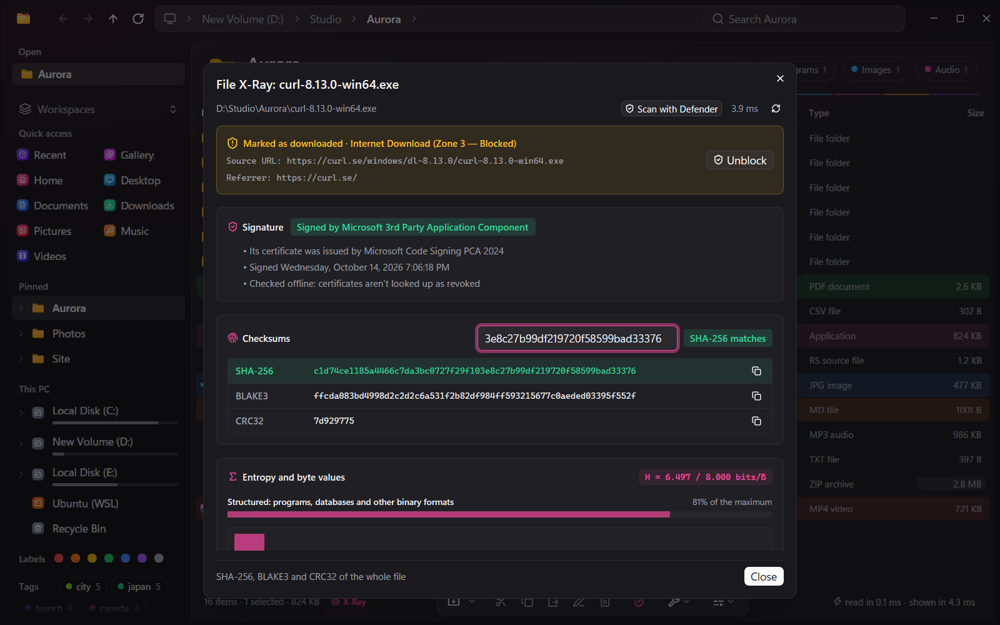</td>
<td width="50%">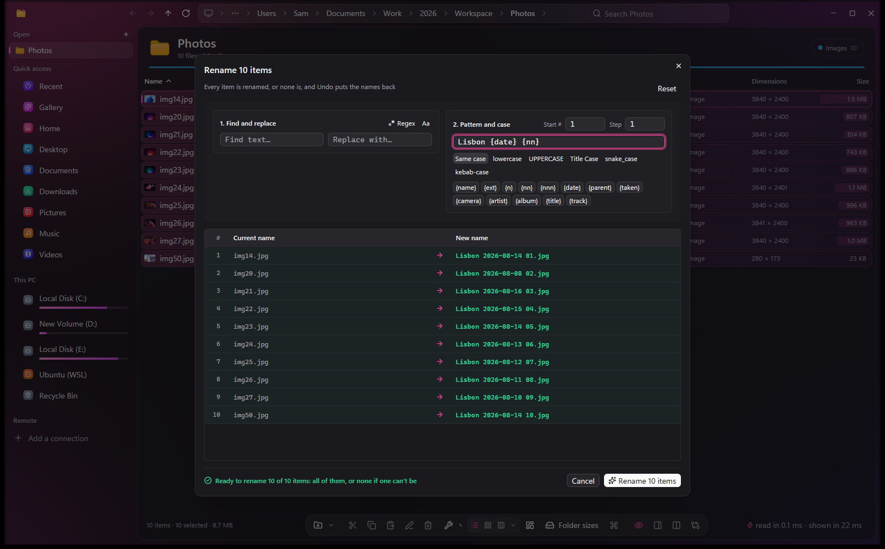</td>
</tr>
<tr>
<td align="center"><b>File X-Ray</b>: check a download against its published SHA-256</td>
<td align="center"><b>F2</b> on several items: rename them all, with a preview</td>
</tr>
</table>

-   **Find duplicates** by their content, then recycle, hard-link or (on ReFS and Dev Drives) clone the extra copies.
-   **Clean up** the build output and package caches of projects you've left alone, empty folders, programs' leftovers, big files, and with Czkawka, look-alike pictures and videos.
-   **What's locking this?** The programs holding a file open, and **End** to close one.
-   **Where did a file go?** 30 days of renames, moves and deletes, read from each drive's change journal.
-   **File X-Ray.** Checksums against a pasted one, who signed a program and hidden streams; scan with Microsoft Defender.
-   **Drive health.** Each drive's temperature, wear and errors, read without administrator rights.

[More about the tools →](docs/features.md#tools)

### Files in other places

-   **Clouds and servers.** Google Drive, OneDrive, Dropbox and 60 more open as folders through [rclone](https://rclone.org), signed in to from Glint; S3 buckets, WebDAV and SFTP servers too, and any of them can show in File Explorer, on demand.
-   **Send and share.** Send a file or a folder to another PC with a ticket (sendme: encrypted end to end, no account), to phones nearby with LocalSend, or share a folder with a phone on your network through a QR code.
-   **Backups.** A folder backed up with restic, encrypted, every day or week; your backups and Windows' restore points show in **Previous versions**.
-   **Folder rules** sort out what lands in Downloads, or keep a folder in sync with a cloud, with Undo.
-   **A copy queue** with pause and resume, where each copy is read back and compared with its original.

[More about remotes, sending and backups →](docs/features.md#files-in-other-places)

### For developers

-   **Git at a glance.** Every file's and folder's status, the branch in the address bar and what changed in a file, read by gitoxide (Git needn't be installed).
-   **A terminal under the files** (`` Ctrl+` ``) that follows the folder you're in: PowerShell, Command Prompt, Nushell, Git Bash or WSL.
-   **Run a project's scripts** (npm, pnpm, Yarn, Bun, just, Cargo, uv), and your own scripts on what's selected.
-   **A repository's card** (onefetch and tokei), and **Open in** VS Code, Cursor, Zed or your terminal.

[More for developers →](docs/features.md#for-developers)

### At home on Windows

-   **Windows' own file engine** for every copy, move, delete and rename, and `Ctrl+Z` takes them back.
-   **Windows' own menu** on `Shift`+right-click, Properties and Open with, and OneDrive's sync marks.
-   **Mica and your accent color**, the Recycle Bin as a place, and the taskbar button's jump list.
-   **Open in Glint** from File Explorer, `Win+E` and folders that open in Glint by default (installer copy), and `Ctrl+Alt+G` to take any file dialog to Glint's folder.
-   **Settings that find themselves.** An Overview of how Glint is set up, suggestions for this PC (index every drive, a drive nearly full, tool updates), and a search box for any setting.

[More about Windows integration →](docs/features.md#at-home-on-windows)

## Compared with File Explorer

| | File Explorer | Glint |
| :--- | :--- | :--- |
| Folder sizes | In Properties or a tooltip | In the list, for every folder |
| What fills a drive | Not shown (Storage settings has categories) | A treemap of any folder, like WizTree's |
| Find a file by name | Windows Search where it indexes, otherwise a walk through every folder | An index of every NTFS drive (opt-in), otherwise fd |
| Search inside files | Indexed places and file types | ripgrep in any folder, with regex; the text in PDFs, Office documents and pictures too |
| Preview | Preview pane | The same previewers, and Glint's own: Markdown, JSON and YAML trees with jq, tables with SQL, Word without Office, books, every file's bytes; Quick Look on `Space` |
| Git | Not shown | Each file's and folder's status, the branch in the address bar, and what changed in a file |
| Compare two folders | Not available | Side by side, down through subfolders and by contents, with Sync |
| Compare two files | Not available (`fc` in a terminal) | Side by side and edited: code by its structure, pictures with a pixel diff, any file byte by byte |
| A search from anywhere | Windows Search in the Start menu | `Ctrl+Alt+F`: every drive's names, answered by the index as you type |
| Tabs and panes | Tabs (Windows 11) | Tabs in each pane, and two panes side by side |
| A terminal | Open in Terminal, in a window of its own | Under the files, following the folder you're in |
| Send files to another PC | Nearby sharing, to Windows PCs close by | A ticket that works from anywhere, encrypted end to end, with no account or size limit |
| Cloud and server storage | OneDrive; WebDAV and FTP as network locations | Google Drive, OneDrive, Dropbox and 60 more clouds, S3, WebDAV and SFTP, opened like folders |
| Duplicate files | Not found | Found by size, then content; recycled, hard-linked or block-cloned |
| Space to free | Disk Cleanup: Windows' own temporary files and caches | Below any folder: build output and package caches, empty folders, leftovers and big files |
| A file in use | *The action can't be completed*, sometimes naming the program | The programs holding it open, and **End** to close one |
| Where did a file go? | Not shown | What was renamed, moved and deleted in the last 30 days, with where it is now |
| Renaming many files | One name for all, numbered (1), (2)… | Patterns, numbering, dates, find and replace, with a preview and Undo |
| Checksums | Not shown (PowerShell's `Get-FileHash`) | SHA-256, BLAKE3 and CRC32 in the File X-Ray, compared with one you paste |
| Timing | Not shown | In the status bar, for every folder and search |

## AI agents

AI agents that speak the [Model Context Protocol](https://modelcontextprotocol.io/) (Claude Code and Claude Desktop, VS Code's Copilot, Cursor and others) can use Glint's engines. `Glint.exe mcp` is the server: the agent starts it, and it answers on its standard input and output with 13 tools. Nine only read; four change files, and only after you allow each in a Windows dialog naming exactly what will happen.

| Tool | What it answers | How |
| :--- | :--- | :--- |
| `search_files` | Files and folders by name on every drive, by the search box's query (`budget ext:xlsx dm:30d`), the best matches first | The instant search index in milliseconds, fd where it doesn't reach |
| `folder_sizes` | A folder's total and each folder in it | The index, otherwise pdu |
| `largest_files` | The biggest files anywhere below a folder | The index's disk-usage map |
| `recent_changes` | What was renamed, moved, deleted or recycled lately, and where each item went | The index's 30 days of changes |
| `search_text` | Lines of text files that contain a pattern | ripgrep |
| `search_content` | Files holding every word given, best first: text, code, PDFs, Office documents and the text in pictures | The index of what files hold, where it's on |
| `search_code` | Code matching an ast-grep pattern, such as `$X.unwrap()` | ast-grep, once installed |
| `query_data` | One SQL query that only reads, over a CSV, JSON lines, Parquet, Excel or SQLite file | SQLite, or DuckDB when it's installed |
| `compare_files` | What differs between two files | Difftastic by structure when it's installed, else line by line |
| `move_items`, `rename_item`, `create_folder`, `recycle_items` | Moves, renames, new folders and the Recycle Bin, asked first, and listed in **Settings → AI agents** with Undo | Windows' file engine |

Agents that show apps (MCP Apps) draw `folder_sizes` and `largest_files` as a map of the folder, and Glint adds itself to Windows' own agent registry where Windows has one.

**Settings → AI agents** has each agent's setup to copy: `claude mcp add glint -- "C:\…\Glint.exe" mcp` for Claude Code, `code --add-mcp` for VS Code, and the `mcpServers` entry for Claude Desktop, Cursor and the like. Once told, the agent starts Glint for itself and sees the names and text it asks for; Glint tells it that what files are named and contain is data, not instructions. Measured here, through the server as an agent asks: `kernel32.dll` on every drive in 8 ms, `C:\Windows`'s folder sizes in 1 ms, the biggest files on `C:\` in 41 ms.

## Keyboard shortcuts

`F1` (or `Ctrl+/`) shows every shortcut on one sheet, and `Ctrl+,` opens Settings. The ones to know:

| Key | Action |
| :--- | :--- |
| `Enter` · `Space` | Open (an archive opens like a folder) · Quick Look |
| `Ctrl+K` | Command palette: folders you use, paths and every command |
| `Ctrl+F` | Search: typing filters the folder, `Enter` searches below it |
| `Ctrl+Alt+F` | Quick search over every drive, from any app |
| `Ctrl+T` · `Ctrl+W` · `Ctrl+Shift+T` | New tab · close it · bring the last one back |
| `Ctrl+Shift+D` · `F6` | Two panes · switch between them |
| `` Ctrl+` `` | The terminal under the files |
| `F2` | Rename (several selected: batch rename) |
| `Ctrl+Z` | Undo the last copy, move, rename, delete or new item |

<details>
<summary><b>Every shortcut</b></summary>

#### Files

| Key | Action |
| :--- | :--- |
| `Enter` | Open the selection (an archive opens like a folder) |
| `Space` | Quick Look: the focused item full size. Arrows move through the folder, `PageUp`/`PageDown` scroll it; `Space` or `Esc` closes |
| `Ctrl+K` / `Ctrl+P` | Command palette: folders you use, paths and every command (`=` and a sum works it out) |
| `Shift`+right-click | Windows' own context menu (also **Show more options** in Glint's) |
| `Tab` in the search box | Put in the filters the plain words stand for (`pdfs over 5 mb` → `ext:pdf size:>5mb`) |
| `Ctrl+T` / `Ctrl+W` | New tab on this folder / close the tab |
| `Ctrl+Tab` / `Ctrl+Shift+Tab` · `Ctrl+1`…`Ctrl+9` | Next / previous tab · go to a tab (`Ctrl+9`: the last one) |
| `Ctrl+Shift+T` | Reopen the last closed tab |
| Middle-click a folder / `Ctrl+Enter` | Open it in a new tab |
| `Ctrl+N` | A new window on the folder shown |
| `Ctrl+Shift+D` | Dual pane on or off |
| `Ctrl+Shift+M` | Compare the two panes |
| `Ctrl+Shift+U` | Swap the panes |
| `Ctrl+M` | Compare two selected files (or one selected in each pane) |
| `F6` | Switch to the other pane |
| `` Ctrl+` `` | Show or hide the terminal under the files (the first one opens in the folder shown) |
| `Alt+Left` / `Backspace` / mouse button 4 · `Alt+Right` / mouse button 5 · `Alt+Up` | Back · Forward · Up |
| `Ctrl+L` / `Alt+D` / `F4` | Type a path in the address bar |
| `Ctrl+F` / `Ctrl+E` / `F3` | Search: typing filters (and searches subfolders, where instant search covers them), `Enter` searches subfolders, `Esc` clears |
| `Ctrl+Shift+F` | Search this folder and below: names, and inside the files |
| `Ctrl+Shift+2` / `Ctrl+Shift+6` / `Ctrl+Shift+9` | Grid view (thumbnails) / list view / columns view |
| `Ctrl+=` / `Ctrl+-` · `Ctrl`+wheel | In the grid: bigger / smaller tiles (`Ctrl+0`: medium) |
| `Ctrl`+wheel · pinch | Zoom the folder's layout: in from the list to the grid's smallest tiles and on to bigger ones, out the same way back |
| `Arrows`, `Home`, `End`, `PageUp/Down` | Move: in the grid, `Left` and `Right` too (`Shift` extends the selection, `Ctrl` moves without selecting) |
| `Ctrl+Space` | Add the focused item to the selection, or take it out |
| Letters | Jump to the next name starting with them |
| `Ctrl+A` | Select all |
| `Ctrl+C` / `Ctrl+X` / `Ctrl+V` | Copy / cut / paste (works with File Explorer too; a copied picture or text pastes as a new file) |
| `Ctrl+Shift+C` | Copy path |
| `F2` | Rename (several selected: batch rename) |
| `Ctrl+Shift+R` | Batch rename the selection, or every item in the folder |
| `Delete` / `Shift+Delete` | Move to the Recycle Bin / delete permanently (in the Recycle Bin, `Delete` deletes for good, once asked) |
| `Ctrl+Z` | Undo the last copy, move, rename, delete, new item or batch rename |
| `Ctrl+Shift+N` | New folder |
| `Alt+Enter` | Properties |
| `F5` / `Ctrl+R` | Refresh |
| `Ctrl+H` | Show or hide hidden items |
| `Ctrl+B` | Flat view: every file in this folder and its subfolders as one list (with a Folder column), until you press it again |
| `Alt+P` | Show or hide the preview pane |

#### Disk usage map

| Key | Action |
| :--- | :--- |
| Click | Go into a folder; on a file, go to its folder with the file selected |
| `Backspace` / `Alt+Up` | Back out to the folder above |
| `Alt+Left` · `Alt+Right` | Back · Forward, as in the list |
| `Enter` / double-click | Open the selected item (a folder is mapped) |
| `Space` | Quick Look the selected item |
| Right-click | The item's menu, as in the list |
| `F5` | Map the folder again (measures it again when pdu drew it) |
| `T` | Color by kind of file, by age, or by what grew |

#### The search box

| Key | Action |
| :--- | :--- |
| `Enter` | Search below the folder: names, and inside the files |
| `Tab` | Take the filters read from plain words ("pdfs from last week") |
| `Arrow Down` | On to the results |
| `Alt+C` / `Alt+W` / `Alt+R` | Match case / whole words / regular expression, inside files |
| `Esc` | Clear the search and go back to the folder |

#### From any app

| Key | Action |
| :--- | :--- |
| `Ctrl+Alt+F` | Quick search over every drive (**Settings → Quick search** picks another shortcut, or none) |
| `Ctrl+Alt+G` | In an Open or Save dialog: go to the folder shown in Glint |

</details>

## How it works

Glint is Rust from end to end. [GPUI](https://www.gpui.rs/), the UI framework of the Zed editor, draws the window, and the [windows](https://github.com/microsoft/windows-rs) crate talks to Windows itself. There is no web view, no HTML and no JavaScript engine in the app: until 0.10 its interface was a web page in WebView2 (Tauri and React). Glint builds with a patched copy of GPUI, in `vendor/` ([docs/gpui/VENDOR.md](docs/gpui/VENDOR.md)).

| Crate | What it is |
| :--- | :--- |
| [`crates/glint`](crates/glint) | `Glint.exe`: a thin `main.rs`, its resources, the bundled tools and the installer |
| [`crates/glint-ui`](crates/glint-ui) | Everything on screen, on GPUI |
| [`crates/glint-core`](crates/glint-core) | The engine, with no window: files, search, archives, media, clouds, tools and the MCP server |
| [`crates/glint-model`](crates/glint-model) | Pure logic: entries, sorting and grouping, search terms, paths, the saved state, words |
| [`crates/shadui-index`](crates/shadui-index) | The instant search service: each NTFS drive's Master File Table and USN journal, for name search, folder sizes and disk-usage maps |

<details>
<summary><b>Under the hood, part by part</b></summary>

-   **Folders**: one `FindFirstFileExW` pass (basic info, large fetch) gets every name, size, date and attribute at once. Rust sorts them in the window's own process, and the list draws only the rows on screen.
-   **Name search**: the instant-search service when it covers the folder, otherwise fd, with results streamed into the list as they arrive.
-   **Folder sizes**: the index's per-folder totals, otherwise pdu. It took over from dust, giving the same totals 14–30% faster: the subfolders of `C:\Windows` are sized in 4.9 s instead of 6.9 s, and its map is measured in 4.7 s instead of 6.7 s (warm cache, the median of 5).
-   **Thumbnails**: Windows' thumbnail cache through `IShellItemImageFactory` (thumbnails only, from the cache only: about a millisecond each), on worker threads that are each a COM apartment of their own. What the cache doesn't have is made by the file type's thumbnail handler: Windows' photo provider runs on Glint's own threads with `IThumbnailCache` and `WTS_EXTRACTINPROC` (220 a second with 8 threads, where the isolated process Windows uses for other handlers makes about 50 however many ask), and Windows caches each one as if Explorer had made it. Requests wait in their tab's queue, shared between panes showing the same file, and are dropped when the tiles asking for them scroll away. Each tile asks at its size in screen pixels; when the cache answers with a smaller size it has (it keeps 16 to 2,560 px versions), the thumbnail is made at the size asked, and the smaller one is the answer only for online-only files or when making fails. Each answer reaches the window as pixels, and both sides keep the latest ones in memory.
-   **Disk usage map**: one request to the index returns the biggest files and folders six levels down (folders are walked biggest first, so nothing too small to draw is looked at), or pdu's JSON tree when the index doesn't have the folder. Either way it goes straight to the window and is drawn as a squarified treemap. For all of C: here (464 GB, 2.9 million MFT records) the service answers in 19 ms for the 20,000 biggest items six levels down, and the map is on screen 53 ms after the click; on a synthetic index of 2.86 million records it takes 9–17 ms, whether the map goes 4 or 32 levels down.
-   **Archives**: [zip](https://github.com/zip-rs/zip2) reads a zip's central directory, served from memory in one read of the file's end (13 ms for 50,000 entries, where reading it from the file takes 150 ms), and [sevenz-rust2](https://github.com/hasenbanck/sevenz-rust2) reads a 7z's header, once Glint has checked how big it unpacks to. Tars and cabinets are read by Glint's own readers, and gzip, xz, bzip2, Zstandard, LZ4 and LZX by pure Rust decoders. RAR is read with RARLAB's UnRAR (C++), which only ever tests files and hands their bytes over; everything else is pure Rust. The entries become a tree of folders kept in memory, with safe Windows names and folder totals, and each listing reaches the list the same way as a folder's. A file is extracted only when it's previewed, opened or copied, cut off at its declared size, and copies out go through `IFileOperation` from a staging folder. See [docs/archives.md](docs/archives.md).
-   **Inside files**: ripgrep's JSON output, streamed in batches, each file it names read once for its size and date so it is a row like any other. Documents are read by worker processes of Glint's own (pdf-extract for PDFs, their XML for the rest), each held to 1 GB and 30 seconds.
-   **Git**: [gitoxide](https://github.com/GitoxideLabs/gitoxide) reads the repository inside Glint: status for the folder on screen and below it, stopped at 4 s, cached per folder and refreshed by one watcher per repository. Nothing is written to it, and a repository whose settings would run programs for status waits until you trust it.
-   **Previews of its own**: Markdown through [comrak](https://github.com/kivikakk/comrak), with the HTML in it cut down to what GitHub allows and never added to the page as HTML; JSON, YAML and TOML read with [jaq](https://github.com/01mf02/jaq)'s readers by a worker process of Glint's own, and jq filters run in jaq, both held to 1 GB and 10 seconds; workbooks through [calamine](https://github.com/tafia/calamine) and Parquet through the [parquet](https://github.com/apache/arrow-rs) crate; Query in SQLite, the file's table loaded into memory or the database opened read-only.
-   **Remote folders**: Glint's own S3 (signed requests) and WebDAV clients, over HTTPS whose certificates Windows checks; SFTP through Windows' own OpenSSH `sftp.exe`, a password handed over by Glint itself when it asks (never on a command line), and host keys checked against `~/.ssh/known_hosts` and a list of Glint's. Clouds through [rclone](https://rclone.org): one `rclone rcd` (its remote control) on 127.0.0.1, on a port and with a password of its own at each start, in a Windows job that ends it with Glint; sign-ins are rclone's own (`rclone authorize`, its page opened by Glint), kept in rclone's configuration. Listings reach the list the same way as a folder's. See [docs/remote.md](docs/remote.md).
-   **Sending and sharing**: [sendme](https://github.com/n0-computer/sendme) and [dufs](https://github.com/sigoden/dufs) run as programs of their own in a Windows job that ends them with Glint; dufs listens only at this PC's address on the network, on a free port, behind a random key in the link.
-   **Folder rules**: notify watches each rule's folder; every 500 ms Glint looks again at the files that came in, and acts on one once its size has held for two seconds and it opens for reading. Rules that wait on age look again every hour, and every step goes to a log kept with Glint's data, which Undo works from. A sync rule runs `rclone copy`, `sync` or `bisync` with its filters, reading rclone's JSON log for what it did.
-   **Previews from Windows**: the file type's preview handler (`IPreviewHandler`), the one File Explorer uses, created out of process (Office's run in Word, Excel and PowerPoint; others in `prevhost.exe`) and drawing in a window over the preview pane. A thread of Glint's with its own COM apartment owns that window and talks to the handler, so the UI never waits on one, and a watchdog cancels a call that hangs. GPUI's window is a DirectComposition window that a handler's child window can't draw over, so the handler is hosted in an owned pop-up kept over the pane's rectangle, and Glint hides it while a menu, dialog or toast covers the pane.
-   **Comparing folders**: Rust walks both trees side by side and answers with each top-level item's status and what Sync copies each way; files compare by date and size, or byte for byte when asked, reading both until they differ.
-   **Quick search**: `RegisterHotKey` on a thread of its own, and a second, borderless window of the app that searches as Files does.
-   **File operations**: Windows' `IFileOperation` (the engine Explorer uses), the clipboard formats Explorer reads, and OLE drag and drop.
-   **Live folders**: [notify](https://github.com/notify-rs/notify) watches the folders on screen (one per pane).
-   **Terminal**: [portable-pty](https://github.com/wezterm/wezterm) runs each shell in a Windows pseudo console (ConPTY), and a thread of its own reads the output into the emulator of [alacritty_terminal](https://github.com/alacritty/alacritty), whose grid the window draws. Each shell is started so its prompt says where it is, as Windows Terminal reads it (OSC 9;9): PowerShell's own prompt is wrapped, and Command Prompt's `PROMPT` and Git Bash's `PROMPT_COMMAND` are set; Nushell says it by itself. Rust picks those (and OSC 7) out of the output, and the pane goes there. The other way, Glint types a `cd` for the shell, only while it sits at its prompt with nothing typed.
-   **Tabs and panes**: every tab keeps its own state, and its name searches and pdu runs go in a lane of their own in Rust, so tabs and panes never stop each other's work.
-   **Opening folders from Windows**: per-user shell verbs under `HKEY_CURRENT_USER\Software\Classes` (no administrator rights) run `Glint.exe "%V"`, and a later launch hands its folders to the window that's open (a named mutex decides which copy is first; the later one sends its folders to the first's hidden message window as `WM_COPYDATA` and ends). What Glint can't open goes back to File Explorer before any window shows. See [docs/explorer-integration.md](docs/explorer-integration.md).
-   **Instant search**: a Windows service in Rust ([`crates/shadui-index`](crates/shadui-index), built as `shadui-index.exe`) that reads each NTFS volume's Master File Table in one sequential pass and follows its USN journal. See [docs/instant-search.md](docs/instant-search.md).

</details>

The tools that ship inside Glint:

| Tool | Version | Used for | License |
| :--- | :--- | :--- | :--- |
| [ripgrep](https://github.com/BurntSushi/ripgrep) | 15.2.0 | Searching inside files | MIT or Unlicense |
| [fd](https://github.com/sharkdp/fd) | 10.5.2 | Finding files by name | MIT or Apache-2.0 |
| [pdu](https://github.com/KSXGitHub/parallel-disk-usage) | 0.24.0 | Folder sizes and disk-usage maps (its engine, built into `Glint.exe`) | Apache-2.0 |

The others, from FFmpeg to rclone, install with one click when a feature needs them: [docs/tools.md](docs/tools.md).

## Build from source

You need Windows 10 or 11 and [Rust](https://www.rust-lang.org/tools/install) (stable, MSVC toolchain, with the Visual Studio C++ build tools). [Node.js](https://nodejs.org/) 22 or newer is only for the release scripts (they use nothing from npm), and [NSIS](https://nsis.sourceforge.io/) 3 only to pack an installer.

```bash
git clone https://github.com/shadijhade/glint.git
cd glint
cargo run -p glint
```

The first build compiles GPUI and all the other dependencies, which takes several minutes; later ones take seconds. Everything builds into `target\ui` (set in `.cargo/config.toml`). `cargo build --release -p glint -p shadui-index` makes `Glint.exe` and the instant search service in `target\ui\release`, and `npm run installer` packs them into `Glint-setup.exe`. The Windows x64 builds of ripgrep, fd and pdu ship in `crates/glint/binaries/`, and `crates/glint/build.rs` puts them next to the built `Glint.exe`. `npm run release`, or the release workflow when a version tag is pushed, builds a release on top of that: the update package the app installs, code signing, and the winget and Scoop manifests ([docs/releasing.md](docs/releasing.md)).

The checks to run before you commit:

```bash
cargo test --workspace
cargo clippy --workspace --all-targets -- -D warnings
npm run test:signing
```

`powershell -STA -File tests\e2e\run.ps1` drives a debug `Glint.exe` the way a person does, with real clicks and keys ([tests/e2e/README.md](tests/e2e/README.md)). A release build hands its folders to an installed Glint that's running, so try one under a name and identifier of its own ([how](docs/explorer-integration.md#trying-it-without-touching-your-glint)). The index's tests (MFT record parsing, queries, disk-usage maps, folder totals under random changes, snapshots, the wire format, and a real named-pipe round trip with its ACL) run without administrator rights.

## Roadmap

-   [ ] Code-signed installers (the SignPath Foundation invited a new application once Glint is better known)
-   [x] 0.13: a right-click menu and a dock that know what you picked, and Settings reworked
-   [x] 0.12: smaller and quieter, with what the move to a native window had stopped running again
-   [x] 0.11: a window of its own (one bar, tabs in a rail, a dock) and one search for names and contents
-   [x] 0.10: a native app in Rust and GPUI, with no web view

<details>
<summary><b>Shipped before 0.10</b></summary>

-   [x] Tabs and a dual-pane view
-   [x] A disk-usage map (treemap) from the index
-   [x] Thumbnails and a grid view
-   [x] Auto-update, with signed update packages
-   [x] Scoop and winget packages
-   [x] [The Microsoft Store](https://apps.microsoft.com/detail/9NQLRJ3HF1C9), signed by Microsoft
-   [x] Zip, 7z, RAR, cabinet and tar archives (compressed too) opened like folders, with their passwords
-   [x] Undo (`Ctrl+Z`) for copies, moves, renames, deletes and new items
-   [x] Quick search from anywhere (`Ctrl+Alt+F`), the tray, and starting with Windows
-   [x] Word, Excel, PowerPoint and font previews through Windows' previewers
-   [x] Comparing folders down through subfolders and by contents, with Sync
-   [x] A terminal under the files that follows the folder shown
-   [x] The Recycle Bin as a place: restore with Undo, delete for good, empty
-   [x] Git status, the branch and what changed, in every folder of a repository
-   [x] Previews of Markdown, JSON and YAML trees with jq, workbooks and Parquet with SQL, and every file's bytes
-   [x] Searching inside PDFs and Office documents
-   [x] Clean up, and duplicates cloned on ReFS and Dev Drives
-   [x] Sending files to another PC, sharing a folder with a phone, and S3, WebDAV and SFTP folders
-   [x] Folder rules
-   [x] Windows 11's Mica and your accent color, Windows' own context menu, marquee selection
-   [x] Plain words read as filters, and name searches ranked across every drive
-   [x] An MCP server, so AI agents can use Glint's instant search
-   [x] Previous versions, from Windows' shadow copies
-   [x] Remotes in File Explorer, on demand
-   [x] Search inside files from an index, and tags

</details>

Missing something? [Open an issue](https://github.com/shadijhade/glint/issues/new/choose). If Glint saves you time, a star helps other people find it.

## Contributing

Bug reports, ideas and pull requests are welcome. [CONTRIBUTING.md](CONTRIBUTING.md) covers the setup, where things are in the code, and the checks. To report a security issue, see [SECURITY.md](SECURITY.md).

## Acknowledgments

-   [fd](https://github.com/sharkdp/fd), [pdu](https://github.com/KSXGitHub/parallel-disk-usage) and [ripgrep](https://github.com/BurntSushi/ripgrep), which do the heavy lifting and ship inside the app.
-   [GPUI](https://www.gpui.rs/) and [gpui-component](https://github.com/longbridge/gpui-kit), which draw Glint's window.
-   The tools Glint installs when a feature needs them, from FFmpeg and rclone to Czkawka, Difftastic and restic ([docs/tools.md](docs/tools.md)), and the crates it's built from ([THIRD_PARTY_CRATES.md](THIRD_PARTY_CRATES.md)).
-   [Everything](https://www.voidtools.com/) and [WizTree](https://diskanalyzer.com/), which showed that reading the MFT directly is the fast way, and [goz](https://github.com/mustafaahci/goz) and [everyfind](https://github.com/kyo5uke/everyfind), whose ideas the index service borrows.
-   [zoxide](https://github.com/ajeetdsouza/zoxide) for frecency, and macOS for Quick Look.

## License

MIT, see [LICENSE](LICENSE). The bundled ripgrep and fd, pdu's engine inside Glint, and the crates that read archives, keep their own licenses; see [THIRD_PARTY_LICENSES.md](THIRD_PARTY_LICENSES.md), and [THIRD_PARTY_CRATES.md](THIRD_PARTY_CRATES.md) for every crate in the app.
