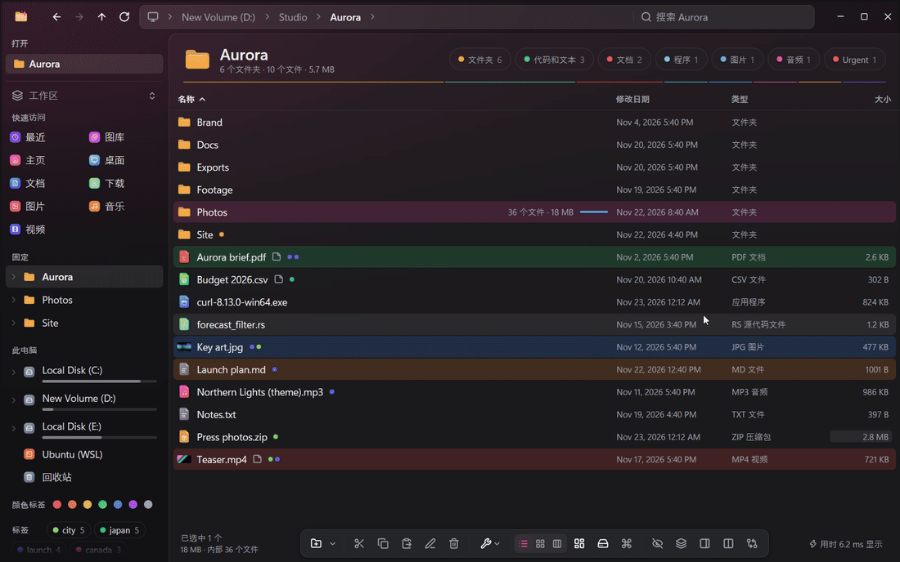

# Glint

**不让你等待的 Windows 文件管理器。**

文件夹在毫秒内打开，每个文件夹都显示大小，任何磁盘上的任何文件边输入边出现。 
用 Rust 编写的原生 Windows 应用。免费、开源，不需要账号。

**[下载安装程序](https://github.com/shadijhade/glint/releases/latest/download/Glint-setup.exe)** · [Microsoft Store](https://apps.microsoft.com/detail/9NQLRJ3HF1C9) · [官网](https://glint.rafd.tech/) · [English](README.md)

> 这是一份简要的中文介绍，完整的说明、基准测试和全部快捷键见 [英文 README](README.md)。从 0.18 起，Glint 的界面跟随 Windows 的显示语言显示中文（由 Helius 翻译），中文文件名、中文搜索和中文输入法也都可以正常使用。

## 为什么用 Glint

-   **文件夹毫秒级打开。** System32 的 5,097 个项目在按下回车 12 毫秒后显示完毕，10 万个文件的文件夹只要 47 毫秒。Glint 本身从启动到显示你的文件夹大约四分之一秒。
-   **每个文件夹都显示大小。** 资源管理器把文件夹大小藏在"属性"里，Glint 在打开文件夹时就把它列出来，还能把任何文件夹画成一张占用空间的地图（类似 WizTree）。
-   **任何磁盘上的任何文件，边输入边找到。** 打开"即时搜索"后，一个小服务会像 Everything 那样读取每个 NTFS 磁盘的主文件表，并跟踪之后的每一次变化：在三个磁盘、300 万个文件名里找出所有 `kernel32.dll` 只需 7.7 毫秒。
-   **一个搜索框，同时搜文件名和文件内容。** ripgrep 在同一个搜索框里读取文件内容，PDF、Office 文档和图片里的文字也能搜到。
-   **几乎所有文件都能预览。** 按 `空格` 全尺寸查看：代码、Markdown、PDF、不装 Office 也能看的 Word 文档、可以用 SQL 查询的表格和数据库、视频，以及任何文件的字节。
-   **标签页、双窗格、终端和 Git。** 每个窗格有自己的标签页，两个文件夹可以逐层比较和同步，文件列表下方的终端跟随当前文件夹，每个文件都显示 Git 状态。
-   **仍然是 Windows。** 复制、移动和删除使用 Windows 自己的文件引擎，有它的进度、"替换或跳过"、回收站和 UAC。剪贴板、拖放和 Windows 的右键菜单与资源管理器及其他程序互通。
-   **AI 助手也能用。** 通过内置的 [MCP 服务器](README.md#ai-agents)，Claude、Copilot、Cursor 等助手可以在毫秒内查找任何磁盘上的文件、统计文件夹大小、搜索文件内容。

## 颜色标签、标签和注释（0.17）

每个文件和文件夹都可以有一个**颜色标签**（一个带名字的颜色，表示状态）、若干**标签**和一段**注释**，用法和 XYplorer 一样（[#8](https://github.com/shadijhade/glint/issues/8)）。

-   **三列。** 颜色标签、标签、注释三列可以显示、隐藏和排序，**分组方式 → 颜色标签** 按颜色标签分组。有颜色标签的行会染上它的颜色，有注释的行带一个小便签图标。
-   **一键操作。** `Alt+1`…`Alt+9` 给选中的项目设置颜色标签，`Alt+0` 取消，`Alt+T` 编辑标签，`Alt+N` 编辑注释。右键菜单里有一排颜色标签的色点，每一步都可以用 `Ctrl+Z` 撤销。
-   **颜色标签由你定义。** 在 **设置 → 文件 → 颜色标签** 里改名、换颜色、添加和调整顺序，可以直接用中文名。
-   **立刻找到。** `label:重要`、`tag:工作`、`comment:周五`、`has:comment`，`!` 表示"非"。在当前文件夹里边输入边筛选，在即时搜索里同样有效。
-   **不用切换输入法。** 中文输入法打出的全角 `：`、`；`、`，`、`！` 可以直接用在筛选条件里（`label：重要`、`tag：工作，报告`）；标签之间可以用 `，` 或 `、` 分隔；颜色标签还可以用颜色的中文名或英文名来找：`label:红色` 能找到名为 Red 的颜色标签，`label:red` 能找到名为"红色"的颜色标签。
-   **跟着文件走。** 在 NTFS 和 ReFS 上，这些信息保存在文件自身的数据流里，无论用什么程序重命名、移动或复制，它们都不会丢，PowerShell 也能读写。在 exFAT、存储卡和部分 NAS 上，它们保存在文件旁边隐藏的 `.glint-marks` 文件里。详见 [docs/marks.md](docs/marks.md)（英文）。
-   **从 XYplorer 迁移。** Glint 会自己找到 XYplorer 的 `tag.dat`，提示**一键导入**（也可以先看预览），中文名称原样保留，整个导入可以一次撤销。两个软件同时使用时，Glint 可以持续跟随 XYplorer 的变化，并且只读取、从不改动 XYplorer 的文件；也可以导出成 XYplorer `tagload` 能读取的格式。

## 合适的时候给出建议

大多数人从不打开设置页，所以 Glint 会在用得上的时候，用一条带按钮的通知把值得打开的功能送到你面前：连续重命名三个文件时提供批量重命名，长时间复制之后提供复制队列，撤销删除之后提供"删除前先询问"，打开一个满是照片的文件夹时提供把它加入图库。一次只出现一条，每次运行最多几条，每条都有"不再建议"和撤销；**设置 → 概览** 里可以看到全部建议，也可以把它关掉。

## 安装

| 方式 | 说明 |
| :--- | :--- |
| **[Microsoft Store](https://apps.microsoft.com/detail/9NQLRJ3HF1C9)** | 由 Microsoft 签名，安装时没有警告，由商店保持更新。 |
| **[安装程序](https://github.com/shadijhade/glint/releases/latest/download/Glint-setup.exe)** | 几秒钟装好，不需要管理员权限，自带 ripgrep 和 fd，自动更新。 |
| **winget** | `winget install shadijhade.Glint` |
| **[Scoop](https://scoop.sh/)** | `scoop bucket add shadijhade https://github.com/shadijhade/scoop-bucket`，然后 `scoop install shadijhade/glint` |

需要 64 位的 Windows 10 或 11，不需要 WebView2 或其他运行库。

## 常用快捷键

`F1`（或 `Ctrl+/`）显示全部快捷键，`Ctrl+,` 打开设置。

| 按键 | 作用 |
| :--- | :--- |
| `Enter` · `空格` | 打开（压缩包像文件夹一样打开）· 快速预览 |
| `Ctrl+K` | 命令面板：常用文件夹、路径和所有命令 |
| `Ctrl+F` | 搜索：输入即筛选当前文件夹，`Enter` 搜索子文件夹 |
| `Ctrl+Alt+F` | 在任何程序里呼出，搜索所有磁盘 |
| `Ctrl+T` · `Ctrl+W` · `Ctrl+Shift+T` | 新建标签页 · 关闭 · 恢复刚关闭的 |
| `Ctrl+Shift+D` · `F6` | 双窗格 · 在两个窗格之间切换 |
| `F2` | 重命名（选中多个时为批量重命名） |
| `Ctrl+Z` | 撤销上一次复制、移动、重命名、删除或新建 |
| `Alt+1`…`Alt+9` · `Alt+T` · `Alt+N` | 设置颜色标签 · 编辑标签 · 编辑注释 |

## 还没有做到的

-   中文文件名目前按字符编码排序，还不是中文版资源管理器的拼音顺序；也还不能用拼音首字母搜索中文文件名。

如果这些对你很重要，或者你遇到了问题，欢迎在 [Issues](https://github.com/shadijhade/glint/issues) 里用中文告诉我。

## 许可

[MIT](LICENSE)
