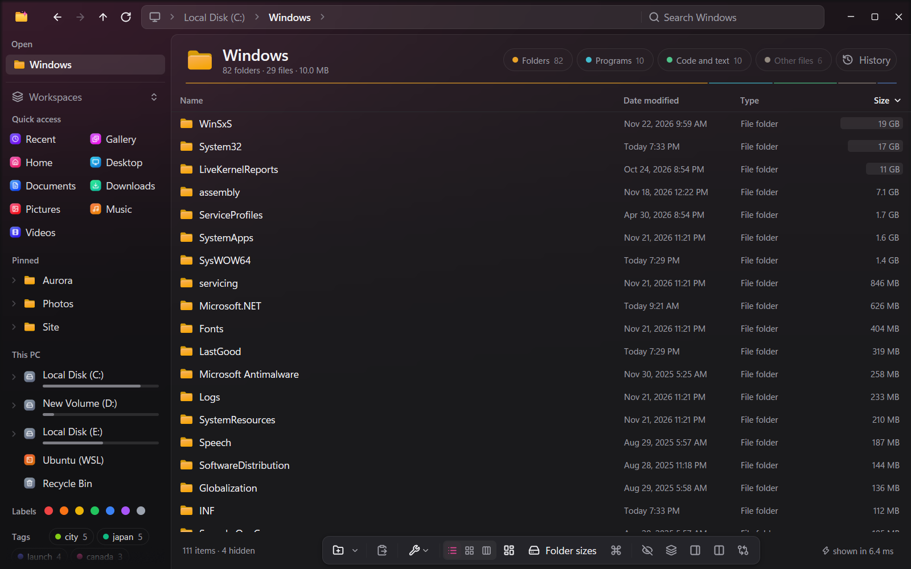
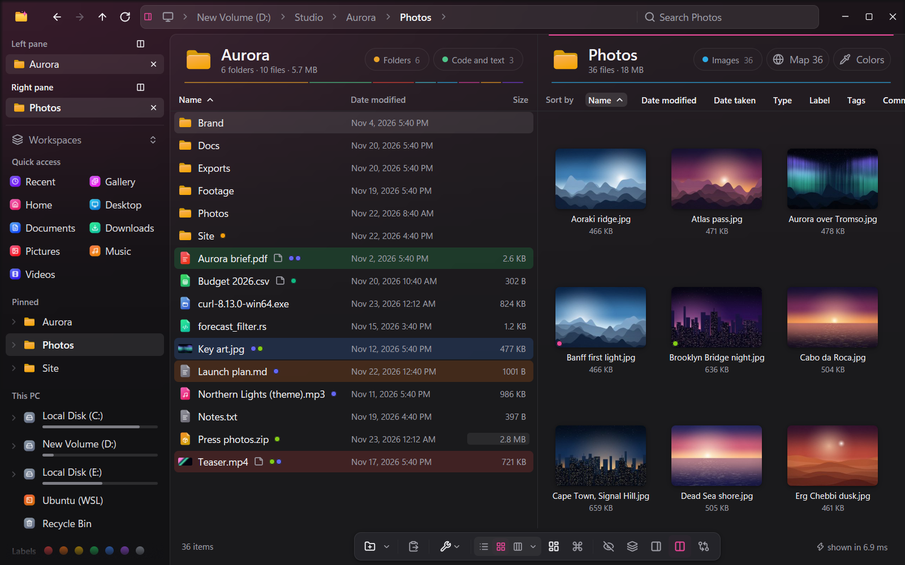
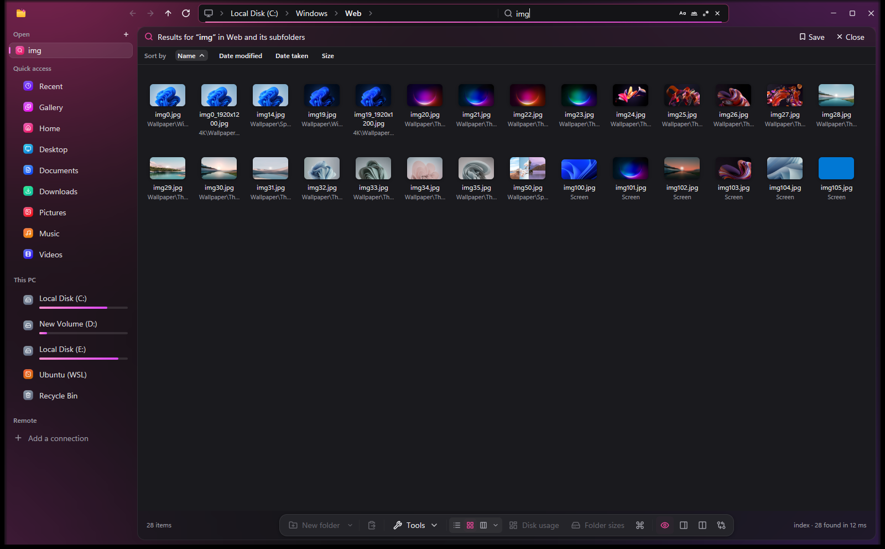
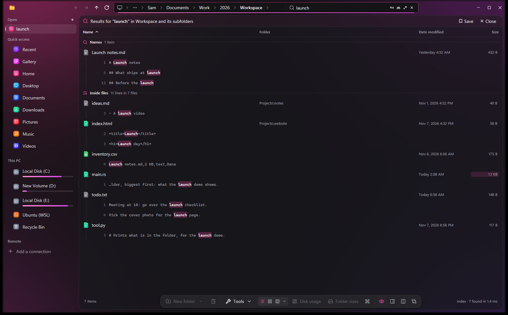
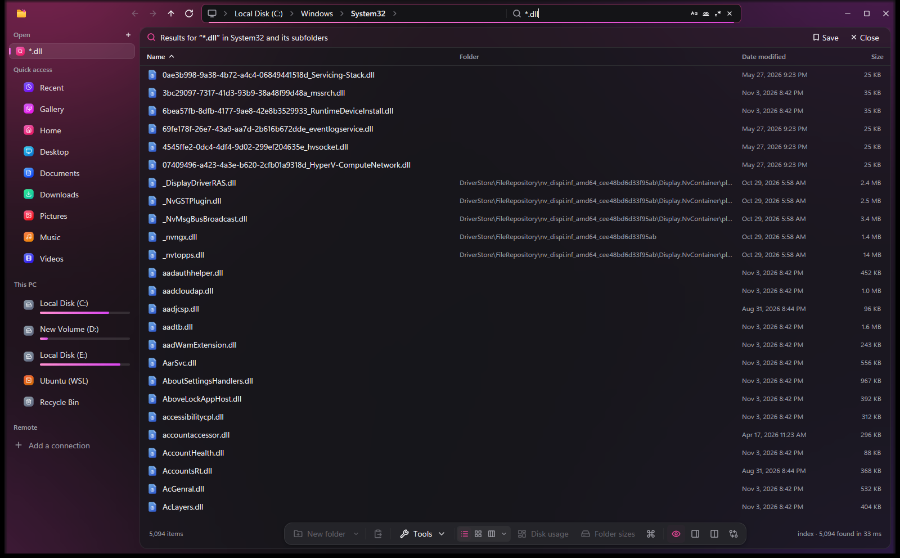
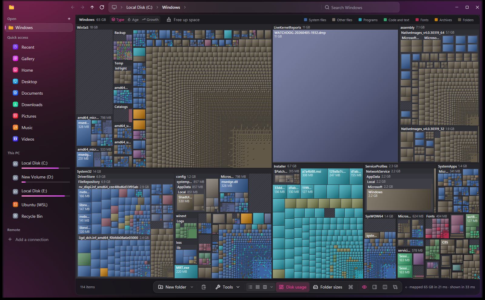
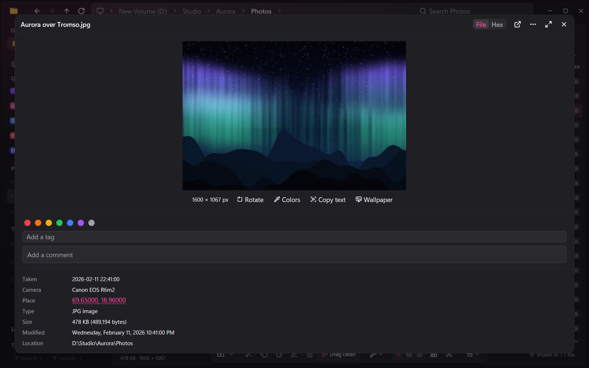
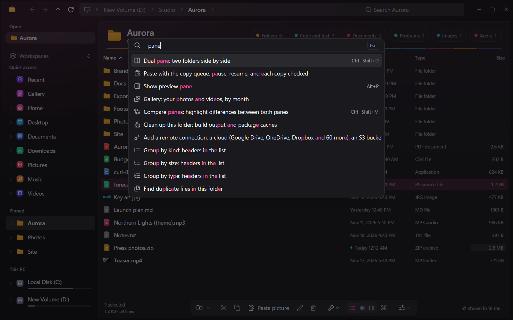
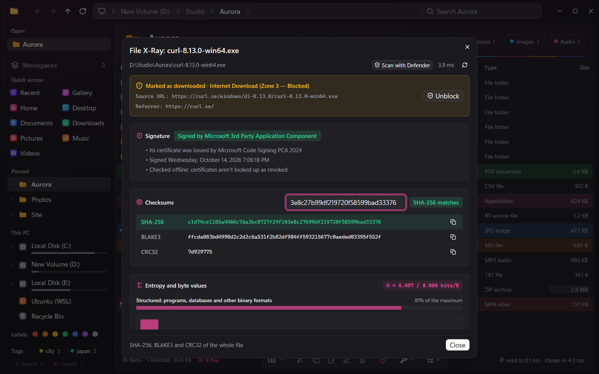
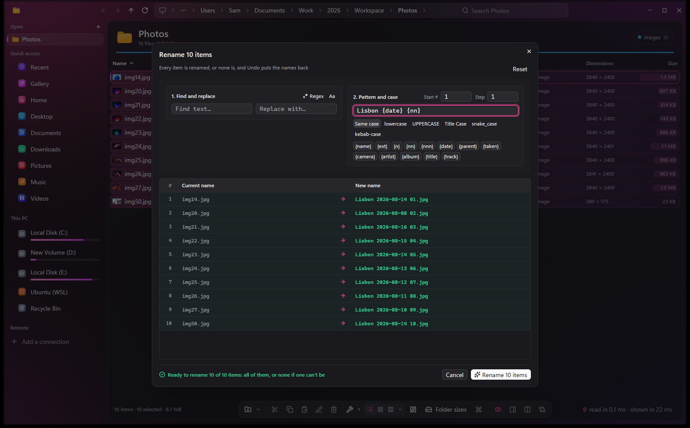

# Glint, feature by feature

Everything Glint does, in detail. The [README](../README.md) has the short tour, how to install it and the benchmarks, and [the release notes](https://github.com/shadijhade/glint/releases) say what changed when. This page describes Glint 0.13.

-   [Browsing](#browsing)
-   [The menu and the dock](#the-menu-and-the-dock)
-   [Tabs and two panes](#tabs-and-two-panes)
-   [Grid view](#grid-view)
-   [Search](#search): [finding files by name](#finding-files-by-name), [one search for names and contents](#one-search-names-and-what-the-files-hold), [instant search](#instant-search-ntfs-index)
-   [Sizes and space](#sizes-and-space): [disk usage map](#disk-usage-map)
-   [Previews and Quick Look](#previews-and-quick-look)
-   [Archives and disk images](#archives-and-disk-images)
-   [Media, documents and data](#media-documents-and-data)
-   [Tools](#tools)
-   [Files in other places](#files-in-other-places)
-   [For developers](#for-developers)
-   [At home on Windows](#at-home-on-windows)
-   [AI agents](../README.md#ai-agents) (in the README)

## Browsing



-   **Instant folders.** Each folder is read in one Win32 enumeration pass and sorted in Rust in natural order (`img9` before `img10`), then drawn as a virtual list. The status bar says how long it took: *read in 0.3 ms · shown in 6.3 ms*.
-   **A window that shows where you are.** Each pane starts with the folder's name and picture, what is in it (*6 folders · 15 files · 13 MB*) and a chip for every kind of thing there: press **Images** and only the images show, press it again for everything. Folders, files and places have pictures of their own, each kind of file a page in its color, and Documents, Downloads, Pictures and the others their own colored folder. Soft light behind the window takes the color of the place you're in (Documents blue, Downloads green, Pictures rose), so you can tell where you are without reading.
-   **It answers before you ask.** Rest the pointer on a folder, or come to it with the arrow keys, and its row says what is in it (*10 files · 8.7 MB*, with a small band of its make-up): Glint has read it by then, so opening it takes a frame. With instant search on, the search box's results follow the keys from the third letter instead of waiting for you to stop typing. And a click or a key is drawn the moment it is handled, not at the display's next refresh: half a frame sooner on average, a whole one at worst.
-   **Opening a folder is a step toward it.** The view grows a little about the folder's row or tile as the folder's files come up, and going up is the same step back, so you see which way you went. It is over in a fifth of a second and never makes you wait: the folder's files take the pointer and the keys from the first frame.
-   **Zoom changes the layout, like a map.** Hold `Ctrl` and turn the wheel (or pinch on a touchpad): from the list, a notch in is the same folder as a grid of small tiles, and each icon flies out of its row onto its tile; on in, the tiles grow. A notch out is the way back, down to the list, where every picture flies home to its row. The file under the pointer stays under the pointer, and the folder never changes: the zoom only changes how you see it. Where it ends (the list going out, the biggest tiles going in), the pane gives a little and comes back.
-   **Motion that keeps up with the hand.** The wheel glides, hover fills fade, a tile's picture comes a little toward you under the pointer, menus and dialogs pop in where they are while the window behind them stands back a touch, and Quick Look grows out of the file it shows. None of it plays with Windows' animation effects turned off.
-   **Columns, and each folder's own view.** Right-click the list's header for its columns (Date modified, Date taken, Type, Dimensions, Duration, Artist, Album, Size) and what to sort by. Each folder keeps its own columns, sort, and list or grid, as File Explorer's do; until you set them, it opens as its kind does: a folder of pictures with when each was taken and its dimensions, videos with their length, music with its artists and albums, Downloads and Recent newest first. Settings → Files turns it off, for the same view everywhere.
-   **Group by, and the Columns view.** **Group by** kind, date, size, type or Git status in the list (the header's menu, or `Ctrl+K`), each group with its count and size. The **Columns** view (`Ctrl+Shift+9`) shows the folder above, this one, and what's in the folder you're on, with `←` and `→` between them.
-   **Gallery.** Your photos and videos, from Pictures, Videos and the folders you add (Settings → Files), with everything below them, as one grid, newest first by when each was taken, and its years and months down the side: a click goes to a month. Instant search's index lists them at once; when each was taken is read once from the photo or video itself and kept, so the gallery opens at once after that (new ones are dated in the background).
-   **Recent.** First in Quick access: the files and folders you opened lately, here or in any app, newest first, from Windows' own Recent Items, each with the folder it's in, under your most-used folders. Everything works on them as in a folder (preview, open, copy, drag out), and **Remove from Recent** forgets one. Files opened in Glint go to Windows' recent items, as File Explorer's do; when Windows is set not to keep them, Recent says so and stays empty. It can be where Glint starts (Settings → Files).
-   **The usual explorer moves.** Back, forward and up, a breadcrumb address bar you can type into, Quick access, pinned folders, drives with free space, a folder tree in the sidebar (each place's arrow opens it, the arrow keys move through it, and it can open itself down to the folder you're in), sorting, multi-select, type-ahead, rename, and hidden items on demand. **New** makes folders, text documents and every kind of file Windows' own New menu has on your PC (a Word, Excel or PowerPoint document from its app's template, a zip…), named as File Explorer names them.
-   **Select by dragging.** Drag across the empty part of the list or the grid for a marquee that selects what it covers (`Ctrl` adds to the selection); held near the top or bottom, the list scrolls along. **Invert selection** is in `Ctrl+K`.
-   **An address bar that gets you there.** The arrow after each part of the path lists that folder's subfolders and archives, with a filter box and arrow keys; the first one lists drives and places. Typing a path (`Ctrl+L`) suggests what's in the folder you're typing in, folders first, and names a letter off after those (`C:\Windows\Sytem32` suggests System32): `Tab` completes, `Enter` opens.
-   **Command palette.** `Ctrl+K` finds any command, or a folder you've been to by typing a few of its letters (`dl` finds Downloads) or with a typo (`stetings` finds Settings), with the folders you open most often and most recently first. A folder's path counts as well as its name, when the letters typed are close together in it. Type a path, `~` or `%APPDATA%` to go there. Type `=` and a sum to work it out as you type, units and all: `= 3 ft to cm`, `= 1 GiB / (3 MB/s) to s`, `= 0x1F + 1` ([fend](https://github.com/printfn/fend), built in); `Enter` copies the answer.
-   **Back and Forward remember where you were.** A search is a place of its own: open a folder from its results and Back (`Backspace`, `Alt+Left`, the mouse's back button or the toolbar's arrow) brings the results straight back as you left them, with that folder selected, without searching again; Back once more is the folder you searched in, and Forward walks the same way. Every place comes back with what was selected and where the list was scrolled. The arrows say where they go, a right-click on either lists the places to jump straight to, a folder deleted meanwhile is skipped (Glint says so), and `Backspace` with nothing to go back to goes up.
-   **Folder history shared with zoxide.** With [zoxide](https://github.com/ajeetdsouza/zoxide) installed (one click in **Settings → Tools**) and **Settings → History → Share folder history with zoxide** on, the folders you `cd` to in a terminal rank in `Ctrl+K` and quick search with the ones you open here, and `z` in a terminal finds the folders you open in Glint. zoxide's scores are read when the palette opens, and added to as you go (a burst of folders passed through adds the last); turning it off leaves Glint's own history as it was.
-   **Every folder opens.** A folder Windows keeps you out of, such as `C:\PerfLogs` or another account's profile, opens all the same and says why, with **Get access**: as File Explorer's Continue button does, Windows asks for administrator approval once, and your account may open it and everything in it from then on. With instant search on, even a folder Windows keeps to itself, such as *System Volume Information*, shows what's in it, read-only, from the index. Old links such as *Documents and Settings* open where they point, a shortcut to a folder opens the folder right here, and files open as a double-click in File Explorer opens them: with their app, or Windows' app picker when no app is set yet. Type `\\server` (or go up from one of its shares) for the folders a PC or NAS shares on your network, as File Explorer lists them; its administrative shares (`C$`, `ADMIN$`) show with hidden items.
-   **The Recycle Bin, as a place.** Under the drives in the sidebar (or typed as `Recycle Bin`): what you deleted, every drive's, with the folder each was deleted from, when, and how big it is (a folder's, everything in it). **Restore** puts the selection back where it was deleted from, making that folder again if it's gone, and says so with **Undo**; Quick Look and the preview show an item before you decide. There, `Delete` deletes for good once Glint has asked, naming what goes; **Restore all items** and **Empty the Recycle Bin** are on the right-click menu (Windows asks before emptying), and files dropped on the sidebar's Recycle Bin are deleted, as in File Explorer. What's in it isn't opened, renamed or copied where it is: restore it first. Nothing watches the Recycle Bin, so it's read again after each delete or restore here, when Glint comes back to the front, and with `F5` ([how it works](recycle-bin.md)).
-   **Paste a picture or text as a file.** With no files on the clipboard, `Ctrl+V` (or **Paste**) saves what's there as a new file in the folder: a picture (a screenshot, or one copied in a browser or the Snipping Tool) as *Pasted image* with the date and time, a PNG, and text as *Pasted text*, a UTF-8 .txt. Its name is selected to type a better one, and `Ctrl+Z` takes it back.
-   **Live.** The open folder refreshes when files change elsewhere.
-   **More windows.** `Ctrl+N` opens another window on the folder shown.

## The menu and the dock

What Glint finds out about what you point at, and what it does with it. All of it happens on the PC: nothing is sent anywhere, and no model is involved, only rules, counts and what Windows and the files themselves say.

-   **The menu starts with the item.** A right-click menu opens with a card: the item's picture and name, a line of facts (its kind and size, a picture's dimensions, a video's or a song's length, a text file's lines, a PDF's pages, how much a folder holds, when it changed), and badges for what matters: **From github.com** on a download (Windows' own mark of where a file came from), **Not signed** or the signer's name on a program, **3 identical copies** when the same bytes are elsewhere on an indexed drive, **In use by Word** when a program holds it open, **Online only** for a cloud file that isn't on the disk, and **Points to…** on a shortcut.
-   **Suggested.** Under the card, up to three rows chosen for this kind of thing, each with its reason under it: *Extract here* for an archive, *Scan with Microsoft Defender* (*It came from github.com*) and *Run in Windows Sandbox* (*It isn't signed*) for a program from the web, *Compare* for two files, *Clean up…* for a project folder with build output in it, *Unblock* for a file Windows marked as downloaded. They are copies: the menu's own rows stay where your hand knows them, and nothing moves once the menu is open.
-   **Type in the menu.** Typing filters every row, the ones in submenus too (shown with the submenu's name before them); `Enter` runs the first, `Backspace` takes a letter back, and the menu keeps its size while you type.
-   **A greyed row says why.** *Rename* in an archive, *Paste* with nothing to paste, a tool that needs a folder on disk: the reason is the row's tooltip, and what a screen reader adds.
-   **Move or copy to.** A submenu with the folders this kind of file usually goes to, learned from your own copies and moves, for moving and for copying, each with **Choose a folder…**. A folder that is clearly where the kind goes is under Suggested too: *Move to “Invoices”*, *Where you usually put pdf files*.
-   **Copy the text in it**, on a picture, reads the text with Windows' own OCR and puts it on the clipboard.
-   **The dock's next step.** While something is selected, the island at the foot of the window holds the first suggestion as a button with one press; a ring of light turns once round it when the step changes.
-   **Paste says what it holds.** *Paste 3 files*, or *Move 3 files here* after a cut, with their names and where they come from in its tooltip. With no files on the clipboard it is a plain button.
-   **The selection, in words.** Beside the island: how many are selected, their size, and what they hold: *4 lines* for text files, *12 pages* for PDFs, *2 min 31 s* for songs and videos, *3 files inside* for a folder, counted through every subfolder. The numbers roll to their value as the counting goes, and rest.
-   **What is happening to the folder.** **Changing now**, with a small line of how busy it is, while files in the folder are being written (press it for what changed), and **C: is nearly full** when the drive has little room left (press it for the disk usage map).
-   **The dock folds with the window.** In a narrow window the buttons lose their words, then the words beside the island go to two short lines, then to none; nothing is cut in half.
-   **It learns what you do, on this PC.** What you choose from a menu, the dock or `Ctrl+K` is counted (in Glint's own settings file, next to your pins), with a half-life of a month, and rises in **Suggested**, in the dock's next step and in `Ctrl+K`. **Settings → History** has **Suggest the next step**, **Learn from what I do** and **Forget what Glint learned**. With suggesting off there is no Suggested and no next step; the card and the dock's words are facts, and stay.
-   **Free, by design.** Glint looks at an item when the pointer has rested on it for a moment, or once a selection settles, on threads Windows runs in efficiency mode at background priority, and stops when you move on. It doesn't look at files that are only in the cloud, on network or removable drives, or at more than 200 items at once. A menu for one item waits at most 40 ms for what is still being found out, so its suggestions are decided once, with the facts.

## Tabs and two panes



-   **Tabs.** `Ctrl+T` opens a tab on the folder you're in, and tabs drag: along their list in the side rail, onto the other pane's (or its files), or to the far half of the files to open side by side. A middle-click (or `Ctrl+Enter`) opens a folder in a new tab behind the current one, as in a browser. `Ctrl+Tab` and `Ctrl+1`…`Ctrl+9` switch, `Ctrl+W` closes, and `Ctrl+Shift+T` brings the last one back. Each tab keeps its own history, selection, search and scroll position, and your tabs come back when the app starts (Settings → Reopen my tabs). A folder opened from File Explorer or a terminal (`Glint.exe C:\Projects`) gets a new tab in the window that's open: Glint runs once.
-   **Dual pane.** `Ctrl+Shift+D` (or its button in the dock) shows two folders side by side, each pane with its own tabs. Click a pane or press `F6` to work in it: the other one steps back a little, and the address bar shows which pane it's on. Drag files across (`Shift` to move), or use **Copy to other pane** and **Move to other pane**, which run on Windows' own file engine like every other file operation. Drag the line between the panes to share out the width (double-click: halves again); each pane's menu, by its tabs, swaps the panes (`Ctrl+Shift+U`), shows a folder in the other pane, evens them out or closes one, and a folder's right-click menu has **Open in the other pane**.
-   **Compare the panes.** `Ctrl+Shift+M` (or its button in the dock) opens the second pane if it's closed and marks each item that's only in one pane, newer, older, or the same date with a different size; the matches are dimmed. **Diffs only** hides them, **Select** picks every difference, and **Sync** copies what's only here or newer into the other pane through Windows' file engine (`Ctrl+Z` takes it back). Dates within 2 seconds count as equal, and folders compare by size once both are measured.
-   **Compare two files.** Select two files, or one in each pane (a bar over the panes then offers **Compare files**), and press `Ctrl+M` or right-click **Compare the two files**; or right-click a file the other pane has too. Text shows side by side, with each change's lines tinted and the words and characters that changed in them marked: `Alt+Up`/`Alt+Down` go from change to change, a minimap beside them shows where each is, **All**, **Context** or **Diffs** picks the rows shown, whitespace (trailing, or all of it) and case can be ignored, and `Ctrl+F` finds text in both. Each change copies across (`Alt+Right`, `Alt+Left`) and a line edits on a double-click, with `Ctrl+Z`, then **Save** (`Ctrl+S`): a file that isn't UTF-8 isn't saved from here, and one changed on disk since it was compared only with **Save anyway**. Closing, **Swap** or another view asks first while there are edits not saved. With [Difftastic](https://github.com/Wilfred/difftastic) installed (one click, with winget) code is compared by its structure: a line reflowed or re-indented isn't a change, and only the tokens that changed are marked; without it, line by line. Pictures show side by side, with a swipe, an onion skin or a **Pixel diff** (with a tolerance), zoomed and panned; any other two files as bytes in hex, with where they first differ (or "the same, byte for byte"), the previous and next difference, and **Go to** an offset. A changed file's **Changes** view opens its last commit's version against it the same way, with **Side by side**, where what's on disk can be edited and saved too.
-   **Down through subfolders, and by contents.** The compare bar's options: **Subfolders too** compares what's inside folders as well, so a folder differs when anything in it does, and **Sync** then copies what's missing or newer inside them, each file into the folder it goes in. **File contents** reads files of the same size on both sides rather than trusting their sizes and dates. Both skip what Find files skips (`node_modules`, `.git`), and leave links to other folders alone.
-   **Both at full speed.** Each tab searches and sizes folders on its own, so a long search in one pane doesn't stop the other's, and both panes refresh when their folders change.

## Grid view



The **List** and **Grid** buttons in the command bar (or `Ctrl+Shift+6` and `Ctrl+Shift+2`, as in Explorer, or `Ctrl+K`) switch the tab you're in; each tab keeps its own view, and new tabs start in the view of the tab they came from. The grid works like the list: click, `Ctrl` and `Shift` to select, arrow keys in all four directions, `Enter` to open, `Space` for Quick Look, `F2` to rename, drag and drop (into the other pane too), the right-click menu and folder sizes under each folder. Sort it from the bar above it.

Zoom it as you would Explorer's icons: `Ctrl` and the mouse wheel over the grid (or a pinch), `Ctrl+=` and `Ctrl+-` (`Ctrl+0` for Medium again), the arrow next to the **Grid** button, or `Ctrl+K` (*large tiles*). The tiles grow into the new size about the pointer, and past the smallest the wheel goes on out to the list (and from the list, in to the smallest tiles): each file's picture flies between its row and its tile. There are five tile sizes, from Small (64 px pictures) to Huge (256 px), and they grow with the text size too. The size is a setting (**Settings → Files**), so every grid has it, in both panes and every tab. A grid keeps its place as it zooms: the focused tile stays where it was on screen (otherwise the tiles at the top stay at the top), and the pictures already there grow or shrink at once while sharp ones for the new size come in.

Thumbnails come from Windows' thumbnail cache, the one Explorer fills, so pictures you've seen in Explorer are there at once (30 in 71 ms). Only the tiles on screen ask for one, and they stop asking when you scroll past them or leave the folder. What Windows doesn't have yet is made on worker threads below normal priority: photos that Windows' own photo provider decodes with its built-in codecs (JPEG, PNG, GIF, TIFF, BMP) on several threads at once, and everything else (videos, documents, fonts, HEIC and RAW photos, or pictures another app took over) by its own handler, where Windows runs it, usually an isolated process. Windows caches the result, so next time it's instant, and online-only OneDrive files are only shown when Windows already has their thumbnail, so nothing downloads. The status bar says how many came, how fast and from where. Where Windows makes none, Glint makes its own: a PDF's first page, drawn by Windows' own PDF renderer when no PDF app put in a thumbnail handler, and SVGs, drawn by the app itself, crisp at any tile size, text and all. JPEG XL pictures show through Windows' codec, once its JPEG XL extension is installed.

Bigger tiles ask for bigger thumbnails, one screen pixel to one (Huge at 125% scaling asks for 320 px). Windows keeps each thumbnail at a few sizes (96, 256 and 768 px among them) and answers with a smaller one when it lacks the size asked for, so those are made at the size the tile needs: a photo first seen in the list (32 px there) isn't stuck that small in the grid. Folders of 60 and 300 photos are on screen in 7–9 ms at every size, and their thumbnails come in this fast (status bar, fresh start of the app each run, default window at 125% scaling; median of 5 runs from the cache, 3 of never-seen photos):

| Tile size | Thumbnails on screen | From Windows' cache | Never seen |
| :--- | ---: | ---: | ---: |
| Small | 49 | 89 ms | 238 ms |
| Medium | 30 | 70 ms | 241 ms |
| Large | 24 | 66 ms | 231 ms |
| Extra large | 15 | 61 ms | 165 ms |
| Huge | 8 | 51 ms | 137 ms |

## Search

### Finding files by name

-   **Find files by name.** Typing in the search box filters the folder as you type; **Enter** searches every subfolder too (from This PC, every drive), and where instant search covers the folder, that happens as you type. All words must match, `*` and `?` work like in Explorer, and `"quotes"` keep spaces. A word with `\` or `/` in it, or after `path:`, matches the whole path rather than the name: `src\lib main` finds what's named *main* in a `src\lib` folder, and `D:\photos` searches drive D from wherever you are. Filters narrow it, as in Everything: `ext:pdf` (or `ext:jpg;png`), `size:>10mb` (`>`, `>=`, `<`, `<=`; kb, mb, gb), `dm:7d` (changed in the last 7 days; h, d, w, y) or `dm:>1y` (longer ago), `file:` and `folder:`. With instant search on, `ext:iso size:>1gb` on This PC lists every big ISO in milliseconds; the search box shows the filters when it's empty. **Save** keeps a search in the sidebar, to run it again with one click. The status bar says who answered: *index · 18 found in 7.7 ms* or *fd · 304 found in 8.09 s*. When nothing turns up, it says what was skipped, with a button each to look in hidden files, skipped folders or every drive.
-   **Flat view.** `Ctrl+B` (or the layers button, the View menu, or `Ctrl+K` → *Flat view*) lists every file in the folder and all its subfolders as one list, with a **Folder** column saying where each is; press it again, or `Esc`, **Back** or **Up**, to return to the folder. It is a search with nothing to match, so it streams in as it's found (instant search's index where it has the drive, fd elsewhere), counts as a place in **Back** and **Forward**, and follows the list, grid and sorting: sort a whole tree by size or date, see every photo below a folder in the grid, or batch-rename across subfolders. Settings' result limit (50,000 by default) and **Folders to skip** apply as in a search, and the bar says *Stopped at 50,000* with **Show all** when a tree is bigger. It doesn't update as files change: `F5` lists them again. Not offered on This PC, in the Recycle Bin or inside an archive.
-   **Plain words work too.** Type `pdfs from last week over 5 mb`, `photos taken in 2024`, `big zip files` or `songs by the beatles` and the box reads them as filters, showing under it what it understood (*PDF files · changed in the last 7 days · over 5 MB*) and the filters that say it: `Tab` puts those in the box, so you learn the syntax by using it, and `Enter` still searches what you typed. It knows kinds of files, when they changed, sizes, and when photos were taken, with what, and who songs are by, all in the page, in microseconds, with nothing sent anywhere. Quick search reads them too.
-   **Photos, videos and music by what they say.** `width:>1920` and `height:<1080` (pixels, as the picture shows, turned by its EXIF), `taken:2024` (`taken:2024-06`, `taken:>2023-06-15`, `taken:7d`, `taken:>1y`), `camera:pixel`, `duration:>5m` (`90s`, `1:30`), `artist:` and `album:` filter by what the files themselves say: their EXIF, video tracks and tags, the same details the preview shows and Date taken sorts by. Typing one filters the folder as each file is read; **Enter** has the index or fd find the photos, videos or songs below it and reads them four at a time, each file once a session, so `taken:2024 camera:canon` over a photo library is a filter and then a read. Each one keeps to the files it can be true of (`artist:` to songs, `width:` to pictures and videos), and the search box lists them when it's empty.
-   **Typos forgiven.** When the index finds nothing named as typed, it looks again for close matches: each word of four letters or more may be a letter off (two letters swapped count as one; two edits from eight letters) at the start of a word in the name, so `reprot` finds *Q3 Report.pdf* and `dowloads` finds *Downloads*. They come closest first, under **Close matches for…**, with *fuzzy* in the status bar. Numbers and shorter words must be there as typed, and so must a word's first letter (unless it's swapped with the second). Looking again costs the service about 30 ms over 3 million names. fd, which answers without the index, finds names only as typed.
-   **Quick search from anywhere.** `Ctrl+Alt+F` opens a search box over every drive, wherever you are: names (and filters) answered by the index as you type, the best matches first and your own files before Windows' (before you type, it offers the folders you use most), and close matches when a name is typed with a typo. `Enter` opens, `Alt+Enter` shows it in Glint, `Esc` puts it away. **Settings → Quick search** picks the shortcut, and can keep Glint in the tray and start it with Windows so it's always there.
-   **Tags.** Tag files and folders (**Tags** in the menu): `tag:work` finds them, the sidebar lists every tag, and the tags travel with the files on NTFS, in a stream of their own that the instant search index reads.

### One search: names, and what the files hold

The search box at the end of the address field looks for what you type in two places at once: in the names below the folder you're in, and inside the files there. Both come back as one list.



-   **Files found by what's in them are rows like any other.** They are listed under **Inside files**, each with the lines that matched under it (the line's number, the match marked; the first three, then a count of the rest: press it to list them all under the file). Press a line to show it in the preview (Quick Look too), and double-press it to open the file in the editor **Settings → Inside files** names, at that line (VS Code and its kin, Notepad++, Sublime Text, Zed, Vim and the JetBrains IDEs take a line; another editor opens the file at its top). Open, copy, rename, delete, drag or preview them as you would any result.
-   **Typing filters the folder; Enter searches below it.** Names come as you type where instant search covers the drive. What the files hold is read on Enter by ripgrep, streaming in as it's found, or as you type where the content index covers the folder. A whole drive is read inside only when you ask (**Inside files too** on the results' bar).
-   **Match case, whole words, regular expressions.** The three switches in the box (`Alt+C`, `Alt+W`, `Alt+R`) say how the words are matched inside files. The filters (`ext:pdf`, `size:>1mb`, `dm:7d`) narrow both halves.
-   **Documents.** **Also look inside → Documents** (in the box's hints) searches the text inside PDF, Word, Excel, PowerPoint, OpenDocument and EPUB files, with the same case, whole-word and regex rules, without Office or a search index. Each line says where it is ("p. 12", "slide 3", "Sales, row 40").
    -   PDFs are read by [pdf-extract](https://github.com/jrmuizel/pdf-extract), the rest from their own XML; scanned PDFs, which hold pictures of text, have none to find.
    -   Documents are read by Glint's own worker processes, up to four at a time, each limited to 1 GB and 30 seconds a document, so a damaged or hostile file can't take the app down.
    -   What's read stays in memory for the session (up to 256 MB), so searching the same folder again is quick; none of it is written to disk.
    -   **Pictures** (with Documents) reads the text in pictures as well, with Windows' own OCR (in the languages your Windows has it for): PNG, JPEG, TIFF, BMP and GIF, and WebP, HEIC and AVIF with Microsoft's extensions for them. A scan or a screenshot is then found by what it says.
    -   Skipped: hidden files and folders, the excluded folders (**Settings → Inside files**), and files kept only in the cloud (reading them would download them).
-   **Recent searches** are one click away in the empty box, each with its folder; **Save** on the results' bar keeps a search in the sidebar.

-   **Search inside files instantly.** **Settings → Search inside files instantly** keeps an index ([tantivy](https://github.com/quickwit-oss/tantivy)) of the text, code and documents below the folders you choose, current as they change, so the search answers from it in milliseconds, as you type. It reads screenshots and scans with Windows' OCR too, and the pages of scanned PDFs, so their words are found.

Up to version 0.10, searching inside files was a mode of its own (Text), with its own screen. From 0.11 it is this one search. What that screen alone did is gone with it: Replace all, code patterns (ast-grep) and exporting the results to CSV or JSON.

### Instant search (NTFS index)



It's off until you turn it on: on This PC, with the status bar's **Turn on instant search**, or in **Settings → Instant search**. Windows asks for administrator approval once, and a small service indexes your fixed NTFS drives. When Glint updates, the service updates itself too, without asking again: it takes only a build signed with Glint's update key, and only a newer one. It reads each drive's Master File Table in one sequential pass (2.3–2.5 s for C: with 2.9 million records here), then follows the USN journal, so a file created, renamed or deleted anywhere is in the index within about 0.3 s. Name searches, folder sizes and disk-usage maps then answer from memory. fd and pdu take over wherever the index can't answer: network shares, FAT and exFAT drives, and searches that read `.gitignore`.

The service only runs once you opt in, with every privilege removed except the three it needs. It answers only you and administrators, over a named pipe no other program can pose as. It knows the names of all files on the indexed drives, including ones your account can't open, so on a shared PC turn it on only for accounts that may see every file name. Measurements, how it works and the full security model are in **[docs/instant-search.md](instant-search.md)**.

## Sizes and space

-   **Folder sizes.** With instant search on, every folder shows its size as it opens, and search results show folder totals too. Otherwise one click measures them with pdu. A bar behind each size shows how it compares with the biggest in the folder.
-   **Compress in place.** Folders take less space and still open normally (games, apps, tools, old projects), with Windows' own transparent compression and no admin rights for your own files. The saving is measured on a sample first, and `Ctrl+Z` decompresses.
-   **Drive health**, in This PC: each drive's temperature, wear, hours on, data written and errors, read from the drive itself without admin rights, and a warning when one may be failing.
-   **Clean up** and **Find duplicates** are in [Tools](#tools).

### Disk usage map



**Disk usage** (in the command bar, or `Ctrl+K`) draws the open folder as a squarified treemap, the way WizTree and WinDirStat do: folders nest six levels deep, files are colored by type, and the 20,000 biggest items are drawn, with everything smaller grouped in its folder. Hover for the name, path and size, click a folder to go into it (or a file to go to its folder), `Backspace` or `Alt+Up` to go back out, `Enter` to open, and right-click for the usual menu.

**Type** and **Age** (or `T`) switch the colors between kinds of file and how long ago each changed, from today (hot) to over a year ago (frozen).

**Growth** colors what changed in the last day, 7 days or 30 days: folders that are new, doubled, grew, stayed the same or shrank, and files written to since. A line above the map says where it went ("Local Disk (C:) grew 14.2 GB since Fri, Oct 16 · Docker\wsl +9.1 GB · Downloads +3 GB"), and hovering a folder says what it was ("Was 2.1 GB on Fri, Oct 16 · +1.4 GB"). It comes from instant search: once a day its service takes a mark, and a folder's size is noted just before its first change after a mark, so every folder's size at each of the last 40 marks is exact while only the folders that changed take room.

With instant search on, the map comes from the index in one request: all of `C:\` is on screen 53 ms after the click. Otherwise pdu measures the folder: going into a folder shows its part of the map while pdu measures it, and going back out shows the map you left. Each tab has its own map, and the status bar shows which engine drew it and how long it took.

## Previews and Quick Look

<table>
<tr>
<td width="50%"></td>
<td width="50%"></td>
</tr>
<tr>
<td align="center"><b>Space</b>: Quick Look</td>
<td align="center"><b>Ctrl+K</b>: the folders you use, and every command</td>
</tr>
</table>

-   **Preview pane and Quick Look.** Syntax-highlighted code and text, images, video, audio, PDFs and folder summaries, in the side pane (`Alt+P`) or full size on `Space`. Quick Look opens out of the file's own row or tile and goes back into it, and fills the window from its maximize button (or a double-click on its title), `PageUp` and `PageDown` scroll it, and text and code can wrap their long lines and be copied whole. **Copy text** under a picture copies the text in it, read by Windows' own OCR.
-   **Photos, songs and videos.** Below a photo: when and where it was taken (the place opens on OpenStreetMap), the camera, lens and exposure; below a song: its artist, album, track, length and quality, with its cover; below a video: when it was recorded and its length.
-   **Markdown** reads as it does on GitHub, with its tables, task lists, footnotes, highlighted code, math (`$…$`, `$$…$$` and ```` ```math ```` blocks, typeset in place), Graphviz diagrams (```` ```dot ```` blocks, drawn as pictures), the pictures beside it and the HTML READMEs use (centered headers, collapsible sections, keys), as GitHub allows it: nothing in a file runs, and pictures from the web aren't fetched. Its links open their file or folder in Glint, web links in your browser, and **Source** shows it as written. A folder's README.md shows above its list too, folded to its title until you open it.
-   **JSON, YAML and TOML** files show as a tree of their values (with **Text** for the file as written), and a jq filter runs over them, `.items[] | select(.size > 1000)`, in [jaq](https://github.com/01mf02/jaq) (jq rewritten in Rust, installed with one click). The file is read, and the filter run, in a process of their own held to 1 GB and 10 seconds, so one that never ends stops there. Each value's jq path is a click away, to copy or filter by.
-   **Hex.** Every file has a **Hex** view as well: its bytes as [hexyl](https://github.com/sharkdp/hexyl) shows them, colored by kind (zero, text, whitespace, other ASCII, the rest), with **Go to** an offset and the byte under the cursor as numbers; a file Glint knows nothing about that isn't text shows that way.
-   **Tables and databases.** CSV, TSV and JSON-lines files show as tables with their column types, and so do Excel and OpenDocument workbooks (.xlsx, .xlsb, .xls, .ods) without Office, a sheet at a time with the others a click away (**Previewer** shows one through Windows' previewer instead: Excel's, with Office installed), and Parquet files with their columns' types; their first 1,000 rows. SQLite databases show as their tables, indexes and views, each table's rows a click away, and programs and DLLs with their architecture, security features, sections, imports and exports. **Query** runs SQL over any of these, reading only: a CSV, JSON-lines or Parquet file is the table `data`, a workbook's sheets are tables by their names, and a database is opened read-only, without a lock or journal file ever appearing next to it; one statement at a time, stopped at 10 seconds, the first 1,000 rows shown.
-   **Windows' own previewers.** Everything else Windows has a previewer for shows through that previewer, as in File Explorer: Word and PowerPoint documents, fonts, Visio drawings… (not files downloaded from the internet, which File Explorer doesn't preview either). Online-only OneDrive files are left alone, so nothing downloads by accident.
-   **Terminal recordings.** [asciinema](https://asciinema.org) recordings (.cast) play in the terminal pane's own renderer, with a scrubber and 1×, 2× and 4×, long pauses cut short.
-   **Word documents without Office.** `.docx` files are laid out as pages in the preview by Glint itself, with nothing loaded from the internet.
-   **Notebooks and 3D models.** Jupyter notebooks show with their outputs, and 3D models (STL, OBJ, glTF, PLY, 3MF) in the preview, now that Windows' 3D Viewer is gone.
-   **Books and comics.** EPUB, Kindle (MOBI, AZW3), FB2 and CBZ read in the preview by Glint's own reader, with their contents, text size, the page you stopped at, and Read aloud with Windows' own voices.
-   **More previews.** Contacts (.vcf), calendar invites (.ics), emails (.eml, and Outlook's .msg) with their attachments and nothing loaded from the internet, the pictures Krita, OpenRaster, Procreate and Sketch files keep, and Graphviz files.
-   **Old text files read right.** Arabic (Windows-1256), Cyrillic, Chinese and other older encodings are detected (Firefox's detector, [chardetng](https://github.com/hsivonen/chardetng)) in previews and Search inside files instantly, instead of showing as gibberish. **Read as** another, or **Convert to UTF-8** (Ctrl+Z takes it back).

## Archives and disk images

Press `Enter` on an archive (or double-click it, or middle-click for a new tab) and it opens like a folder, in the list or the grid, in either pane and any tab: go into its folders, back up out of it, Back and Forward, the path in the address bar (`C:\Downloads\photos.zip\2024\summer`, typed or pasted too), and its tabs come back when the app starts. An archive inside an archive opens the same way. That's zip, 7z, RAR and cabinet (`.cab`) files, tars (`.tar`, and `.tar.gz` or `.tgz`, `.tar.xz`, `.tar.bz2`, `.tar.zst`, `.tar.lz4`), and single compressed files (`.gz`, `.xz`, `.bz2`, `.zst`, `.lz4`), which open as a folder holding the file.

Glint reads only the archive's own list of entries (the zip central directory, the 7z header, a tar's headers), once, and keeps it in memory: a zip of 50,000 files lists in 57 ms, and every folder in it after that in 0.2 ms. A compressed tar keeps no such list, so the first time it's opened it's decompressed from start to end, with progress and Stop. Every folder shows its size, and name search, folder sizes and the disk usage map work inside archives too. Previews, Quick Look and thumbnails extract only the file they show, to a temp copy that goes when you close the app, and opening a file opens a read-only copy of it.

Files that are zips by another name (Word, Excel and PowerPoint documents, `.jar` and `.apk` files, NuGet and VSIX packages, EPUBs…) and Windows Installer packages (`.msi`) still open in their app, or run, on `Enter`; right-click **Open as archive** to look inside. An installer package shows what it installs, laid out as the folders it installs into (`Program Files (x86)\Contoso\app.exe`), read from its cabinets without running anything. A file found to be an archive by its first bytes, under any name, opens too.

A password-protected file (a zip's, ZipCrypto or AES, a 7z's or a RAR's) shows a lock, and its preview asks for the password; an archive whose list of files is encrypted too asks as you open it. The password is tried before it's kept, for that archive only and in memory until Glint closes, and then everything it opens previews, opens, copies and extracts like any other file.

An [ncdu](https://dev.yorhel.nl/ncdu) export (`ncdu -o`, as a `.ncdu` file, or a `.json` one from its preview) opens as the disk it describes, scanned somewhere else, with its folder sizes, search and the disk usage map; its files are names and sizes only. Right-click a folder → **Export as ncdu JSON…** writes one of a folder here, for ncdu or Glint to open later.

Archives are read-only: what would change one is greyed out, with a *Read-only archive* badge in the command bar. **Copy**, **Copy to other pane** and dragging out extract the selection, folders and all, then let Windows' own file engine copy it, so progress and *Replace or Skip* are Windows' own. Paths can't escape the folder they're extracted to (no zip slip), entries are cut off at their declared size, zip bombs (huge expansion ratios, overlapping entries, oversized 7z headers) are refused, password-protected entries without their password say so, and a damaged archive is an error, never a crash. Methods, limits and the temp folders: [docs/archives.md](archives.md).

Right-click **Extract here** on an archive unpacks all of it, with the same checks, into a new folder next to it named after it, as Explorer's *Extract All* does (a single compressed file comes out as the file, next to it). **Compress to zip file** packs the selection into a zip next to it (Deflate, with the files' dates), named after the first item and ready to rename. Both show progress, can be stopped, leave nothing behind when they fail, and `Ctrl+Z` takes them back.

**Compress to 7z** and **tar.zst** work the same way, and a zip (AES) or a 7z can have a password (a 7z's names are encrypted too).

Disk images and installers open like folders too, with [7-Zip](https://www.7-zip.org) installed: ISO, VHD(X), VMDK, DMG, WIM, ext4 and APFS images, installers, and Debian and RPM packages. See what an installer holds without running it.

## Media, documents and data

Each of these is on the right-click menu of the files it works on, and in `Ctrl+K`. The tools they use (FFmpeg, pdfcpu, DuckDB, pandoc and the rest) install with one click the first time ([which ones](tools.md)).

-   **Media.** A video or recording's preview has **Trim**: two handles, **Save trim**, copied as stored in a moment (or **Exact**, re-encoded to start on the very frame). Right-click → **Media** converts and shrinks videos (MP4 with H.264, HEVC or AV1, "fit under 10/25/50 MB" for mail and chats, with the PC's NVIDIA, Intel or AMD encoder when it has one), takes the sound out (as stored, or MP3, M4A, Opus, FLAC, WAV), makes GIFs and animated WebPs, and writes **subtitles** from what's said (whisper.cpp, on this PC, in its language or in English). A video Windows can't play (AVI, WMV, MKV and the like) gets a copy that plays, made by FFmpeg in seconds and kept for next time.
-   **Make smaller**, one action for anything chosen: videos re-encoded with FFmpeg at a quality that keeps them looking the same (H.264, HEVC or AV1, HDR kept as HEVC or AV1), photos as smaller JPEGs (MozJPEG, through [rimage](https://github.com/vlad-salone/rimage)), PNGs losslessly, BMPs as PNGs, PDFs tidied by [pdfcpu](https://github.com/pdfcpu/pdfcpu) without changing their pages, and the pictures inside Word, PowerPoint and Excel files. Nothing that comes out bigger is kept, every copy keeps its original's date, and Ctrl+Z takes it back.
-   **PDF tools**, with [pdfcpu](https://github.com/pdfcpu/pdfcpu): merge, split, keep or take out pages, turn them, make a PDF smaller, save its pictures, add or take off a password (AES-256), stamp DRAFT across it. Offline, beside the originals, and Ctrl+Z takes it back.
-   **Data files of any size**, with [DuckDB](https://duckdb.org): once it's installed, **Query** reads CSV, JSON and Parquet where they are, however big; **Profile** describes every column (type, missing values, distinct values, range, quartiles); **Query together** joins several files; **Convert data** writes Parquet, CSV or JSON lines.
-   **Convert document**, with [pandoc](https://pandoc.org): Word, OpenDocument, Markdown, HTML, EPUB, LaTeX, RTF and more into one another, Markdown into PowerPoint, and PDFs typeset by [Typst](https://typst.app) without Word or LaTeX. Arabic and Hebrew documents stay right to left.
-   **Songs**: edit title, artist, album, track, year, genre and cover for one song or many (titles and track numbers from file names too); **Even volume** in Media brings recordings to the same loudness; the audio preview has a waveform.
-   **Remove personal info** before sharing: where a photo was taken, the camera's serial number, names, the apps used and editing history, out of photos, videos, PDFs (ExifTool) and Word, Excel and PowerPoint files (Glint itself). **Change when it was taken** moves or sets photos' dates.
-   **Encrypt** files and folders with a passphrase or someone's age key: [age](https://age-encryption.org)'s format, in Glint itself, readable with age or rage anywhere.

## Tools

In the command bar's **Tools** menu, a folder's or a file's right-click menu, and `Ctrl+K`. A tool that needs a program Glint doesn't ship installs it with one click, for your account only (**Settings → Tools** lists them all; [which ones, and where they go](tools.md)):

-   **Find duplicates.** Files of the same size are compared by their first and last 4 KB, then by a BLAKE3 hash of all their content, so a folder of thousands of files is checked in moments. Keep one copy of each and move the others to the Recycle Bin, or replace them with hard links to the one you keep: every path stays and the space is freed, but the copies become one file, so changing any of them changes them all. Each copy is compared with the kept one byte for byte right before it's linked, and cloud (OneDrive) files are left alone. On a drive that clones files (ReFS, or a [Dev Drive](https://learn.microsoft.com/windows/dev-drive/)), **Clone** takes the place of hard links: each copy becomes a block clone of the one you keep, sharing its space until one of them changes, yet a file of its own with its own dates and attributes. The clone is compared byte for byte with the copy it replaces before it takes its place.
-   **Clean up.** What can go to free space below a folder, in four tabs. **Developer junk**: build output and package caches that a project's own tools make again (`node_modules` and `.next` beside a `package.json`, Rust's `target` beside a `Cargo.toml`, .NET's `bin` and `obj` beside a project file, Python virtual environments and caches, and the build folders of Gradle, Maven, CMake, Unity, Unreal, Flutter, Swift, Elixir, Haskell, Zig, Godot, Elm and Terraform), each with when its project last changed (its build output and `.git` aside), so **Projects untouched for 30 days** picks the ones you've left alone. A folder that only shares the name (a `target` folder of photos) is left out, and so is a link to one (a worktree's `node_modules`). **Empty folders**: nothing in them, down through their subfolders. **Temporary files**: what programs leave behind (`.tmp` files, Office's `~$` owner files, `Thumbs.db`, `.DS_Store`), less what a program still has open. **Big files**: 100 MB to 10 GB and up, biggest first, grouped by type. With [Czkawka](https://github.com/qarmin/czkawka) (one click installs it, with winget): **look-alike pictures** (resized, converted or re-saved copies, with thumbnails and **Keep the biggest**), **look-alike videos** (FFmpeg reads them), the **same music** by its tags or by how it sounds, **broken files** with why they don't open, and files with the **wrong extension**, which get their real one. Hidden folders aren't looked in for empty folders or big files, nor AppData for big files (WSL's and Docker's disks there are whole systems), and Windows' own folder and the Recycle Bin never are. What you choose goes to the Recycle Bin, and `Ctrl+Z` brings it back. With instant search on, 103 folders of developer junk holding 58.6 GB under a `C:\Repos` here were found, sized and dated in 0.3 s; without it, fd finds them and pdu sizes them (7.1 s). Also on the disk-usage map, as **Free up space**.
-   **What's locking this?** For when Windows says a file is open in another program: Windows' Restart Manager names the programs that have the selection open (or files in a folder), in milliseconds, and **End** closes one after asking. *End all* leaves File Explorer and services running.
-   **Recent changes.** What changed in a folder and below it in the last 15 minutes to 30 days, newest first, with the folders that changed most, and a live list of the changes Glint saw while the folder was open.
-   **Moved and deleted: where did a file go?** What was renamed, moved, deleted for good, put in the Recycle Bin, restored or emptied from it, on the drives instant search covers, for the last 30 days, by day: search a name or a folder, and **Show** opens what's still there where it is now (a file moved on since included), or the folder it was in. It comes from each drive's change journal, which Windows keeps anyway, so it reaches back days before it was turned on. A folder deleted with what's in it is one line that counts them, and what programs do with their own files (AppData, caches, temporary files, saves that replace a file) is left out.
-   **File X-Ray.** A file's SHA-256, BLAKE3 and CRC32 (paste a published checksum to compare, and it says which one matched; a file over 256 MB is hashed in full when you ask), its entropy and byte values, size on disk, NTFS file ID and hidden streams (alternate data streams), with Windows' *downloaded from the internet* mark and **Unblock**, as in Properties. A program, installer, driver or script also shows whether its digital signature holds and who signed it, as Windows checks it (in the file, or in the catalogs that sign Windows' own files), offline, with when it was signed; a program's preview says so too.
-   **Scan with Microsoft Defender.** A custom scan of the selection or the folder (also in the File X-Ray), with Stop, and what it found by name; Defender deals with it as its settings say, and Windows Security's Protection history lists it.
-   **Batch rename.** Select several items and press `F2`, or `Ctrl+Shift+R` for the whole folder: find and replace (regular expressions too), a pattern of `{name}`, `{ext}`, `{n}`/`{nn}`/`{nnn}`, `{date}` and `{parent}`, details from inside the files (`{taken}` and `{camera}` from photos, `{artist}`, `{album}`, `{title}` and `{track}` from songs), and case changes, with a live preview that flags clashes. Every item is renamed or none is (swaps and numbered chains included), and **Undo** puts the names back.
-   **Convert pictures.** Select pictures and right-click **Convert pictures…**: [rimage](https://github.com/vlad-salone/rimage) (installed with one click, from its release and checked against its pinned SHA-256) makes JPEGs with MozJPEG, lossless PNGs with OxiPNG, WebP or AVIF, at the quality you choose, at a share of their size or a longest side (never larger), with their camera, place and date taken left in or taken out. They go next to the pictures (with what you add to their names), into a folder there, or in their place, the pictures moved to the Recycle Bin. A few at a time, with progress and Stop, each keeping its picture's date modified; it says how much smaller they came out, and `Ctrl+Z` takes it all back.
-   **Run in Windows Sandbox**, from a file's menu: a throwaway Windows to try a program or a document in.

These work on files on disk, not inside archives. Sending, sharing and folder rules are under [Files in other places](#files-in-other-places).

<table>
<tr>
<td width="50%"></td>
<td width="50%"></td>
</tr>
<tr>
<td align="center"><b>File X-Ray</b>: check a download against its published SHA-256</td>
<td align="center"><b>F2</b> on several items: rename them all, with a preview</td>
</tr>
</table>

## Files in other places

-   **Clouds, through rclone.** Google Drive, OneDrive, Dropbox, Box, pCloud, MEGA, Proton Drive, iCloud Drive and 60 more services [rclone](https://rclone.org) reaches open as folders under **Remote** in the sidebar, with how full each is. **Add a connection** walks through rclone's own steps in Glint: pick a service, and sign in on its own page in your browser (or fill in its settings), without a terminal. Remotes already in rclone's configuration are a click away, the ones made here work in rclone in your terminals too, and their sign-ins stay with rclone. A **folder rule** keeps a folder in sync with one: copied there, mirrored there, or both ways (rclone bisync), when files change and as often as you ask. rclone is optional: Settings → Clouds or the installer's Extra tools page installs it ([how it works](remote.md#clouds-through-rclone)).
-   **Remote connections.** An S3-compatible bucket (Amazon S3, Cloudflare R2, Backblaze B2, MinIO…), a WebDAV server (Nextcloud, a NAS, dufs) or an SFTP server (through Windows' own OpenSSH, with your SSH keys or a password), added under **Remote** in the sidebar, opens as a folder, read-only. Previews read text only as far as they show and download the rest (up to 100 MB); Open, Copy, Copy to the other pane and dragging out download first, with how far and Stop. A connection's secret access key or password stays in Windows Credential Manager, names Windows wouldn't take are shown as it would, and thumbnails (a download each) are a choice per connection ([how it works](remote.md)).
-   **Remotes in File Explorer, on demand.** Right-click a remote (a cloud through rclone, S3, WebDAV or SFTP) → **Show in File Explorer, on demand**: it appears in File Explorer and every app's Open dialog, as OneDrive does, with Windows' Cloud Files API. Folders fill in as they're opened, and a file downloads when an app reads it. Read-only for now, while Glint runs.
-   **Send to another PC.** Right-click a file or a folder and choose **Send to another PC…**: [sendme](https://github.com/n0-computer/sendme) (built on iroh, installed with one click) reads it through and shows a ticket, as text and as a QR code, that the other PC pastes into **Receive from another PC** (or `sendme receive`). It goes straight from one PC to the other, encrypted end to end, through a relay only when the two can't reach each other, with no account and no size limit, and it's offered until you stop it or close Glint (the title bar says **Sending** till then). What's received lands in the folder you're in, under a free name if that one's taken.
-   **Phones nearby.** **Send to a phone nearby** finds the [LocalSend](https://localsend.org) apps on your network (Android, iPhone, Mac, Linux) and sends to them; while **Nearby** is open, they can send to this PC too.
-   **Share on this network.** Right-click a folder (or a file) and choose **Share on this network…**: [dufs](https://github.com/sigoden/dufs) (installed with one click) serves it at a link, shown with its QR code, that a phone or another computer on the same network opens in its browser to see and download what's there (a folder as a zip too). The link holds a random key and works only at this PC's address on that network; it's read-only unless you let them add files (and even then nothing that's there can be replaced or deleted), and it stops after 15 minutes, an hour or 4 hours, or when you stop it. The first time, Windows asks whether dufs may accept connections from the network. When Windows keeps other devices out (its firewall blocks dufs on this kind of network, often because the network is set as public), the share says so and opens the page that changes it, the network's settings or the firewall's allowed apps; Glint never changes them itself.
-   **Back up** a folder to a USB drive, a network folder or a cloud, with [restic](https://restic.net): encrypted, each backup adding only what changed, every day or week while Glint runs (7 daily, 4 weekly and 12 monthly kept). The backups show in Previous versions, to open, compare and restore.
-   **Previous versions.** Right-click a file or folder → **Previous versions…**: what Windows' restore points and backups kept of it (its shadow copies), with **Open**, **Compare** (side by side for a folder, a diff for a file) and **Restore** or **Restore a copy**. A shadow copy opens as a read-only folder of its own, and copying out of one works as from any folder. The times come from the instant search service; without it, Glint finds the copies by itself.
-   **Folder rules.** A rule watches a folder (and its subfolders, if you like) for files that match by name (`*.pdf; invoice*`), size and how long they've sat there, and does something with each once it's complete (its size has held for two seconds and it opens): moves it into a folder (dated ones like `Documents\{year}`, never replacing a file), renames it by a pattern (`{date} {name}{ext}`), unblocks it, extracts it, or puts it in the Recycle Bin. Or a rule keeps the whole folder in sync with a cloud (through rclone), and its preview is rclone's dry run. Rules are off until you turn one on, after **What would it do?** shows what's there that it takes; **What they did** lists every step, each with **Undo**, and so does the note each step shows. They run while Glint runs, and those that wait on age look again every hour.
-   **A copy queue.** **Paste with the copy queue** (the folder's menu, or `Ctrl+K`), or every copy and move once Settings → Files says so: each waits its turn, with how far it is, its speed and time left, **Pause** (a file half-copied waits where it is), **Resume** and **Cancel**, in a panel over the bottom right and on the taskbar button. Each copy is read back from the disk and compared with its original (BLAKE3) unless you turn that off. A name that's taken asks: replace, skip or keep both, for the rest too. A move within a drive is a rename; across drives, the originals go only once they're copied and checked, and what was skipped stays. Undo takes back exactly what it made.
-   **Drag and drop.** Drag files out to File Explorer, the desktop, a mail or a chat, or drop them in from anywhere onto a folder, a tab, a folder in the address bar, a sidebar place or the open folder. A drop copies, and with `Shift` held it moves: the dragged picture says which and where (*Copy to Documents*, *Move to Documents*). Files held over a tab open it after a moment, to drop into its folder.

## For developers

-   **Git at a glance.** In a Git repository, files and folders show **Changed**, **Staged**, **New** or **Conflict** (a folder shows the strongest of what's below it), what `.gitignore` leaves out is faded, and the status bar says how long status took: 13–15 ms in Glint's own repository here, once its files are in Windows' cache. The address bar shows the branch, with how far it is ahead of or behind the branch it tracks (⎇ main ↑2 ↓1), and a click on it shows what changed and **Show changes**. Typing `git:changed` (or `git:new`, `git:staged`, `git:conflict`, `git:ignored`) in the search box filters the folder to them. A changed file's preview (and Quick Look) can show **Changes**: what changed since its last commit, line by line with the lines around each change, as the preview stays on Changes from one changed file to the next. [gitoxide](https://github.com/GitoxideLabs/gitoxide) reads the repository inside Glint, so Git needn't be installed, and nothing is written to it. Status stops at 4 s and shows what it found by then; a repository of over 300,000 files, or one on another computer, shows it on `F5`. A repository whose own settings name programs for status to run (filter drivers such as Git LFS's, or `core.fsmonitor`) is left alone until you trust it, from the branch in the address bar.
-   **A repository's card.** A Git repository's folder, previewed (selected, or open with nothing selected), shows what it is: from [onefetch](https://github.com/o2sh/onefetch), its version, license, branch, commits, when it last changed, its languages as a bar and who works on it, with its web address; from [tokei](https://github.com/XAMPPRocky/tokei), its lines of code by language. Both install with one click on the card, and a card is kept for the commit the repository is at.
-   **A terminal under the files.** `` Ctrl+` `` opens one in the folder shown, with tabs of its own: PowerShell 7 (else Windows PowerShell), or Command Prompt, Nushell, Git Bash or WSL from the **+** menu and **Settings → Terminal**. It follows the folder shown: `cd` in it and the pane opens that folder, open a folder and the terminal goes there too, while it waits at its prompt with nothing typed (in WSL only this way round). `Ctrl+C` copies what's selected (with nothing selected it's the shell's), `Ctrl+V` pastes, and `` Ctrl+` `` hides it again with its shells still running. [alacritty_terminal](https://github.com/alacritty/alacritty)'s emulator keeps its screen, and Glint draws it in the app's colors.
-   **Run a project's scripts.** In a project's folder (or below it, up to its repository's root), the command bar's **Run** menu and `Ctrl+K` list what it can run: package.json's scripts (with npm, pnpm, Yarn or Bun, as its lock file says), a justfile's recipes, Cargo's build, run, test, check and clippy, and pyproject.toml's scripts with uv. Each runs in a new terminal under the files, in its project's folder, typed at the prompt as you'd type it, so it stays there to run again; just and uv install with one click when a project needs them.
-   **Your own scripts, on what's chosen.** Put a script in Glint's Scripts folder (`Ctrl+K` → Open the Scripts folder, which starts you with an example): PowerShell, Python (with uv, so a script's `# /// script` dependencies come with it), TypeScript or JavaScript (with Bun or Node.js), Nushell, or a `.cmd`. It's then in the **Scripts** menu when you right-click files or a folder, and in `Ctrl+K`, and runs in the terminal under the files, in the folder shown, given the paths of what's chosen as its arguments: as you, never elevated, and in the same tab when you run it again.
-   **Open in your editor or terminal.** **Open in** on a folder's or a file's menu (and `Ctrl+K`) lists the code editors and terminals on this PC: VS Code, Cursor, Zed, Antigravity, Windows Terminal, WezTerm, and yazi (in Windows Terminal). A terminal opens a file's folder. The program **Settings → Inside files** names for opening files can be picked from the editors found, too.

## At home on Windows

-   **Windows-native file operations.** Copy, cut, paste, delete and rename go through Windows' own file engine, so progress, *Replace or Skip*, the Recycle Bin and permission prompts behave exactly like Explorer. The clipboard is shared with Explorer: copy here, paste there, and the other way round. A delete or a move says so with **Undo** right there, and `Ctrl+Z` takes back the last copy, move, rename, Recycle Bin delete, new folder or batch rename, with the names Windows actually gave (*Keep both*, *- Copy*), and steps further back on each press.
-   **Windows' own menu.** **Show more options** at the bottom of a file's menu, or `Shift`+right-click as in File Explorer, opens Windows' own context menu: every app's entries (7-Zip, Git, your editor, PowerToys, your antivirus), Send to, Open with, Give access to, Restore previous versions, and with `Shift` the extended ones such as Copy as path. Windows runs what you choose; Rename and Delete are Glint's own, with Undo.
-   **Explorer integration.** Properties, Open with…, Run as administrator (on programs and scripts), Show in File Explorer and Open in Terminal. The other way round too, if you turn them on in **Settings → Files**: *Open in Glint* on File Explorer's right-click menu for folders and drives, Glint opening folders when you double-click them in File Explorer or on the desktop, and Win+E opening This PC in Glint. Double-clicked drives, This PC, the Recycle Bin and other special places still open in File Explorer, and file dialogs aren't affected ([how it works](explorer-integration.md)).
-   **Windows' own touches.** The taskbar button's right-click menu has This PC, Quick search, the Recycle Bin and your pinned and most-used folders (the pinned ones only, if Windows is set not to show recently opened items), its preview has Back, Forward and Up for the folder shown, and the button fills with progress while an archive is read or files are extracted or zipped. Linux distributions installed with WSL are under This PC. A disc image (`.iso`, `.img`) opens as a drive right here when Windows' own Mount is its app, without a File Explorer window, and USB drives, discs and mounted images have **Eject**. Pictures turn in place (a JPEG by its orientation, so it loses nothing) or become the desktop background, and files go to Windows' Share, all from the right-click menu. OneDrive's files (and other cloud apps' that sync the way it does, such as Dropbox and iCloud) show File Explorer's marks: available when online, available on this device, always available, or waiting to sync. Any of them can be kept on this device or have its space freed up.
-   **At home on Windows 11.** The window sits on Mica Alt, as File Explorer does, behind the bar and the side rail, tinted in Glint's own theme and lit in the color of the place shown; **Settings → Appearance** can turn it off, and can use your Windows accent color instead of Glint's pink. Glint opens where you left it, maximized or not, on the screen you left it on.
-   **Updates nobody has to think about.** Glint looks for a new version at start and every hour (by the clock, so a laptop that slept still finds it), downloads it in the background, checks its signature, and says once that it's ready, with Windows' own notification while Glint waits in the tray. It installs when you quit Glint, or straight away after a start with Windows that nobody has opened yet; **Restart to update** in the header does it now. A broken-off download picks up where it stopped, nothing big downloads on a metered connection, and nothing installs while a copy is running or an AI agent is connected. A copy installed with Scoop updates through Scoop, so Scoop and UniGetUI know the new version. **Settings → About → Install updates automatically** turns it off.
-   **The file dialog jump.** `Ctrl+Alt+G` in any app's Open or Save dialog takes it to the folder open in Glint.
-   **Settings that find themselves.** Settings opens on an **Overview**: instant search, tools, clouds and the theme at a glance, each with the one thing to do about it, and **Suggestions for you** worked out from this PC (index every drive when instant search is off, a drive nearly full, tools with updates, Quick search's shortcut needing the tray, starting with Windows, Windows' dark mode, a cloud to connect). The most useful one may also come up once, a while after Glint starts, and never again for a week, or ever if you say so. **Search settings** finds a setting by its name or the words people use for it ("tray", "dark mode", "startup") and opens its page with the row marked. The interface is in English.
-   **Your set-up, on another PC.** **Settings → About → Settings file** exports Glint's settings, pinned folders, saved searches, remote connections and folder rules to a file, and imports one: added to what's there or replacing it, part by part. Passwords and sign-ins never go in it (they stay in Credential Manager and rclone's configuration), and imported folder rules come turned off.
